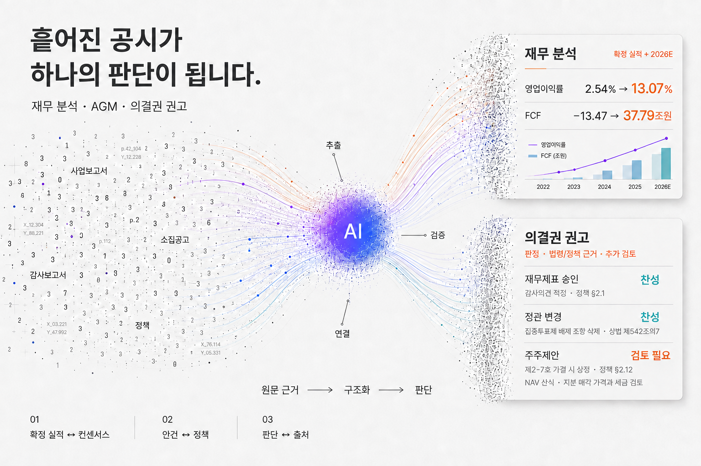

<div align="center">

# OpenProxy MCP

[](https://www.python.org/downloads/)
[](https://modelcontextprotocol.io/)
[](#도구-구조-32개)
[](docs/RELEASE_NOTES.md)
[](https://github.com/MarcoYou/open-proxy-mcp)
[](https://github.com/sponsors/MarcoYou)

[English](README_ENG.md) · [简体中文](README_ZH.md)

[빠른 시작](#빠른-시작) · [무엇을 물을 수 있나](#무엇을-물을-수-있나) · [결과 읽는 법](#결과-읽는-법) · [최근 바뀐 것](#최근-바뀐-것) · [도구 구조](#도구-구조-32개) · [데이터 소스](#데이터-소스)

</div>

<picture>
  <source media="(prefers-color-scheme: dark)" srcset="screenshot/opm-readme-particle-flow-dark-ko-20260905.png">
  <source media="(prefers-color-scheme: light)" srcset="screenshot/opm-readme-particle-flow-light-ko-20260905.png">
  
</picture>

**안건은 한 줄이지만, 판단에는 회사 전체가 필요합니다.**

OpenProxy는 한국 상장사의 DART 공시를 AI가 읽을 수 있게 구조화하는 MCP 서버입니다. 주주총회 의결권 분석에서 시작해 재무·가치평가·사업·지분·주주환원·시장 공시 전반으로 넓어졌습니다. AI는 답과 함께 **원문 근거(공시 접수번호)**를 제시합니다.

---

## 빠른 시작

**설치 없이 DART API 키 하나로 연결합니다.** 화면과 사례로 보는 안내는 📘 [사용 설명서(PDF, 13쪽)](docs/manual/OpenProxy_사용설명서.pdf)에 있습니다.

**1. 무료 API 키 받기** — [DART OpenAPI](https://opendart.fss.or.kr/)에서 회원가입 후 인증키를 신청합니다(무료·즉시 발급).

**2. AI 서비스에 연결하기** — 커넥터(앱) 추가 화면의 서버 주소에 아래 URL을 넣고, 이름은 `open-proxy-mcp`로 지정합니다.

```
https://open-proxy-mcp.fly.dev/mcp?opendart=발급받은_OpenDART_API_키
```

| 서비스 | 연결 경로 | 이용 범위 |
|---|---|---|
| [**Claude**](https://support.claude.com/en/articles/11175166-get-started-with-custom-connectors-using-remote-mcp) | `Customize → Connectors → + → Add custom connector` | Free(1개)·Pro·Max. Team/Enterprise는 관리자 추가 |
| [**ChatGPT**](https://developers.openai.com/api/docs/guides/developer-mode) | `Settings → Security and login → Developer mode`, 이후 `Plugins → +` | 웹 Plus·Pro·Business·Enterprise·Education |
| [**Perplexity**](https://www.perplexity.ai/help-center/en/articles/13915507-adding-custom-remote-connectors.html) | `Account settings → Connectors → + Custom connector → Remote` | Pro·Max·Enterprise |

> 서버 주소는 커넥터 설정에만 넣으세요. OpenProxy는 키 원문을 저장하지 않으며 로그에서도 가립니다.

**3. 첫 질문 보내기** — 새 채팅에서 `삼성전자 회사 정보와 최근 공시 3건을 보여줘`라고 물어보세요. 회사와 공시 목록이 나오면 연결된 것입니다. 이후에는 도구 이름을 몰라도 그냥 질문하면 됩니다.

<details>
<summary>Claude에서 프롬프트·리소스 불러오기</summary>

채팅 입력창의 `+` → `커넥터 → open-proxy-mcp에서 추가`([메뉴 위치](screenshot/claude-resource-picker-ko-20260907.png)).

- `Company Snapshot` — 회사·사업·실적·가격·주주 정보를 빠르게 훑는 기업 현황 요약 프롬프트
- `OpenProxy Feature Guide` — 지금 등록된 도구와 기능 목록(`tools_guide` 리소스)
- `Open Proxy Guideline` — 의결권 판단 정책 원문

</details>

---

## 무엇을 물을 수 있나

도구 이름을 외울 필요 없이 하고 싶은 말을 하면 AI가 알아서 고릅니다. 영역마다 실제로 되는 질문 예시와 꼭 알아 둘 점입니다.

| 분석 영역 | 이렇게 물어보세요 | 알아 둘 점 |
|---|---|---|
| 🗳️ [**주총·의결권**](docs/features/proxy-voting.md) | 「LG화학 다음 정기주총 안건별 의결권 의견을 근거와 함께 알려줘」<br>「삼성전자 작년 주총 안건이 실제로 어떻게 표결됐어?」 | 안건마다 찬성·반대·**검토 필요**와 공시·정책·법령 근거가 나옵니다. 반대가 0건인 회사가 보통입니다 |
| 📊 [**재무·실적**](docs/features/financials.md) | 「삼성전자 최근 3년 실적과 향후 2개년 컨센서스를 비교해줘」<br>「현대차 [잠정실적](docs/features/provisional-earnings.md)이 컨센서스 대비 어땠어?」 | 확정(A)·잠정·예상(E)은 출처가 달라 한 줄에 섞지 않습니다 |
| 💹 [**가치평가·추정치**](docs/features/price_multiple_data.md) | 「네이버 PER·PBR이 과거 대비 어느 수준이야?」<br>「코스피 업종별 선행 PER을 트레일링과 나란히 보여줘」 | 실적 기준일과 주가 기준일은 따로 표시됩니다 |
| 📈 **성과·위험** | 「내 포트폴리오(삼성전자 50%, SK하이닉스 50%)의 1년 수익률을 코스피와 비교하고 종목별 기여를 나눠줘」 | 수익률·변동성·초과수익·기여·업종 분해를 부를 때 계산합니다 |
| 🏭 [**사업·보유자산**](docs/features/business-details.md) | 「한화솔루션이 무엇으로 돈을 벌어? 사업부문별로」<br>「태광산업이 들고 있는 계열사 지분 가치를 계산해줘」 | 부문별·제품별·지역별 매출은 같은 매출을 나눈 다른 축이라 더하지 않습니다 |
| 🧭 [**지분·주주환원**](docs/features/ownership.md) | 「삼성물산 최대주주와 특수관계인 지분 알려줘」<br>「[밸류업](docs/features/shareholder-return.md) 공시에 적은 내용과 실제 집행이 얼마나 맞아?」 | 주당배당금은 종류주식 한 주 기준, 배당총액·배당성향은 회사 전체 기준입니다 |
| 🔔 **시장·리스크** | 「오늘 아침 공시 중에 중요한 것만 정리해줘」<br>「최근에 [경영권 분쟁](docs/features/control-contest.md) 신호가 잡힌 회사가 있어?」 | 그때그때 훑는 시장 공시는 최근 3개월이 한도입니다. 업종별 흐름은 쌓아 둔 기록으로 약 1년을 봅니다 |
| 🔗 **근거 확인** | 「방금 그 수치가 어느 공시 몇 번 항목에서 나온 거야?」<br>「정관의 이 조항이 상법 몇 조에 걸려?」 | 모든 수치에 접수번호가 붙고 DART 원문 주소로 바뀝니다. 정관·법령 조회는 DART API를 쓰지 않습니다 |

**거버넌스 검토 파일럿** — `governance_screen`은 지정한 최대 30개사의 공시 원문을 모아, 연결된 AI가 소수주주 대우·이해상충·이사회 책임을 판독하고 검토 순서를 정합니다. 결과는 **부분 근거에 대한 AI 평가 · 사람 미검토**로 표시합니다.

자료가 일부만 나오거나 같은 질문을 반복하게 되면 [도구 연결·추가 조회·오류 대응 안내](docs/TOOL_CALLING.md)를 보세요.

---

## 결과 읽는 법

공시는 항목마다 기준이 다릅니다. 이 여섯 가지만 알면 대부분 바르게 읽습니다.

1. **「자료 없음」은 「없다」가 아닙니다.** 읽은 공시에서 찾지 못했다는 뜻입니다. 0으로 채우지 않습니다.
2. **응답의 `status`·`warnings`를 먼저 봅니다.** 무엇을 못 찾았고 어떤 기준으로 대체했는지 거기 적힙니다.
3. **회사는 한 번만 확정하면 됩니다.** 이름이 겹치면(「한국철강」 등) 고르기 전까지 다음 조회로 넘어가지 않고 되묻습니다.
4. **기준이 다른 숫자를 섞지 않습니다.** 확정·잠정·예상, 연결·별도, 지배주주 귀속·전체가 다르면 성장률을 계산하지 않고 차이만 표시합니다.
5. **의결권 의견의 「반대 0건」이 정상입니다.** 정책의 반대 기준이 곧 자동 반대 조건은 아닙니다. 추가 판단이 필요한 우려는 **검토 필요**로 둡니다 — [판정·정보 기준일 읽는 법](docs/features/proxy-voting.md).
6. **📢 공지가 붙을 수 있습니다.** 점검·변경 예고 같은 운영자 공지가 응답 맨 위나 JSON의 `notices` 칸에 나옵니다. 데이터가 아니라 안내입니다.

<details>
<summary><b>더 자세히 — 업종·결산월·배당·스캔 한도</b></summary>

<br>

| 무엇 | 왜 |
|---|---|
| **사업연도는 결산월을 따릅니다** | 12월 결산이 아닌 회사는 달력 연도와 어긋납니다. 신영증권(001720)의 `2025-06-30`은 FY2026-Q1입니다 |
| **금융사에는 없는 지표가 있습니다** | 매출이나 일반기업용 비율은 **미제공**이지 0이 아닙니다 |
| **시장·업종 선행 배수는 추정치가 있는 종목만의 합입니다** | 추정치 없는 종목이 빠져 트레일링 배수와 모집단이 다릅니다. 종목 수를 함께 적습니다 |
| **접수번호 앞 두 자리가 출처를 가릅니다** | `00`은 DART 정기공시(소집공고), `80`은 거래소 수시공시(주총결과) |
| **DART 키 하나당 분당 1,000회** | 넘으면 그 키가 두세 시간 막힙니다. 서버는 910회에서 스스로 멈추고, 응답의 `data.usage`에 호출 수를 적습니다 |
| **웹 원문 파싱은 분당 40건** | 요청 간 0.4~1초 무작위. 차단은 IP 기준이라 그 머신 전체가 막힙니다 |
| **조회 결과는 저장하지 않습니다** | 캐시·시장 스냅샷·호출량 집계만 남습니다 |

</details>

---

## 최근 바뀐 것

전체 이력은 **[릴리즈 노트](docs/RELEASE_NOTES.md)**에 있습니다. 사용자 눈에 띄는 최근 변화만 추렸습니다.

| 날짜 | 무엇이 달라졌나 |
|---|---|
| 2026-10-23 | **재무 수치 정확도** — 현금흐름을 계정 코드로 읽고, 소수 EPS·통화가 바뀐 해의 전년비·금융사 경고를 바로잡았습니다. 조회에 실패한 것을 「없음」으로 내던 곳들을 고쳤습니다 |
| 2026-10-23 | **운영자 공지** — 점검·변경 예고를 도구 응답 안에 싣습니다(중요도에 따라 자주·드물게) |
| 2026-10-22 | **새 도구 `performance_analysis`** — 수익률·위험·기여·업종 분해, 공식 지수·국고채 금리 대비 |
| 2026-10-18 | **잠정실적에 「컨센서스 대비」** — 아침 공시 디제스트의 잠정실적 카드에도 붙습니다 |

---

## 도구 구조 (32개)

여덟 가지 분석 흐름을 **총 32개 도구**가 뒷받침합니다. 분류의 정본은 [도구 카탈로그](wiki/tools/README.md)의 「무엇을 알고 싶을 때 무엇을 쓰나」 표이고, 도구별 예시 질문·스키마도 거기 있습니다.

<details>
<summary><b>도구 목록 펼치기</b></summary>

<br>

| 분류 | 도구 | 역할 |
|---|---|---|
| 🏢 회사 찾기 | [`company`](wiki/tools/company.md) | 회사 식별 + 최근 공시 목록 — 모든 분석의 출발점 |
| 🔔 공시 스캔·검토 | [`screener`](wiki/tools/screener.md), [`governance_screen`](wiki/tools/governance_screen.md) | 전체시장 공시 디제스트·업종별 흐름 · 지정 기업 거버넌스 검토 순서(파일럿) |
| 🗳️ 주주총회·의결권 | [`shareholder_meeting_notice`](wiki/tools/shareholder_meeting_notice.md), [`shareholder_meeting_results`](wiki/tools/shareholder_meeting_results.md), [`proxy_guideline`](wiki/tools/proxy_guideline.md) | 소집공고(전)·결과(후) · 판단 기준 문서 원문 |
| 💰 지분·재무·지배구조 | [`ownership_structure`](wiki/tools/ownership_structure.md), [`financial_metrics`](wiki/tools/financial_metrics.md), [`provisional_earnings`](wiki/tools/provisional_earnings.md), [`business_details`](wiki/tools/business_details.md), [`asset_holdings`](wiki/tools/asset_holdings.md), [`price_multiple_data`](wiki/tools/price_multiple_data.md), [`forward_estimates_data`](wiki/tools/forward_estimates_data.md), [`trading_data`](wiki/tools/trading_data.md), [`performance_analysis`](wiki/tools/performance_analysis.md), [`corp_gov_report`](wiki/tools/corp_gov_report.md), [`director_board`](wiki/tools/director_board.md) | 지분 구조 · 확정/잠정 실적 · 사업의 내용 · 자산주 · PER/PBR · 컨센서스·추정치 변화 · 시세·지수·금리 · 수익률·위험·기여 · 지배구조보고서 · 이사회 |
| 🎁 주주환원·자본 | [`dividend_disclosure`](wiki/tools/dividend_disclosure.md), [`dividend_data`](wiki/tools/dividend_data.md), [`treasury_share`](wiki/tools/treasury_share.md), [`value_up`](wiki/tools/value_up.md), [`shareholder_commitment`](wiki/tools/shareholder_commitment.md), [`corporate_restructuring`](wiki/tools/corporate_restructuring.md), [`dilutive_issuance`](wiki/tools/dilutive_issuance.md) | 배당 공시·시계열 · 자기주식 · 밸류업 · 약속 대 이행 · 합병/분할 · 증자/CB/BW/감자 |
| ⚔️ 분쟁·거래·리스크 | [`proxy_contest`](wiki/tools/proxy_contest.md), [`corporate_deals`](wiki/tools/corporate_deals.md), [`order_contracts`](wiki/tools/order_contracts.md), [`risk_events`](wiki/tools/risk_events.md), [`financial_notes`](wiki/tools/financial_notes.md), [`director_news`](wiki/tools/director_news.md) | 경영권 분쟁 신호 · 지분 인수/매각 · 수주·공급계약 · [리스크 사건](docs/features/risk-events.md) · 금융사 주석 · 이사 후보 뉴스 |
| 🔗 근거·참조 | [`evidence`](wiki/tools/evidence.md), [`law_lookup`](wiki/tools/law_lookup.md) | 접수번호 → 원문 열람 주소 · 정관↔법령 양방향 조회(DART API 0회) |

</details>

**의결권 권고** — 공개 서버에서는 의결권 권고 도구 4개(`proxy_advice_start` → `proxy_advice_read` → `proxy_advice_rules` → `proxy_advice_finish`)로 안건마다 찬성·반대·검토 초안과 근거를 받습니다. 소집공고·사업보고서·감사·권유·법원 공시를 판단 기준시각 전 것만 읽고, 의결권 가이드라인(안건 유형 10개)으로 판단한 뒤 서버가 검사합니다. 가이드라인과 검사는 비공개 서버에서 돌며 이 저장소에는 없습니다. 예전 `proxy_advise_before_meeting`은 2026-10-26에 은퇴했습니다. 초안은 사람이 검토하지 않았고, 실제 투표를 보내지 않습니다.

---

## 데이터 소스

| 소스 | 용도 | 비고 |
|------|------|------|
| [DART OpenAPI](https://opendart.fss.or.kr/) | 정기·주요 공시 메타, 재무 API, 배당·자사주·지분 등 정형 데이터 | **필수** — 무료 API 키 |
| DART 웹 (`dart.fss.or.kr`) | 공시 본문 파싱(소집공고·주요사항보고서 등) | 분당 40건 |
| [KRX KIND](https://kind.krx.co.kr/) | 거래소 공시 보조 확인 | 보조 소스 |
| [국가법령정보센터](https://www.law.go.kr/) 기반 법령 원문 | 정관 변경·의결권 판단의 법령 근거 | [legalize-kr](https://github.com/legalize-kr/legalize-kr)에서 주간 동기화 |
| 주요 자산운용사·국민연금의 공개 의결권 행사 내역 | 의결권 판단 교차 검토 | 사전 수집·구조화한 공개 자료 |

---

## 보안 · 면책 · 라이선스

**보안** — 취약점, 특히 API 키가 새는 경로는 **공개 이슈 대신** [SECURITY.md](SECURITY.md)의 절차로 알려 주세요.

**면책** — OpenProxy는 DART 공시 데이터를 구조화해 AI에게 제공하는 도구입니다. AI는 부정확한 분석을 낼 수 있고, 그 의견은 개발자나 소속 단체의 의견이 아닙니다. 투자 결정이나 의결권 행사의 최종 판단은 반드시 원문 공시와 전문가 검토를 거쳐야 합니다.

**라이선스** — [PolyForm Noncommercial License 1.0.0](https://polyformproject.org/licenses/noncommercial/1.0.0/) · 전문은 [`LICENSE`](LICENSE)

- **비상업적 사용**(개인 연구·학습·비영리·공공기관)은 자유롭게 허용됩니다.
- **상업적 사용**은 별도 라이선스 계약이 필요합니다(OpenProxy AI).
- **재배포 시 출처 표기**: `Copyright (c) 2026 OpenProxy AI (https://github.com/MarcoYou/open-proxy-mcp)` 유지(PolyForm 'Notices' 조항).

> 상업 라이선스·기타 문의: gunhoqw20@gmail.com
