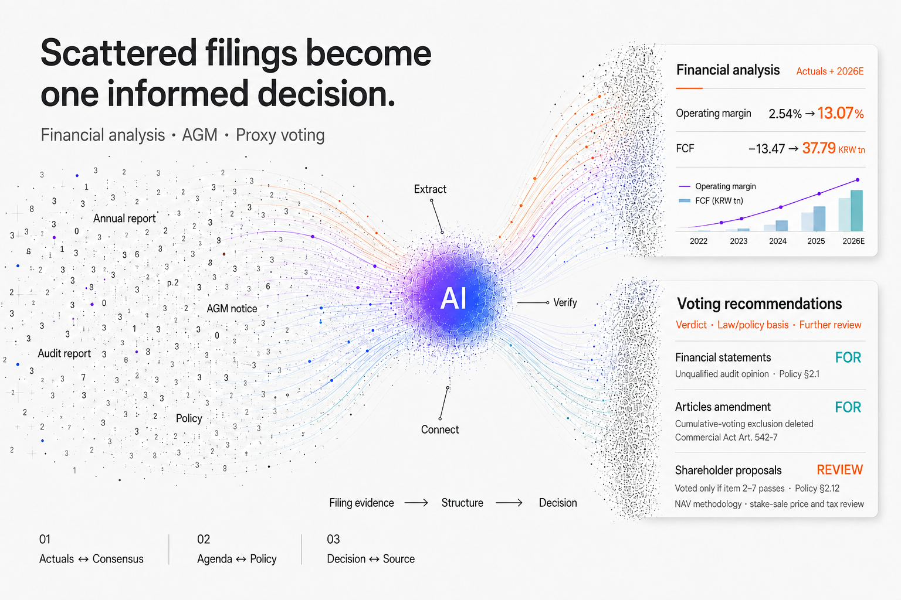

<div align="center">

# OpenProxy MCP

[](https://www.python.org/downloads/)
[](https://modelcontextprotocol.io/)
[](#tool-structure-32-tools)
[](docs/RELEASE_NOTES_ENG.md)
[](https://github.com/MarcoYou/open-proxy-mcp)
[](https://github.com/sponsors/MarcoYou)

[한국어](README.md) · [简体中文](README_ZH.md)

[Quick Start](#quick-start) · [What to Ask](#what-to-ask) · [How to Read the Output](#how-to-read-the-output) · [Recent Changes](#recent-changes) · [Tool Structure](#tool-structure-32-tools) · [Data Sources](#data-sources)

</div>

<picture>
  <source media="(prefers-color-scheme: dark)" srcset="screenshot/opm-readme-particle-flow-dark-en-20260906.png">
  <source media="(prefers-color-scheme: light)" srcset="screenshot/opm-readme-particle-flow-light-en-20260906.png">
  
</picture>

**An agenda item may fit on one line. A sound decision requires the full picture.**

OpenProxy is an MCP server that structures the filings of **Korean listed companies** — the disclosures they file with DART, Korea's electronic disclosure system — so that AI can read them. It began with AGM and proxy-voting analysis and grew to cover financials, valuation, business, ownership, shareholder returns and market-wide disclosures. AI presents each answer with its **source evidence (the filing's receipt number)**.

---

## Quick Start

**Connect with one DART API key. Nothing to install.** For a walkthrough with screens and examples, see the 📘 [User Guide (PDF, 13 pages)](docs/manual/OpenProxy_User_Guide.pdf).

**1. Get a free API key** — sign up at the [English OpenDART portal](https://engopendart.fss.or.kr/) and request an authentication key (free, issued immediately).

**2. Connect your AI service** — enter this URL as the server address when adding a connector or app, and name it `open-proxy-mcp`.

```
https://open-proxy-mcp.fly.dev/mcp?opendart=YOUR_DART_API_KEY
```

| Service | Setup path | Availability |
|---|---|---|
| [**Claude**](https://support.claude.com/en/articles/11175166-get-started-with-custom-connectors-using-remote-mcp) | `Customize → Connectors → + → Add custom connector` | Free (one connector), Pro, Max; admin setup for Team/Enterprise |
| [**ChatGPT**](https://developers.openai.com/api/docs/guides/developer-mode) | `Settings → Security and login → Developer mode`, then `Plugins → +` | Plus, Pro, Business, Enterprise, Education on web |
| [**Perplexity**](https://www.perplexity.ai/help-center/en/articles/13915507-adding-custom-remote-connectors.html) | `Account settings → Connectors → + Custom connector → Remote` | Pro, Max, Enterprise |

> Enter this URL only in the connector settings. OpenProxy does not retain the raw key and redacts it from logs.

**3. Send your first request** — in a new chat, ask `Show Samsung Electronics' company information and three recent filings.` If the company and filings appear, the connection works. From there, just ask in natural language; you do not need to know the tool names.

<details>
<summary>Open prompts and resources in Claude</summary>

Select `+` in the chat input, then `Connectors → Add from open-proxy-mcp` ([menu location](screenshot/claude-resource-picker-en-20260907.png)).

- `Company Snapshot` — a quick overview of the company, business, results, valuation and ownership
- `OpenProxy Feature Guide` — the currently registered tools and capabilities (`tools_guide` resource)
- `Open Proxy Guideline` — the source policy used for proxy-voting analysis

</details>

---

## What to Ask

You do not need to memorise tool names — say what you want and the AI picks the tools. Example prompts that work today, with the one thing worth knowing for each area:

| Area | Ask like this | Worth knowing |
|---|---|---|
| 🗳️ [**AGM & proxy voting**](docs/features/en/proxy-voting.md) | "Give me LG Chem's next AGM agenda with a voting view and evidence for each item"<br>"How did Samsung Electronics' AGM items actually get voted last year?" | Each item gets FOR, AGAINST or **REVIEW** with filing, policy and legal grounds. Zero AGAINST views is common |
| 📊 [**Financials & results**](docs/features/en/financials.md) | "Compare Samsung Electronics' last three years with the next two years of consensus"<br>"How did Hyundai's [provisional results](docs/features/en/provisional-earnings.md) compare with consensus?" | Actual (A), provisional and estimate (E) come from different sources and are never mixed on one line |
| 💹 [**Valuation & estimates**](docs/features/en/price_multiple_data.md) | "Where is NAVER's PER and PBR relative to its history?"<br>"Show KOSPI sector forward PER next to trailing" | The results date and the price date are shown separately |
| 📈 **Performance & risk** | "Compare a portfolio of 50% Samsung Electronics and 50% SK hynix with KOSPI over one year and split the contribution by stock" | Returns, volatility, excess return, contribution and sector breakdown are computed on request |
| 🏭 [**Business & assets**](docs/features/en/business-details.md) | "How does Hanwha Solutions make money, by segment?"<br>"Value Taekwang Industrial's stakes in affiliates" | Segment, product and region revenues are different cuts of the same total and are not added up |
| 🧭 [**Ownership & shareholder returns**](docs/features/en/ownership.md) | "Who are Samsung C&T's largest shareholder and related parties?"<br>"How well does the [value-up plan](docs/features/en/shareholder-return.md) match what was actually executed?" | Dividend per share is per share of each class; total dividends and payout ratio are company-wide |
| 🔔 **Market & risk** | "Summarise only the important filings from this morning"<br>"Which companies recently showed [control-contest](docs/features/en/control-contest.md) signals?" | Live market-wide scans cover the last three months; sector flows use stored records for about a year |
| 🔗 **Evidence** | "Which filing and which item did that number come from?"<br>"Which article of the Commercial Act does this charter clause fall under?" | Every number carries a receipt number that resolves to the DART original. Charter and law lookups use no DART API calls |

**Governance review pilot** — `governance_screen` collects the filings of up to 30 named companies; the connected AI reads them for treatment of minority shareholders, conflicts of interest and board accountability, and orders them for review. Results are marked **AI assessment of partial evidence · not reviewed by a person**.

If results come back partial or you find yourself repeating a question, see the [tool-calling, follow-up and error guide](docs/TOOL_CALLING.md).

---

## How to Read the Output

Each type of filing follows its own conventions. These six points cover most of it.

1. **"Not found" does not mean "none".** It means the filings read did not contain it. Missing values are never filled with 0.
2. **Read `status` and `warnings` first.** They say what was not found and which basis was used instead.
3. **Pin the company once.** If a name is ambiguous, the server asks before moving on.
4. **Numbers on different bases are not mixed.** Actual, provisional and estimate; consolidated and separate; controlling-interest and total — when bases differ, growth is not computed and only the difference is shown.
5. **"Zero AGAINST" is normal for voting views.** A policy's AGAINST criterion is not an automatic AGAINST condition; concerns that need further judgment stay at **REVIEW** — [how to read verdicts and information cut-offs](docs/features/en/proxy-voting.md).
6. **A 📢 notice may appear.** Operator notices such as maintenance or change announcements show at the top of a response or in a JSON `notices` field. They are announcements, not data.

<details>
<summary><b>More detail — fiscal years, financial companies, dividends, scan limits</b></summary>

<br>

| What | Why |
|---|---|
| **Fiscal years follow the closing month** | Non-December closers do not match calendar years. Shinyoung Securities (001720) `2025-06-30` is FY2026-Q1 |
| **Some metrics do not exist for financial companies** | Revenue and general-company ratios are **not provided**, not zero |
| **Market and sector forward multiples only include companies with estimates** | The population differs from trailing multiples; the company count is shown |
| **The first two digits of a receipt number tell the source** | `00` is a DART periodic filing (AGM notice), `80` an exchange filing (AGM results) |
| **One DART key allows 1,000 calls per minute** | Exceeding it blocks that key for two to three hours. The server stops at 910 and reports calls in `data.usage` |
| **Web parsing runs at 40 pages per minute** | 0.4–1 s random spacing; blocks are per IP, so the whole machine is affected |
| **Your query results are not stored** | Only caches, market snapshots and call-volume counts are kept |

</details>

---

## Recent Changes

The full history is in the **[release notes](docs/RELEASE_NOTES_ENG.md)**. Only recent user-visible changes are listed here.

| Date | What changed |
|---|---|
| 2026-10-23 | **Financial accuracy** — cash-flow lines are read by account code; fractional EPS, prior-year values in years when the reporting currency changed, and financial-company warnings were corrected. Places that reported a failed lookup as "none" were fixed |
| 2026-10-23 | **Operator notices** — maintenance and change announcements appear inside tool responses, more or less often depending on importance |
| 2026-10-22 | **New tool `performance_analysis`** — returns, risk, contribution and sector breakdown, against official indices and treasury rates |
| 2026-10-18 | **"Versus consensus" on provisional results** — also on the provisional-results cards of the morning filing digest |

---

## Tool Structure (32 tools)

**32 tools in total** support the eight areas above. The authoritative grouping is the "what to use for what" table in the [tool catalog](wiki/tools/README.md), which also has example prompts and schemas per tool.

<details>
<summary><b>Show the tool list</b></summary>

<br>

| Group | Tools | Role |
|---|---|---|
| 🏢 Find a company | [`company`](wiki/tools/company.md) | Company identification and recent filings — the entry point for every analysis |
| 🔔 Filing scan & review | [`screener`](wiki/tools/screener.md), [`governance_screen`](wiki/tools/governance_screen.md) | Market-wide filing digest and sector flows · governance review order for named companies (pilot) |
| 🗳️ AGM & proxy voting | [`shareholder_meeting_notice`](wiki/tools/shareholder_meeting_notice.md), [`shareholder_meeting_results`](wiki/tools/shareholder_meeting_results.md), [`proxy_guideline`](wiki/tools/proxy_guideline.md) | Notice (before) and results (after) · policy source text |
| 💰 Ownership, financials, governance | [`ownership_structure`](wiki/tools/ownership_structure.md), [`financial_metrics`](wiki/tools/financial_metrics.md), [`provisional_earnings`](wiki/tools/provisional_earnings.md), [`business_details`](wiki/tools/business_details.md), [`asset_holdings`](wiki/tools/asset_holdings.md), [`price_multiple_data`](wiki/tools/price_multiple_data.md), [`forward_estimates_data`](wiki/tools/forward_estimates_data.md), [`trading_data`](wiki/tools/trading_data.md), [`performance_analysis`](wiki/tools/performance_analysis.md), [`corp_gov_report`](wiki/tools/corp_gov_report.md), [`director_board`](wiki/tools/director_board.md) | Ownership · actual/provisional results · business description · asset plays · PER/PBR · consensus and revisions · prices, indices, rates · returns, risk, contribution · governance report · board |
| 🎁 Shareholder returns & capital | [`dividend_disclosure`](wiki/tools/dividend_disclosure.md), [`dividend_data`](wiki/tools/dividend_data.md), [`treasury_share`](wiki/tools/treasury_share.md), [`value_up`](wiki/tools/value_up.md), [`shareholder_commitment`](wiki/tools/shareholder_commitment.md), [`corporate_restructuring`](wiki/tools/corporate_restructuring.md), [`dilutive_issuance`](wiki/tools/dilutive_issuance.md) | Dividend filings and history · treasury shares · value-up · promises vs execution · mergers/splits · rights issues, CB/BW, capital reduction |
| ⚔️ Contests, deals, risk | [`proxy_contest`](wiki/tools/proxy_contest.md), [`corporate_deals`](wiki/tools/corporate_deals.md), [`order_contracts`](wiki/tools/order_contracts.md), [`risk_events`](wiki/tools/risk_events.md), [`financial_notes`](wiki/tools/financial_notes.md), [`director_news`](wiki/tools/director_news.md) | Control-contest signals · stake deals · orders and supply contracts · [risk events](docs/features/en/risk-events.md) · financial-company notes · director-candidate news |
| 🔗 Evidence & reference | [`evidence`](wiki/tools/evidence.md), [`law_lookup`](wiki/tools/law_lookup.md) | Receipt number → original filing URL · two-way charter ↔ law lookup (0 DART API calls) |

</details>

**Voting advice** — on the hosted public server, four advice tools (`proxy_advice_start` → `proxy_advice_read` → `proxy_advice_rules` → `proxy_advice_finish`) give a FOR, AGAINST or REVIEW draft with reasons for each agenda item. They read only filings published before your cutoff (meeting notice, annual report, audit and proxy filings, court filings), judge each item by the voting guideline (10 item types) and have the server check every recommendation. The guideline and the checks run on a private server and are not in this repository. The old `proxy_advise_before_meeting` was retired on 2026-10-26. Drafts are not reviewed by a person, and no vote is ever sent.

---

## Data Sources

| Source | Use | Notes |
|------|------|------|
| [DART OpenAPI](https://opendart.fss.or.kr/) | Filing metadata, financial API, dividends, treasury shares, ownership and other structured data | **Required** — free API key |
| DART web (`dart.fss.or.kr`) | Parsing filing bodies (AGM notices, material event reports, etc.) | 40 pages per minute |
| [KRX KIND](https://kind.krx.co.kr/) | Supplementary check of exchange filings | Secondary source |
| Korean law text based on the [National Law Information Center](https://www.law.go.kr/) | Legal grounds for charter changes and voting judgments | Synced weekly from [legalize-kr](https://github.com/legalize-kr/legalize-kr) |
| Public voting records of major asset managers and the National Pension Service | Cross-checking voting judgments | Public data, collected and structured in advance |

---

## Security · Disclaimer · License

**Security** — report vulnerabilities, especially any path that could leak an API key, through [SECURITY.md](SECURITY.md) **instead of a public issue**.

**Disclaimer** — OpenProxy structures DART filing data for AI. AI can produce inaccurate analysis, and its views are not those of the developer or affiliated organisations. Final investment or voting decisions must be checked against the original filings and reviewed by professionals.

**License** — [PolyForm Noncommercial License 1.0.0](https://polyformproject.org/licenses/noncommercial/1.0.0/) · full text in [`LICENSE`](LICENSE)

- **Noncommercial use** (personal research, study, nonprofits, public institutions) is freely permitted.
- **Commercial use** requires a separate license agreement (OpenProxy AI).
- **Attribution on redistribution**: keep `Copyright (c) 2026 OpenProxy AI (https://github.com/MarcoYou/open-proxy-mcp)` (PolyForm "Notices" clause).

> Commercial licensing and other enquiries: gunhoqw20@gmail.com
