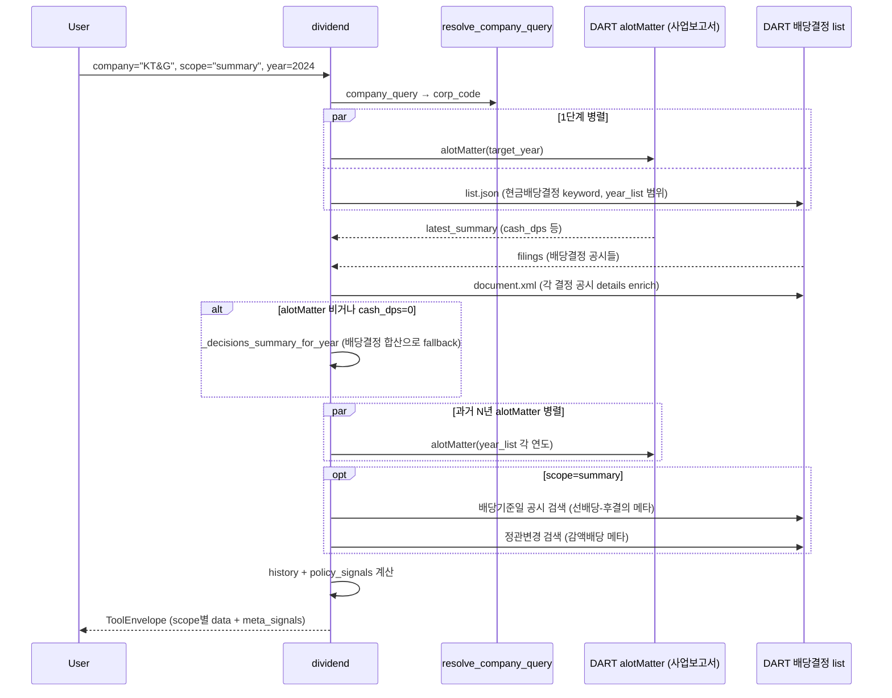

# dividend_disclosure

## 이름 (260902 개명)
`dividend` → **`dividend_disclosure`**. 같은 날 DB 기반 [[dividend_data]](구
`dividend_history_data`·`dividend_screener`, 260903 통합)가 생기면서 「dividend」라는
이름이 어느 것인지 가리키지 못하게 됐다. 이 도구는 **공시 원문을 그때그때 열어 읽는
쪽**이다 — 그 성격을 이름에 담았다. 옛 이름의 사용통계는 `usage_tracker.TOOL_ALIASES` 가
접어 한 계열로 잇는다.

## 둘을 어떻게 가르나
| 도구 | 무엇 | DART 콜 |
|---|---|---|
| `dividend_disclosure` | 회사 하나를 실시간으로 깊게(결정공시·시가배당률·현재가 기준 수익률) | 있음 |
| [[dividend_data]] | 여러 해·조건·시장·섹터를 DB 에서 (확정 시계열 + 결정공시 횟수 집계) | 0 |

## 한 줄 요약
실지급·확정된 배당 사실 탭. DPS, 총액, 배당성향, 시가배당률, 연도별 추이. 미래 정책·약속은 다루지 않는다(그건 [[value_up]]).

## 사용법
```
dividend(
    company="KT&G",
    scope="summary",
    year=2024,
)
```

자연어 예시:
- "KT&G 2024 배당" → `scope="summary"` (DPS·배당성향·시가배당률 + 선배당-후결의·감액배당 신호)
- "작년 주당배당금·배당 총액 얼마였어?" → `scope="summary"` + `year` 지정
- "배당성향 추이 어때?" → `scope="history"` (N년 추이 + 분기 breakdown + policy_signals)
- "삼성전자 최근 배당 결정들" → `scope="detail"`
- "메리츠금융지주 최근 3년 배당 추이" → `scope="history"`

meta_signals 읽는 법:
- `pre_dividend_post_resolution`: 같은 I001 검색에서 걸러낸 주주명부폐쇄(기준일)결정 notice가 1건 이상이면
  True(신정관 선배당-후결의 가능성), 0건이면 False(전통 결산일=기준일 방식). [[배당기준일결정]] 참조.
- `capital_reserve_reduction`: True면 `capital_reserve_agendas`에 자본준비금 감소 관련 주총 안건 목록이
  함께 실린다 — [[감액배당결정]] cross-link. 감자(자본금 감소)와 혼동 금지.

## 입력 인자
| 인자 | 타입 | 필수 | 설명 | 기본값 |
|---|---|---|---|---|
| company | str | yes | 회사명 / ticker / corp_code | - |
| scope | str | no | 3종 (아래 참조) | "summary" |
| year | int | no | 사업연도, 0이면 최신 | 0 |
| years | int | no | history scope 누적 연수 | 3 |
| start_date / end_date | str | no | YYYYMMDD | "" |
| format | str | no | "md" / "json" | "md" |

scope:
- `summary`: 연간 DPS + 배당성향 + 시가배당률 + meta_signals (선배당-후결의, 감액배당) (기본).
  최근 결정 표 10건 + **그 10건의 비고 원문 전문**.
- `detail`: 요약 + 최근 결정 최대 50건 (md 표·비고 원문 모두 그 50건, json 은 전부)
  + **사업보고서 `alotMatter` 항목 원문 표**.
- `history`: 최근 N년 추이 (DPS / payout / yield / pattern)

🔴 260903 이전 문서에는 「md 렌더는 10건까지」로 적혀 있었다 — `detail` 은 이제 서비스가
따로 담아 둔 `data["detail"]["latest_decisions"]`(50건)를 읽는다. 최상위
`data["latest_decisions"]` 는 두 스코프 공용이라 20건에서 잘려 있어 `detail` 에서 쓰지 않는다.

## 출력 schema (data dict)
```json
{
  "company_id": "...",
  "summary": {"cash_dps": 1668, "cash_dps_preferred": null,
              "total_amount_mil": 11107906, "payout_ratio_dart": 25.1,
              "yield_dart": 1.5,
              "pre_dividend_post_resolution": false,
              "capital_reserve_reduction": false},
  "latest_decisions": [...],
  "policy_signals": {"trend": "...", "has_quarterly_pattern": true,
                     "has_special_dividend": false, "latest_change_pct": -3.2},
  "history": [{"year": 2024, "annual_dps": 1444, "decision_count": 4,
               "payout_ratio": 25.1, "yield_pct": 1.5, "pattern": "..."}],
  "no_filing": false,
  "filing_count": N,
  "usage": {"dart_api_calls": N, "mcp_tool_calls": 1}
}
```

핵심 필드:
- meta_signals: 선배당-후결의 (2024 신법), 감액배당 cross-link (자본준비금 감소)

> **분류·정확도 규칙**:
> - **분기별 누적차분** (`quarterly_full`, 최신연도): 분기/반기/사업보고서 누적값을 차분(Q2=반기-Q1…)해
>   보통+우선 DPS·배당총액 산출. 결정공시 버킷팅(경계 오귀속·예비결산 중복)보다 정확, 무배당 분기 0·특별배당 포착. [[배당공시유형]] §7.
>   **앞 보고서 행이 비어 있으면**(예: 반기보고서 없음) 그 차분은 한 분기가 아니라 두 분기분이다 — 한 분기 이름을 붙이지 않고 「Q2+Q3 합산(반기보고서 없음)」처럼 합산이라고 적으며(`merged`·`span`·`missing_reports` 칸), 같은 분기들의 결정공시와 맞춰 보는 줄을 붙인다(DATA-DIV8).
  **있는 보고서와 없는 보고서는 응답 모양으로 가른다**: DART 가 013(행 없음)을 주면 없는 보고서(합산), 000 과 함께 행을 주면 값 칸이 전부 「-」여도 있는 보고서(그 시점 누적 0 → 그 분기 0원). 기업은행 2025 는 1분기·3분기 보고서가 있어 Q1 0 · Q2 0 · Q3 0 · 결산 1,048원이고, 롯데리츠(1분기·3분기 013)·KB금융(반기 013)은 합산 표시가 그대로다.
> - **결정공시 표의 분기 라벨** (`_quarter_label`): 배당기준일 **당일 또는 그 이전에 끝난 가장 최근 회계 분기**(회계연도 결산월 기준, 기준일이 분기 말 날이면 그 분기). 결산배당은 「결산」. 기준일의 달력 월로만 매기던 종전 규칙은 4월 결의·5월 기준일의 1분기 배당(KB금융 2025-05-12)을 「Q2」로 불러 누적차분 표(Q1)와 어긋났다. 기준일이 분기 말인 회사(삼성전자 3-31·6-30·9-30)는 종전과 같다. 같은 결의 묶기 키(사업연도·분기·기준일)의 건수는 그대로다.
> - **최신연도 4분류**: 중간배당 확정 / 확정 전(D 명부폐쇄 기준일 매칭) / 미공시(payer인데 결산 미확정) / 무배당(직전도 배당 없음). target연도 매칭으로 단정.
> - **미확정 시간판정**: "미공시(결산 배당 미확정)"은 해당 사업연도 정기주총 경과(today > 익년 5/31) 시 **"무배당(확정·결산 현금배당 없음)"**으로 정정 — 주총이 끝났는데 결정공시·기준일이 없으면 배당을 안 하기로 확정한 것(메리츠·SK증권=배당→자사주 소각 전환). 배당기준일 설정된 "확정 전"은 실제 배당신호라 유지. 근거: dividend-payout-classification-260717.
> - 권위 = 사업보고서 alotMatter **다년컬럼**(개별연도 호출 제거). per-decision 시가배당률은 0 억제(연간값 권위).
> - **미결의**(`undecided_fiscal_years`, 결산이 끝났는데 결의 공시·사업보고서 배당이 모두 없는 사업연도 — 비12월 결산사의 「FY 끝났는데 배당 아직」):
>   결의 여부는 배당결정 공시 검색으로 본다. 검색이 오늘까지 덮으면(기본 조회) 끝난 사업연도를 다 보고, **과거 연도를 지정한 조회**(year=2020 →
>   검색은 2021-12-31 까지)는 결산일 + 183일(결의가 나오는 기간)이 검색 범위 안에 드는 해만 판정한다(261019 — 종전엔 삼성전자 year=2020 에
>   FY2022~FY2025 「미결의」 거짓 경고 4줄. 그 해들의 결의는 읽지도 않은 것이다).
>   결의 공시가 없는 끝난 해는 **그 해 사업보고서 배당 항목을 한 번 읽어 확인**한다(해마다 최대 1콜) — 이미 나온 보고서의 확정 DPS 를 「미결의」로 내지 않는다(2026-10-23, DATA-FY1).
>   조회가 실패(013 아님)한 해는 「미결의」가 아니라 「모른다」라 경고만 싣는다. 요약이 서는 사업연도는 요청 연도가 아니라 `_annual_summary` 가 결산기준일(stlm_dt)에서 읽은 FY 다.
> - **결정공시의 사업연도 귀속** (`_bucket_fiscal_year`, 결산월 `end_month` 를 받는다): 사업연도 = 결산 **종료**연도(`FISCAL_YEAR_BASIS`).
>   결산배당은 기준일이 결산월이거나 결산 뒤 4개월 안이면 방금 끝난 사업연도(12월 결산: 12월 → 그 해, 1~4월 → 전년 / 3월 결산: 3월 → 그 해, 4~7월 → 그 해),
>   중간·분기배당은 기준일이 속한 사업연도(6월 결산 기준일 2024-12-31 → FY2025). 12월 결산이면 종전 규칙과 같다(결산월을 모르면 12월로 본다).
> - 상세 교훈은 private storage 에 있다(공개 wiki 에 없음).

## Data sources
- **DART API**: `alotMatter` (사업보고서, 1차 source), `현금ㆍ현물배당결정` 공시 합산 (alotMatter 비거나 cash_dps=0일 때 fallback)
- **현재가 기준 배당수익률의 시세**: 일별 시세 저장분의 최신 거래일 종가([[price_multiple_data]] `_market_for` 재사용, DART·KRX 0콜) — 저장분에 없을 때만 **KRX Open API** 로 확인
- **현재가 기준 배당수익률의 주식 기준**: 결산기준일 뒤 액면분할·병합·무상증자·주식배당(수정주가 이벤트 `krx_adj_events` 확정 라벨, 또는 확정 라벨이 아니어도 상장주식수가 계수의 역수만큼 바뀐 조정 — 무상증자 신주 상장 지연을 넣어 이벤트 뒤 63일까지 본다)이면 DPS × 계수로 지금 주식 기준에 맞춰 나눈다([[price_multiple_data]] 와 같은 `align_dps_to_price`·`_dps_events`, 261019). 사업보고서 접수일 뒤 이벤트만 그대로 곱하고, 결산기준일과 접수일 사이 이벤트는 그런 회사에서만 그 사업연도(배당 사항을 읽은 해) 주식 총수(DART 1콜)를 읽어 배당받은 주식 수와 견주고, 못 읽으면 그대로 두고 경고한다. 칸 `summary.yield_current_dps_krw`·`yield_current_dps_adjustment`(바꾼 회사만).
- **반기·분기 결산 리츠**: 현재가 기준 배당수익률도 그 사업연도의 **12개월 결산기 DPS 합**으로 센다(261021) — 아래 「반기·분기 결산 회사」 절. 결산기 사이에 낀 분할·병합은 앞 결산기에만 곱한다.
- 외부 호출: summary 13회 (배당결정 공시 N건 본문), history 21회 (+ 분기교정). 결의 공시가 없는 끝난 사업연도마다 사업보고서 배당 항목 +1회(비12월 결산 위주)

## Flow



호출 횟수: summary 13회 (배당결정 공시 N건 본문, 최대 12), history 21회 (+ 분기교정 8).

## 자유서술 칸은 통째로 낸다 (260903 마스터 확정)
자리가 정해진 칸(공시일·구분·DPS·기준일, `alotMatter` 의 당기/전기/전전기)은 열로 파싱한다
— 늘 같은 자리에 같은 뜻이 들어가므로 규칙이 깨지지 않는다. 그 밖의 **회사가 무엇이든
적는 칸은 요약하지 않고 원문 그대로 싣는다.** 읽는 쪽이 LLM 이므로 판단은 읽는 쪽에서 한다.

### 1. 배당결정 비고 원문 — 11. 기타 투자판단과 관련한 중요사항
`summary`·`detail` 이 결정 표 아래에 **결의 한 건마다 비고 전문**을 블록인용으로 붙인다.
잘라내기·발췌 없다. 서식에 칸이 없는 사실이 전부 이 칸에 몰린다:

| 이 칸에만 있는 것 | 서식의 다른 칸 |
|---|---|
| 특별·기념배당, 자기주식 제외 산정, 감액배당 재원, 주총 갈음, 차등배당, 「감사·주총 과정에서 변동될 수 있음」 단서 | 없음 — 정규식으로 하나를 뽑으면 나머지가 조용히 사라진다 |

실측(코스피 결정공시 3,831건): 중앙값 245자 · p99 594자 · 최대 1,512자 · 빈 칸 0건 ·
줄바꿈 0건 · 파이프 0건. `raw_cell()`(`tools/_shared.py`)이 하는 일은 **구조 보호뿐**이다
— 줄바꿈을 공백으로, 표 셀에 넣을 때만 `|` 이스케이프. 내용은 한 글자도 안 버린다.

### 2. `alotMatter` 항목 원문 표 (`detail`)
`| 항목(원문) | 주식종류 | 당기 | 전기 | 전전기 |` — 사업보고서 배당 항목을 이름째,
값째 그대로. 위 「연간 요약」은 이 표에서 골라 이름 붙인 파생값이고, **어긋나면 이 표가
정본이다.**

### 3. `## 정책 신호` 는 파생 힌트다
`has_special_dividend` 등 넷은 표·비고 원문에서 **규칙으로 뽑은 요약**이고, 규칙은 서식
변형을 놓친다. 특히 `특별배당 이력` 은 비고에 「특별배당」·「기념배당」이 박힌 경우만
참이다(코스피 전수 3,831건 중 2건). 🔴 **아니오 = 없다가 아니다.**
정본은 위 비고 원문이다 — 렌더에도 그 문구를 붙인다.

## 파싱 전략 / source of truth

### 신뢰도 순위 (어떤 공시의 어떤 값을 믿는가)
1. **사업보고서 alotMatter `주당 현금배당금(원) · 보통주`** — 최우선, 연간 DPS·배당성향·시가배당률의 source of truth.
   - **최신 보고서 1회 응답의 당기/전기/전전기 컬럼**으로 최근 3개 사업연도를 한 번에 확보 (`_alot_multiyear_summaries`). 분기+결산이 이미 연간으로 합산돼 있고, 단일 출처·동일 기준이라 연도 간 일관. 자회사·정정 오염 없음. **문서 파싱 0회.**
   - 배당성향은 `(연결)현금배당성향(%)`, 시가배당률은 `현금배당수익률(%) 보통주` 컬럼 사용.
   - ⚠️ `주당 현금배당금` 행이 보통주 뒤에 **빈 행(stock_type="-")**으로 한 번 더 오면, 빈 값("-"→0)이 실제값을 덮어쓴다 → "보통주 명시 or 값>0"일 때만 반영 (메리츠금융지주·셀트리온·에이피알 케이스).
   - ⚠️ 최신 사업연도는 보고서 확정 전까지 컬럼이 "-"일 수 있음(선배당-후결의·미확정) → 그 해만 결정공시 fallback.
2. **현금ㆍ현물배당결정 거래소공시 (XML 본문 파싱)** — 보조.
   - 용도: (a) **분기별 breakdown** (alotMatter엔 분기 분해 없음), (b) alotMatter 빈 신규/최신연도 **fallback**, (c) 분기/연간 **패턴 판정**.
   - 합산 시 필수: **자회사(`자회사의 주요경영사항`) 제외** (지주사 DPS 과대계상 주원인) + **정정/재공시 dedup** (`_effective_decisions`, `(사업연도,분기,기준일)` 최신 1건).
   - ⚠️ 연간 **합산** 신뢰도 낮음: 결산배당이 기지급 분기를 차감한 "잔액"으로 적히는 등 단순 합이 실제 연간과 다름 → 연간 수치는 항상 alotMatter(1) 우선.
3. **연도별 alotMatter 개별 호출** — **지양**. 특정 연도 단독 호출은 배당성향/수익률만 있고 DPS=0을 반환하는 경우가 있음(KB금융 2023 단독 호출). (1)의 다년 컬럼으로 대체.

### 타겟팅 (cap 방식 아님)
- 검색: 기간(`bgn_de`/`end_de`) + 공시유형 `I001` (서버) → 제목 `"배당결정"` 포함 + `"자회사"` 제외 (클라이언트, DART가 제목 서버검색 미지원).
- 거른 집합이 곧 "그 기간 모회사 배당결정 공시 전부"라 양이 작다(분기배당사 ~연 4건). **임의 cap 없이 타겟된 공시만 파싱** — 구버전 raw `[:20]` 절단(오래된 연도 통째 누락) 제거.

- [기재정정] dedupe (board_date+amount+shares 키)
- 정책 예측·미래 약속 추가 금지 (그건 `value_up`)
- regression 0 검증: 200기업 audit `dividend.summary` 75.0% exact (147/196), no_filing 24.0% (47건, KOSDAQ 무배당 정상). 21지표 audit 통과.

## 관련 공시 (rules/disclosures/)
- [[현금배당결정]] — DPS / 기준일 / 시가배당률 (1차 source)
- [[주식배당결정]] — 1주당 배당주식수
- [[배당기준일결정]] — 선배당-후결의 시그널 (2024 신법)
- [[분기배당결정]] — 연간 DPS = 1Q+반기+3Q+결산
- [[감액배당결정]] — 자본준비금 감소 → 이익잉여금 전입 → 배당 (cross-link)
- [[배당공시유형]] — 배당 6종 통합 인덱스
- [[사업보고서]] — alotMatter 배당 요약

## 관련 개념 (rules/concepts/)
- [[배당성향]] — 배당금 총액 / 지배주주 귀속 당기순이익
- [[배당수익률]] — 주가 대비 배당금 비율
- [[배당수익률]] — 시가배당률(DART 공식, 배당기준일 전전거래일 1주 평균) vs 현재가 기준 배당수익률
- [[분기배당]] — 분기별 중간배당, DPS 합산 주의
- [[특별배당]] — 일회성, 추이 분석 시 정기와 분리
- [[감액배당]] — 자본준비금 감소 후 이익잉여금 전입
- [[자본준비금]] — 감액배당 전제 조건
- [[당기순이익]] — 배당성향 분모 (연결 지배주주 귀속)
- [[주주환원]] — 배당·자사주를 아우르는 상위 개념

## 관련 결정 (decisions/)
- [[배당공시유형]] — 배당 9종 + 자사주 5종 + 2026.03 신법 통합 비교
- [[DART-KIND-매핑-화이트리스트-2026-04]] — KIND whitelist 정책
- cross-domain 체이닝(v1 설계문, 260831 삭제) — DIV → VUP / TRS 체이닝

## 관련 audit/fix (private storage `wiki-private/architecture/audits/`)
- 260429_0912_audit_parsing-200기업-v2-no_filing — dividend.summary 75.0% exact
- 260429 asyncio.gather 병렬화(3x) — 분석문은 storage `wiki-private/archive/opm-decisions/` 이관
- 21개 산술 지표 검증 기록: private storage

## 알려진 issue + TODO
- alotMatter와 거래소 공시 수치 충돌 시 `requires_review`.
- 특별배당 비정형 금액 구조 → `requires_review`.
- 시가배당률 비고 + 가격 fallback 실패 시 `requires_review`.
- 이항(우선주) 배당은 `cash_dps_preferred`로 별도 노출.
- **선배당-후결의(2024 신법) 회사**(예: 메리츠금융지주): 금액이 든 `현금ㆍ현물배당결정` 거래소공시 없이 `주주명부폐쇄 기준일설정`만 하고 주총/사업보고서로 확정하는 케이스가 있다. 최신 사업연도가 결정공시·alotMatter 모두 비면 → (2026-06-08 개선) `pre_dividend_post_resolution` 신호가 True 일 때 history 패턴을 `무배당` 대신 **`확정 전 (배당기준일 설정·금액 미정)`** 으로 표기하고 `pending_confirmation:true` + warning 부착. 추세(policy_signals)는 확정 연도만으로 계산해 미확정 연도의 DPS=0 이 −100% 로 왜곡하는 것 방지. 진짜 무배당(신규상장 등 기준일 공시 자체가 없음)은 신호 False 라 그대로 `무배당`(에이피알 검증).

## 반기·분기 결산 회사(리츠 등) — 사업연도 = 그 해 결산기 합 (261021, DATA-DIV1·DATA-FY3)
반기·분기 결산 회사는 사업연도 하나에 사업보고서가 **결산기마다 따로** 나온다. `alotMatter` 한 번에 결산기가 `stlm_dt` 로 갈라져 여럿 온다(롯데리츠 FY2025 = 2025-06-30 행 · 2025-12-31 행).

🔴 **한 행의 당기·전기·전전기는 연 단위가 아니라 결산기 단위다.** 2025-12-31 행 = 123 · 117 · 112 = 2025-12 · 2025-06 · 2024-12 결산기, 2025-06-30 행 = 117 · 112 · 103. 종전 다년 칸은 이 열을
「한 해 앞」으로 읽어 한 결산기씩 밀렸고, 요약은 결산기준일을 첫 행에서 DPS·총액을 마지막 행에서 읽어 한 요약이 두 결산기를 섞었다.

| 칸 | 종전 | 지금 |
|---|---|---|
| 롯데리츠 FY2025 DPS | 123 | **240** (117 + 123) |
| 롯데리츠 FY2024 · FY2023 | 117 · 112 (각각 2025-06 · 2024-12 결산기) | **215 · 204** |
| 사업연도 구간 | 2024-07-01 ~ 2025-06-30 (결산월 6 오인) | 2025-01-01 ~ 2025-12-31 |
| 요약의 기준일 · DPS · 총액 | 2025-06-30 · 123 · 355.43억 (서로 다른 결산기) | 2025-12-31 한 결산기, 연간 DPS·총액은 사업연도 합(240원 · 693.52억) |
| 현재가 기준 배당수익률 | 한 결산기 DPS ÷ 종가 | 12개월 결산기 DPS 합 ÷ 종가 |

규칙(`services/dividend.py` `settlement_periods`):
- 행들의 결산기준일 간격이 모두 같고 3·6개월이면 열을 결산기 단위로 읽는다(`settlement_months`). 같은 결산기가 여러 행에 있으면 **그 결산기 자신의 행(당기)**, 없으면 가장 가까운 뒤 보고서의 열이 이긴다.
- **사업연도 = 결산기준일의 해**, **결산월 = 가장 늦은 결산기준일**의 달(KB스타리츠 01·07월 → 7월 결산, 사업연도 2024-08-01 ~ 2025-07-31).
- 응답의 열이 거슬러 올라가는 범위 밖의 해는 한 결산기만 보고 연 DPS 를 지어내지 않는다 — 배당결정 공시 합산(`source: decisions`)이 채운다. 열 범위 안에서 칸이 빈 결산기(상장 전)는 없는 결산기로 센다.
- 간격이 고르지 않은 응답(결산월 변경 이행기 — 한국주철관 2020 03→12)은 열이 몇 개월 앞인지 알 수 없어 행마다 **자기 당기만** 쓰고, 가장 앞 행만 종전처럼 연 단위 열을 쓴다. 이때 사업연도 합을 요약(헤드라인)으로 쓰지 않는다.
- 결산기 합 요약의 **배당성향**은 공시 원문 한 칸이 아니라 결산기 배당총액 합 ÷ 결산기 `(연결)당기순이익` 합으로 **계산한 값**이고(결산기마다 적힌 성향은 더할 수 없다), **시가배당률**은 결산기마다 결의 당시 공시값의 합이다 — 렌더 라벨이 그렇게 밝힌다. 결산기가 하나인 회사는 종전대로 공시 원문 그대로다.
- 칸: `summary.settlement_periods`(결산기별 `stlm_dt`·`dps_krw`·`total_amount_mil`·`yield_pct`·`rcept_no`), `summary.settlement_months`, `summary.latest_period`(사업보고서 한 통의 가장 늦은 결산기 값), `summary.dps_basis`.
  결산기가 여럿인 응답의 `detail` 원문 표에는 `결산기준일` 칸이 붙는다.
- 원문 줄 대조: 코스피 리츠 95개 (회사, 사업연도) 묶음에서 앞 행의 당기 = 뒤 행의 전기(어긋남 0)였고, 새 사업연도 합은 원장(`div_declared`)의 결산기 합과 95/95 같다([[dividend_data]] 와 같은 규칙).

한계 — 결산기 하나만 나온 응답(올해 상반기 결산만 제출된 리츠)은 결산기가 하나인 회사와 모양이 같아 종전처럼 열을 연 단위로 읽는다. 또 06→12 결산월 변경 이행기(체시스 2023)는 간격 6개월이라 반기 결산과 구별되지 않는다(무배당 회사라 값은 같다).

## 주당값과 총액의 기준 — 종류별 / 회사 전체
| 값 | 기준 | 어디서 |
|---|---|---|
| 연간 DPS(보통주) · 시가배당률(보통주) · 현재가 기준 배당수익률 · history 의 DPS·수익률 | **보통주 한 주** | `alotMatter` 「보통」 표기 행(종류 칸을 비운 회사는 그 행) |
| 연간 DPS(우선주·1종 종류주식 …) · 시가배당률(그 종류) | **그 종류 한 주** — 라벨은 원문 표기 그대로 | `alotMatter` 우선주·종류주식 행 |
| 배당총액 · 배당성향 | **회사 전체(전 종류 합산·연결)** | `alotMatter` 현금배당금총액 · (연결)현금배당성향 |

🔴 260906 정정 — 「우선주」 글자가 없는 종류주식 표기(「종류주식」·「종류주」·「1종 종류주식」·
「전환주」·「기타주식」, 코스피 원장 235행)를 옛 규칙이 보통주로 읽어 **뒷줄이 보통주 DPS 를
덮어썼다.** 한국금융지주 FY2024 보통 3,980 → 「1종 종류주식」 4,042, 두산 2,000 → 2,050 으로
나갔고 현재가 기준 수익률·history·`price_multiple_data` 배당수익률까지 같이 틀렸다.
분류는 `dividend_parser.share_class`/`split_by_share_class` 하나로 모았고 기말 요약과 다년 history 가
같은 규칙을 쓴다(`tests/test_dividend_share_class.py`).

## 변경 이력
- 2026-10-23: **비12월 결산의 사업연도 귀속·요약과 추이표의 FY·종류주식 DPS 세 곳 수정** (DATA-FY1·DATA-EQ4) — ① 결정공시 귀속(`_bucket_fiscal_year`)이 12월 결산을 가정해 3월 결산 결산배당(기준일 2026-03-31)을 FY2025 로, 6월 결산 중간배당(기준일 2024-12-31)을 FY2024 로 묶던 것을 결산월을 받아 결산 종료연도로 귀속(FY2026 · FY2025). ② 요약이 서는 사업연도를 요청 연도가 아니라 결산기준일(stlm_dt)의 해로 맞추고, 결의 공시가 없는 끝난 해는 사업보고서 배당 항목을 읽어 확인 — 이미 사업보고서가 나온 해(3월·6월 결산 FY2026)를 추이표가 「배당 항목도 확인되지 않는다 — 미결의」로 내던 것이 확정 DPS 행으로 바뀐다. ③ 분기 누적 길(`_cum_full_from_items`·`_interim_dividend_from_quarterly`)과 `_common_cash_dps_from_items` 이 요약과 같은 `split_by_share_class` 로 보통주를 골라, 「우선주」 글자가 없는 종류주식 행(보통주 3,980 → 「1종 종류주식」 4,042)이 보통주를 덮지 않는다. 12월 결산·보통주만 있는 회사의 응답은 그대로다. 응답 키·도구 이름·인자는 그대로(DART 호출은 결의 공시가 없는 끝난 해마다 +1).
- 2026-10-23: **누적차분 표가 「보고서는 있고 그 시점 누적 배당이 0」을 없는 보고서로 읽던 것 수정** (DATA-DIV8, 조사 N9) — 값 칸이 전부 「-」인 000 응답을 「N분기보고서 없음」 합산으로 낸 탓에 기업은행 2025 가 「Q1+Q2 합산(1분기보고서 없음) 0원 · Q3+결산 합산(3분기보고서 없음) 1,048원」으로 나왔다. 이제 013(행 없음)만 없는 보고서로 다루고, 행이 있으면 있는 보고서(누적 0)로 다룬다: 기업은행 2025 = Q1 0 · Q2 0 · Q3 0 · 결산 1,048. 롯데리츠 2025(1분기·3분기 013)·KB금융 2025(반기 013)는 진짜 없는 보고서라 합산 표시가 그대로다. 응답 키·숫자 합은 그대로.
- 2026-10-22: **분기배당 귀속 분기를 두 표가 같게** (DATA-DIV8) — 결정공시 표의 라벨을 「기준일 당일 또는 그 이전에 끝난 가장 최근 회계 분기」로(KB금융 2025 Q2·Q3·Q4 예비결산 → Q1·Q2·Q3, 기준일이 분기 말인 삼성전자는 그대로), 누적차분 표는 앞 보고서 행이 비면 「Q2+Q3 합산(반기보고서 없음)」처럼 합산이라고 적고 결정공시 대응 줄을 붙인다(KB금융 2025: Q1 912 · Q2+Q3 합산 1,850 = 920 + 930 · 결산 1,605, 연 합 4,367 그대로). 응답 키는 그대로이고 누적차분 행에 `merged`·`span`·`missing_reports` 칸이 합산 행에만 더해진다.
- 2026-10-22: **리츠 결산기 배당결정 서식 읽기**(DATA-DIV1) — 리츠는 「현금ㆍ현물배당결정」이 아니라 「부동산투자회사금전배당결정」 서식을 써서 `DIVIDEND_KEYWORDS` 에 안 걸렸다(KB스타리츠 2026-10-15 DPS 90원 · 신한글로벌액티브리츠 2026-10-13 DPS 34원 누락). 키워드를 더하고 번호가 다른 이 서식(1 배당금총액 · 2 1주당 배당금 · 3 시가배당률 · 4 기준일 · 5 지급예정일 · 6 주총 · 7 결의일)을 읽는 파서를 더했다. 배당구분 행이 없어 `dividend_type`=「결산배당」(결산기 배당으로 집계)이고 `dividend_type_source` 에 그 사실을 싣는다. 일반 서식의 응답은 그대로다.
- 2026-10-21: **반기·분기 결산 리츠의 다년 칸·요약·현재가 기준 배당수익률을 결산기 합으로**(롯데리츠 FY2025 123 → 240원 · FY2024 117 → 215원 · FY2023 112 → 204원, 사업연도 구간 2024-07~2025-06 → 2025-01~2025-12). 위 「반기·분기 결산 회사」 절 — DATA-DIV1·DATA-FY3. 결산기가 하나인 회사는 그대로다.
- 2026-10-19: 현재가 기준 배당수익률을 지금 주식 기준 DPS 로 — 사업연도 뒤 분할·병합·무상증자면 옛 주식 기준 DPS 를 새 주가로 나눠 계수만큼 어긋났다(운영 10-19 INVENI 38.46% → 7.69%, 미원화학 42.06% → 4.21%, 엠앤씨솔루션 무상증자 1:2 14.49% → 4.83%). 위 「Data sources」 절. 이벤트가 없는 회사는 그대로다.
- 2026-10-19: 과거 연도를 지정한 조회에서 검색하지 않은 뒤 사업연도들을 「미결의」로 경고하던 것 수정 — 위 「미결의」 규칙. 기본 조회(작년 기준)는 그대로다.
- 2026-10-18: 사업보고서 배당 사항(alotMatter)이 DART 013(그 사업연도 사업보고서 없음 — 미제출·합병·상장폐지)이면 「alotMatter 조회 실패: 013」 경고를 싣지 않는다 — 빈 표와 같은 뜻이고, 배당결정 공시 합산 안내나 「무배당으로 본다 (정상)」이 이미 설명한다. 반대로 배당 사항·배당결정 공시 검색이 **실패**(020 한도·800 점검 등)했는데 0건이면 `status=error`·`filing_status=fetch_failed` — 종전엔 「… 무배당으로 본다 (정상)」·`no_filing` 으로 나갔다.
- 2026-10-18: 현재가 기준 배당수익률의 시세 출처 표기를 「krx_weekly」 → 「일별 시세 저장분(최신 거래일 종가)」 — [[price_multiple_data]] `_market_for` 가 일별 저장분을 읽게 바뀐 데 따른 것. 값은 그대로다.
- 2026-09-06: **종류주식이 보통주 DPS 를 덮던 것 수정** — 위 「주당값과 총액의 기준」 절.
  라벨 정리: 그 밖 종류 DPS 는 원문 표기로, 시가배당률에 (보통주)·(그 종류) 병기, 배당총액에
  「전 종류 합산 신고총액」, history 헤더에 (보통주).
- 2026-09-03: **자유서술 칸 통째 반환.** 배당결정 비고(11번) 전문을 `summary`·`detail` 에
  결의별로 싣고, `detail` 에 `alotMatter` 항목 원문 표를 추가. `## 정책 신호` 를
  「원문에서 뽑은 파생 힌트」로 재라벨(내용은 유지 — 축소 아님). `detail` 의 결정 렌더가
  10건이 아니라 `data["detail"]["latest_decisions"]` 50건을 읽도록 정정.
  회귀 테스트 `tests/test_dividend_raw_cells.py`.
- 2026-08-06: 검증 서사를 private storage 로 이관(경계 규칙 [[wiki_schema]] 0.0).
  폐기된 `cash_shareholder_return`·`total_shareholder_return` scope 잔재 제거 —
  현재 scope 는 `summary`/`detail`/`history` 셋이다.
- 2026-07-17: "미공시(결산 배당 미확정)" 의 주총 경과 시간판정 → "무배당(확정)".
- 2026-06-09: 분기별 누적차분(`quarterly_full`) + 최신연도 4분류.
- 2026-06-08: 연간 DPS/배당성향/수익률 source 를 **alotMatter 다년 컬럼**
  (`_alot_multiyear_summaries`)으로 전환 — per-year 개별 호출·결정공시 합산 의존 제거.
  자회사 공시 제외 · 정정/재공시 dedup · raw `[:20]` 절단 제거 · `주당 현금배당금` 빈 행
  overwrite 수정 · 선배당-후결의 `확정 전` 표기 + `pending_confirmation` · history 정합성 경고.
- 2026-05-01: tool wiki 페이지 작성.
- 2026-04-29: CSR 분자 정정(retire → acquire) · 200기업 audit 75.0% exact.
- 2026-04-18: tool 검증 + release_v2 go.
