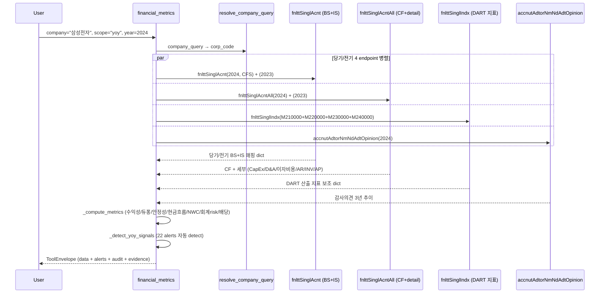

# financial_metrics

## 한 줄 요약
DART 재무 4 endpoint 통합 — 수익성/안정성/현금흐름/운전자본 회전일수/회계 risk 지표. 한국 표준(연결, 지배주주 귀속). 듀퐁 3단 분해, FCF, NWC, CCC, accruals_gap, 감사의견 추이 자동 산출.

기준·표기: [[연결-별도]](연결·지배주주 귀속이 기본 — `net_income_total_krw` 만 전체) · [[단위-표기-규약]](`_krw`·`_pct`·`_ratio`) · 어느 해 값을 쓰나 [[시점-제약]].

## 분기 기간 판정 (2026-08-25, beta)

`quarterly`는 DART `bsns_year`를 사업연도로 그대로 사용하지 않는다.

- 대상 FY 주변의 DART 보고서를 넓게 수집한 뒤 `period_end`와 회사 결산월(`acc_mt`)로 `fiscal_year`·`fiscal_quarter`를 다시 계산한다.
- 결과에는 각 분기별 `period_end`와 `fiscal_year_end_month`를 함께 싣는다. 예: 신영증권(001720)은 `2025-06-30 / 결산월 3월`을 `FY2026-Q1`로 표시한다.
- 반환 범위는 요청 FY와 직전 2개 FY로 제한한다. 수집 과정에서 다음 FY 자료가 들어와도 결과에 섞지 않는다.
- QoQ는 같은 FY의 바로 앞 분기가 실제로 존재할 때만 계산한다. 분기가 건너뛰면 `-`다.
- 결산일이 지난 대상 분기가 공시 목록에 없으면 행을 조용히 생략하지 않고 `quarterly_status.missing`과 markdown의 상태로 표시한다. **법정 제출 기한이 지났으면 `미제출`, 아직 기한 안이면 `제출기한 전`**이다(DATA-API1) — 기한은 `report_calendar.cell_available`(분기·반기 45일 · 사업보고서 90일 · 외국 상장사 60·120일)이고 기한 당일은 아직 낼 수 있어 다음 날부터 `미제출`이다(12월 결산 3분기는 11-14 까지 `제출기한 전`). 종전엔 결산 다음 날부터 `미제출`이었다. 결산월을 바꾼 회사의 옛 결산월 기한은 반영하지 않는다. 아직 기간 종료일이 오지 않은 미래 분기는 표시하지 않는다.
- **`미제출`은 DART 가 「없다」(013)고 답한 분기에만 쓴다.** 그 분기 보고서 조회가 020(키의 하루 한도)·800(점검)·전송 오류로 **실패**했으면 `status` 는 `조회 실패(미확인)`(`reprt_code` 칸 동반)이고 경고도 「제출 여부를 확인하지 못했다 — 미제출이 아니다」로 갈린다 (DATA-API1·DATA-U3). 12월 결산이 아니면 DART 사업연도와 회계연도가 한 해 어긋날 수 있어 앞뒤 한 해의 같은 보고서 실패까지 「미확인」으로 본다(단정보다 안전한 쪽).
- **분기 범위 순이익은 비지배지분을 포함한 총계다.** `quarterly`·`qoq` 행의 `net_income_krw` 는 주요계정 「당기순이익」(총계)이고 새 키 `net_income_basis` = `total_incl_nci` 가 그 기준을 싣는다. markdown 머리도 「순이익(총계·비지배 포함)」이다. `summary`·`yearly`·`yoy` 의 `net_income_krw` 는 지배주주 귀속이라 **같은 이름이어도 기준이 다르다** — 000230 2023 3분기 총계 −574.4억·지배 −255.5억. 값과 옛 키는 그대로다. 지배 몫은 새 키 `net_income_controlling_krw`(+`net_income_controlling_source`=`db_ni_cum_diff`)에 따로 싣는다 — 운영 `dart_finstat_q.ni_cum`(수집이 공용 `controlling_ni` 규칙으로 저장한 누적 지배 순이익)의 차분(1분기=누적 자체, 그 밖=이 칸 − 한 분기 앞 칸)이라 DART 호출은 늘지 않는다(DB 1회). 앞 칸이 없거나 두 칸·이 보고서의 재무제표 기준(연결/별도)이 다르거나 비KRW 행이면 비우고, DB 를 못 읽으면 비우고 경고한다. 값이 하나라도 있으면 표에 「순이익(지배)」 열이 더해진다 (DATA-NI2).
- **순이익이 영업이익의 1.3배를 넘는 분기에는 영업외손익·법인세 설명 줄이 붙는다**(DATA-NI4). 영업이익이 양수이고 `net_income_krw`(총계)/`operating_profit_krw` > 1.3 인 분기 행에 새 키 `net_to_operating_ratio`·`non_operating_net_krw`(= 법인세차감전 순이익 − 영업이익, 금융손익·지분법·기타를 합친 순액)·`income_tax_krw`(= 세전이익 − 순이익, **0 ~ 세전이익 범위일 때만**)와, 모든 행에 `income_before_tax_krw`(주요계정 「법인세차감전 순이익」 3개월, Q4 는 연간 − 9개월 누적, 못 구하면 null)를 싣고 markdown 표 아래에 「영업이익 + 영업외손익 − 법인세 = 순이익」 줄을 더한다. **세전이익 − 순이익이 음수이면 법인세비용으로 단정하지 않는다** — 법인세수익(이연법인세자산 인식 등으로 법인세비용이 음수인 분기)이거나, 주요계정 「당기순이익」이 중단영업 순이익을 품은 총계라 중단영업이 큰 분기(예: 086520 2021 반기)에 생긴다. 주요계정에는 법인세비용 행이 없어 도구는 어느 쪽인지 가를 수 없다. 그런 분기는 `income_tax_krw` 를 비우고 새 키 `pretax_minus_net_krw`(= 세전이익 − 순이익, 법인세수익·중단영업 순이익 등이 섞일 수 있는 값)로만 싣고, 줄도 「음수라 법인세비용으로 단정할 수 없다 — 법인세수익이나 중단영업 순이익 등이 섞일 수 있으니 원문의 법인세비용·중단영업 손익으로 확인」으로 바꾼다. 0 ~ 세전 범위 안의 `income_tax_krw` 도 중단영업 손익이 섞이면 순수한 법인세비용이 아닐 수 있어 기준을 「(세전 − 순이익)」으로 밝혀 싣는다. 값은 고치지 않는다 — 원문과 같은 값의 설명이다(SK하이닉스 000660 2026 반기보고서 연결 3개월: 영업이익 60.54조 · 세전 122.71조 · 순이익 93.92조 · 법인세비용 28.79조, 전체 재무제표에서 금융수익 65.86조 · 금융비용 3.64조 · 지분법 −0.20조). 영업이익이 0 이하이거나 세전이익을 못 읽었거나 Q4 가 `⚠연간`이면 달지 않고, 추가 DART 호출은 없다.
- Q4는 사업보고서 연간 누적액에서 3분기 누적액을 차감해 standalone 3개월 값으로 만든다. 차분할 수 없으면 `⚠연간`으로 표시하고 QoQ를 계산하지 않는다.

JSON 핵심 필드:
- **주당 값(EPS)은 공시 소수를 유지한다** (P1-#20): `eps_krw`·`diluted_eps_krw`(원/주)는 금액이 아니라 `_eps_amount` 로 읽어 소수 공시(외화 보고사 USD 4.14, 원화 리츠 4.21)를 버리지 않는다 — 정수로 공시된 값은 종전처럼 int. 비KRW 는 기말환율로 환산해 정수 원(4.14×1,470=6,086), 원화 소수는 소수 그대로(md 는 「4.21원」). 배수 도구(`price_multiple_data`)의 EPS 는 읽기만 같고 내보낼 때 반올림한 정수라 두 도구의 소수 자릿수가 다른 것은 의도다(배수 도구가 공시 EPS 를 못 찾아 이 도구의 `eps_krw` 로 물러날 때는 소수 그대로 나간다).

```json
{
  "fiscal_year": 2026,
  "fiscal_quarter": "Q1",
  "period_end": "2025-06-30",
  "fiscal_year_end_month": 3,
  "quarterly_status": {
    "fiscal_year": 2026,
    "missing": [{"fiscal_quarter": "Q4", "period_end": "2026-06-30", "status": "미제출"}]
  }
}
```

## 사용법
```
financial_metrics(
    company="삼성전자",
    scope="yoy",
    year=2024,
)
```

자연어 예시:
- "롯데케미칼 2024 yoy 분석" → `scope="yoy"` → operating_loss + interest_coverage_low + negative_fcf alerts
- "SK하이닉스 turnaround 검증" → `scope="yoy"` → turnaround alert
- "삼성전자 듀퐁 분해 + ROE 구성" → `scope="summary"` → ROE 13.07% = 16.63% × 0.62 × 1.27
- "오스템임플란트 5년 감사의견" → `scope="audit_opinion"`
- "영업이익률이랑 ROE 얼마야?" → `scope="summary"` (수익성 핵심 지표 1년)
- "차입금 의존도 높아? 총차입금 얼마?" → `scope="summary"` (`total_debt`·`debt_dependency_pct`; 금융업은 n/a)
- "회계상 리스크 신호 있어?" → `scope="yoy"` (accruals_gap·debt_surge 등 alerts)

## 입력 인자
| 인자 | 타입 | 필수 | 설명 | 기본값 |
|---|---|---|---|---|
| company | str | yes | 회사명 / ticker / corp_code | - |
| scope | str | no | 7종 (아래 참조) | "summary" |
| year | int | no | 사업연도, 0이면 최신 완료 사업연도(결산월 기준 — 12월 결산 4/1부터 전년, 2월 결산 JTC 는 7/1부터 그해 2월 말 사업연도. `quarterly`·`qoq` 는 올해) | 0 |
| years | int | no | yearly/audit_opinion 누적 연수 (**상한 10** — 초과 요청은 줄이고 그 사실을 warning 으로 알린다) | 3 |
| consolidated | bool | no | True=CFS(연결, 한국 표준), False=OFS(별도) | True |
| sj_div | list[str] | no | `accounts` 전용 — 재무제표 종류 필터(`BS`·`IS`·`CIS`·`CF`·`SCE`). 미지정이면 전부 | - |
| format | str | no | "md" / "json" | "md" |

scope:
- `summary`: 1 사업연도 56개 핵심 지표 (수익성/듀퐁/안정성/현금흐름/운전자본/회계risk/배당유보/NAV)
- `yearly`: 최근 N년 추이 (revenue/op_profit/net_income/OPM/ROE/debt_ratio/CFO/FCF)
- `quarterly`: 최근 12분기 추이 (4Q × 3년 — Q1/Q2 반기/Q3/Q4 사업)
- `yoy`: 전년 대비 + 22개 alerts + 감사의견 cross-check
- `qoq`: 전분기 대비 (operating_loss_quarter / revenue_decline_qoq alerts)
- `audit_opinion`: 감사의견 3년 추이 (적정/한정/부적정/감사인 변경 추적)
- `accounts`: 전체 재무제표 **계정 원행 그대로**(`fnlttSinglAcntAll`). 요약이 버리는 수백 행을 공시 순서(`ord`)로 낸다. 파생값 없음 — 계정 해석은 읽는 쪽이 한다. `sj_div=["BS"]` 로 좁힌다. 삼성전자 BS 실측 52행·DART 2콜·27KB. `sj_div` 는 응답 캐시 키에 들어가(대문자·중복 없이 정렬, 미지정과 빈 목록은 같은 값) 필터가 다르면 서로 다른 응답이다. `sj_div_present` 는 **필터 전** 그 보고서의 구성이고, 필터가 다 걸러낸 0행이면 경고가 요청한 `sj_div` 와 필터 전 구성을 적는다(「자료 없음」이 아니다). 손익계산서(IS)를 따로 내지 않고 포괄손익계산서(CIS) 하나로 공시한 회사(SK하이닉스 2025 연결: BS 54 · CIS 27 · CF 37 · SCE 112)에 `sj_div=["IS"]` 를 주면 CIS 행을 손익 행으로 돌려주고(각 행 `sj_div` 는 원문 그대로 CIS) `accounts.sj_div_mapped` = `{"IS": "CIS"}` 와 경고를 단다. `["IS","CIS"]` 처럼 CIS 도 요청했거나, CIS 를 요청했는데 IS 만 있는 보고서는 대체하지 않는다. 필터 전 행이 0 인 응답(모든 폴백이 비었음)은 캐시하지 않는다.

## 출력 schema (data dict)
```json
{
  "company_id": "cmp_005930",
  "scope": "summary",
  "year": 2024,
  "fs_div": "CFS",
  "consolidated": true,
  "summary": {
    "revenue_krw": 300870903000000,
    "revenue_account_nm": "수익(매출액)", "revenue_account_id": "ifrs-full_Revenue",
    "revenue_standard": true, "revenue_basis": "매출액", "revenue_source": "fnlttSinglAcnt",
    "operating_profit_krw": 32725961000000,
    "operating_margin_pct": 10.88,
    "net_income_krw": 50048199000000,
    "ebitda_krw": 32725961000000,
    "ebitda_margin_pct": 10.88,
    "roe_pct": 13.07, "roa_pct": 10.31, "roic_pct": 6.15,
    "asset_turnover_ratio": 0.62, "equity_multiplier": 1.27, "roe_dupont_pct": 13.07,
    "debt_ratio_pct": 27.93, "current_ratio_pct": 243.30,
    "interest_coverage_ratio": 2.52, "net_cash_krw": 40518545000000,
    "total_debt_krw": 25240000000000, "total_debt_confidence": "MED",
    "short_term_debt_krw": 18750000000000, "long_term_debt_krw": 6490000000000,
    "convertible_debt_krw": null, "lease_liabilities_krw": null,
    "total_debt_incl_lease_krw": 25240000000000, "hybrid_capital_krw": null,
    "debt_dependency_pct": 4.45, "debt_dependency_status": "computed",
    "is_financial_company": false,
    "borrowing_detail": {"by_canonical_id": {"OPM_ST": 17570000000000, "OPM_LT": 6480000000000},
      "convertible_included": false, "conflicts": [], "reviews": [],
      "data_quality_flags": [], "no_borrowing_rows": false},
    "cfo_krw": 72982621000000, "capex_krw": 51406355000000,
    "fcf_krw": 21576266000000, "fcf_margin_pct": 7.17,
    "cfo_to_op_ratio": 2.23, "cfo_to_net_income_ratio": 1.46,
    "working_capital_krw": 133735967000000, "nwc_krw": 83007761000000,
    "nwc_change_yoy_krw": 6054318000000, "nwc_to_revenue_pct": 27.59,
    "days_sales_outstanding": 52.9,
    "days_inventory_outstanding": 88.1,
    "days_payable_outstanding": 42.4,
    "cash_conversion_cycle_days": 98.6,
    "accruals_gap_pct": -123.01,
    "ar_to_revenue_pct": 14.50, "inv_to_revenue_pct": 17.20,
    "dividend_paid_krw": 10888749000000, "payout_ratio_pct": 21.76,
    "retained_earnings_krw": 370513188000000, "nav_krw": 402192070000000,
    "eps_krw": 4950, "diluted_eps_krw": 4950
  },
  "yoy": {"current": {...}, "prior": {...}, "alerts": ["accruals_red", "nwc_efficiency_low"],
          "audit_opinion": {"current": {...}, "prior": {...}}},
  "audit_opinion": {"opinions": [{"stlm_dt": "2024-12-31", "adt_opinion": "적정의견",
                                  "adtor": "삼정회계법인", "core_adt_matter": "..."}],
                    "summary": {"latest_opinion": "적정의견", "all_clean": true}},
  "no_filing": false, "filing_count": 1,
  "usage": {"dart_api_calls": 12, "mcp_tool_calls": 1}
}
```

핵심 필드:
- **매출 계정 선택** (`services/revenue_account.py`, 260906): 「매출액」이라는 계정명을 안 쓰는 회사가 많다 —
  정보서비스·바이오는 「영업수익」, 보험은 「보험수익」(1117호)·「보험영업수익」(1104호), 건설은 「수익(매출액)」·
  「공사수익」, 은행·금융지주는 매출 행이 없고 「이자수익」뿐. 주요계정(`fnlttSinglAcnt`) 템플릿에는 그 회사가
  「매출액」을 안 쓰면 **행이 아예 없고**(리파인 2024: IS 가 영업이익부터), 전체 재무제표(`fnlttSinglAcntAll`)엔
  있지만 `account_id` 가 `-표준계정코드 미사용-` 이다. 그래서 ① `ifrs-full_Revenue` 정확매칭 → ② 없으면 계정명
  **접두** 매칭(배제: 매출원가·매출총이익/손실·매출채권·기타영업수익·출재보험서비스수익…) → ③ 순서는 KSIC 로
  (65 보험: 보험수익 코드 → 영업수익 / 64·66 금융: 영업수익 → 순영업수익 → 이자수익 / 41·42 건설: 매출액 →
  공사·분양수익 / 그 외: 매출액 → 영업수익 — **이자수익·보험수익으로 안 내려간다**). 주요계정에 없으면 전체
  재무제표(이미 호출 중, DART 콜 0 추가)에서 고른다. 결과에 `revenue_account_nm`·`revenue_account_id`·
  `revenue_standard`(매출액과 같은 뜻으로 읽어도 되나 — 보험수익·이자수익이면 false)·`revenue_basis`(사람용
  기준명: 매출액/영업수익/보험수익/이자수익… — 삼성생명은 IFRS17 보험수익 행을 「일반보험서비스수익」이라 적으므로
  원문명 대신 이걸로 표기)·`revenue_source` 를 같이 내고, standard 가 아니면 warning + render 라벨 「매출액(이자수익 기준)」. KSIC 는 `company.json` 의 `induty_code`
  (이미 호출) → 없으면 Postgres `dart_fundamentals` 순. 실측 fixture 회귀: `tests/test_revenue_account_pick.py`.
- **단위 처리**: 모든 금액 raw KRW int (`_krw` suffix), %는 float (`_pct` 11.5 = 11.5%), 비율은 decimal (`_ratio` 0.85). render에서만 조/억 변환.
- **연결 default**: 한국 표준 = 연결 지배주주 귀속. `consolidated=False` 옵션으로 별도 가능.
- **분모 0/음수 graceful**: 적자 회사 ROE/배당성향 → None + warning. 분모 음수일 때 산출 안 함.
- **ROE 분모의 지배자본**(261021): `controlling_equity_krw`(기말 지배자본 — ROE·자본잠식이 쓴 자기자본)·`controlling_equity_case`(고른 길)·
  `prev_controlling_equity_krw`(전기 쪽 — ROE 분모 = 두 값의 평균, 전기 보고서를 못 받았으면 null). 케이스는 수집·배수 도구와 같은 말이다 —
  `BS_ID`(지배자본 계정 줄)·`BS_NM`(이름 줄)·`TOTAL_MINUS_MINORITY`(자본총계 − 비지배)·`TOTAL`(비지배 없음), 믿지 않은 줄이 있었으면 끝에 `_CAPLINE`
  (자본금 줄)·`_COMPLINE`(자본 구성요소 줄)·`_OFFTOTAL`(자본총계 − 비지배와 크게 어긋남). 전체 재무제표를 못 받아 공용 규칙이 못 낸 경우만 `ACNT_NAME`·
  `TOTAL_MINUS_NCI`·`TOTAL_FALLBACK`(자본총계 그대로 — 지배자본이라고 하지 않는다). 아래 「지배자본을 고르는 규칙」 참조.
- **보고서 사이 단위 가리기**(261021): 회사가 단위를 잘못 적은 사업보고서(통째로 10ⁿ 배)를 앞뒤 해 사업보고서와 대 바로잡았으면 그 해 행(요약·yearly 행·yoy 의
  current/prior)에 `data_quality.scale_fix` — `[{report, rcept_no, divisor, method, evidence}]` — 가 붙고 경고 「🔧 DART 원문 단위 오류를 바로잡았다…」가 한 번
  나온다. 어긋남은 있는데 가리지 못했으면(보고서가 둘뿐 등) 값은 원문 그대로 두고 `data_quality.scale_cross_report` + 경고 「🚨 보고서 사이 단위 어긋남…」.
  어긋남이 없으면 `data_quality` 칸이 없다(종전 응답 그대로). 아래 「보고서 사이 단위 가리기」 참조.

## 기간 맞춤 — 3개월 전년비와 올해 yoy (2026-10-21)

- **당기(standalone, 3개월) 전년비**: 반기·3분기 보고서의 `standalone`(당기 3개월) 지표는 전년 값도 **전년 같은 분기 3개월**이다. 종전엔 전기 전체 재무제표를 누적 열(6·9개월)로 읽은 맵을 그대로 써서 순이익 전년비(`net_income_yoy_pct`)가 3개월 대 누적이었다 —
  079160 2021 반기 지배 순이익 당기 3개월 −845.09억의 전년비 +64.59%(전년 상반기 누적 −2,386.87억) → +40.97%(전년 2분기 3개월 −1,431.69억). 같은 행을 3개월 열로 다시 읽을 뿐 DART 호출은 늘지 않고, 누적(primary)·잔액(BS·NWC) 쪽은 그대로다 (DATA-Q1).
  로컬 원문 캐시 481종목·1,785 반기/3분기 보고서 쌍으로 재면 1,781쌍의 standalone 순이익 전년비가 바뀐다(부호가 뒤집힌 것 497).
- **`yoy` 에 올해를 주면**: 올해는 사업보고서가 아직 없어 3분기·반기·1분기 누적으로 대체되는데 전기는 사업보고서 12개월이라 `revenue_decline`·`roe_decline_*`·`receivables_surge`·`inventory_surge`·`dividend_halt` 가 거짓으로 켜졌다.
  당기와 전기의 보고서 코드(`reprt_code`)가 다르면 **전기를 당기와 같은 보고서(전년 같은 분기 누적)로 다시 센다**(같은 요청 안 조회는 한 번만 부른다). 새 키 `yoy.period_aligned`(true) · `yoy.period_note`(다시 센 사실). 전년 같은 보고서가 없어 못 맞추면 `period_aligned`=false,
  그 다섯 경고는 계산하지 않고 `yoy.alerts_not_evaluated` 에 이름을, 경고에 까닭을 적는다. 연간 대 연간이면 달라지는 것이 없다 (DATA-Q6).

## yoy_signals (25개 alerts)
- **수익성**: `loss_conversion`, `operating_loss`, `turnaround`, `continued_loss`, `revenue_decline`
- **부채/유동성**: `debt_surge`, `interest_coverage_low` (이자보상배율 **2배 미만** — 1배 미만이면 영업이익으로 이자를 못 낸다)
- **자본잠식 (KOSDAQ 관리/폐지 사유)**: `capital_impairment_partial` (잠식률 0~50%), `capital_impairment_50plus` (50%+, KOSDAQ 관리종목 사유), `capital_impairment_full` (완전 자본잠식, 상장폐지 사유)
- **현금흐름**: `cfo_quality_red` (영업이익이 **흑자일 때만** — 적자에서는 `cfo_to_op_ratio` 가 음수로 뒤집혀 켜지지 않는다), `negative_fcf`, `low_dividend_capacity_use`
- **운전자본**: `nwc_surge`, `nwc_efficiency_low`
- **듀퐁 분해**: `roe_driven_by_leverage` (평균 총자산 ÷ 평균 지배자본이 2배 초과인 **수준** 판정 — ROE 변화 방향과 무관), `roe_decline_margin_driven`, `roe_decline_turnover_driven`
- **회계 risk**: `accruals_red` (영업이익이 현금보다 30%+ 큰 **한 방향**만 — 현금이 이익보다 많은 쪽은 켜지지 않는다), `receivables_surge`, `inventory_surge`
- **감사의견**: `non_clean_audit_opinion`, `audit_opinion_change` — 의견은 공백·끝의 「의견」을 뗀 뒤 **정확히 「적정」일 때만** 깨끗한 의견이다(「부적정」·「한정」·「의견거절」은 비적정). 「해당사항없음」·빈칸 행은 판정에서 뺀다
- **배당**: `dividend_halt`

### 자본잠식 정의 (한국 상법/거래소 기준)
- **자본금**: 발행주식수 × 액면가 (회사 설립 + 증자로 들어온 원금)
- **자본총계**: 자본금 + 자본잉여금 + 이익잉여금 (현재 회사가 보유한 순자산)
- **자본잠식**: 누적 적자로 이익잉여금이 음수가 되어 자본총계가 자본금보다 작아진 상태
- **잠식률**: (자본금 - 자본총계) / 자본금 × 100
- **trigger**:
  - 잠식률 50%↑ + 2년 연속: KOSDAQ 관리종목 지정
  - 완전 자본잠식 (자본총계 ≤ 0): KOSDAQ 상장폐지 사유 (KOSPI는 사업보고서 미공시 등 다른 trigger)

## Data sources
- **DART API 4 endpoint**:
  - `fnlttSinglAcnt` (단일회사 주요계정) — BS 9 + IS 5 = 14 핵심 행. 당기/전기/전전기 3년 단일 호출.
  - `fnlttSinglIndx` (주요 재무지표) — DART 산출 ROE/부채비율/EPS 등. idx_cl_code 4 그룹 (수익성/안정성/성장성/활동성) × 4 호출.
  - `fnlttSinglAcntAll` (전체 재무제표) — 213 행 (BS/IS/CIS/CF/SCE). CapEx, 감가상각비, 이자비용, 매출채권/재고/매입채무 추출.
  - `accnutAdtorNmNdAdtOpinion` (회계감사인+의견) — 6 행 (3년 × CFS+OFS). 감사인 / 적정의견 / 강조사항 / 핵심감사사항(KAM) / rcept_no.
- 외부 호출: scope별 최대 12회 (일반 7회). **`yearly` 는 요청 안에서 인접 연도 조회를 공유한다**
  — 연도마다 「당기+전기」를 부르므로 겹치는데, 그 겹침을 `_FetchMemo` 가 없앤다(실측 삼성전자
  years=3 16→13 · 5 24→16 · 10 **47→29콜, -38%**). 값은 한 자리도 바뀌지 않는다(3사 5년 전 지표 대조). `accounts` 는 2회(요약 8회보다 싸다 — 요약에 얹어 공짜로 나오는 게 아니라 자기 호출을 한다). 기능통화가 비KRW 인 회사는 환율 1회가 더 붙는다(ECOS→야후 대체값, 확정일 ECOS 값만 영구 표 — 261019). reprt 폴백 + TTM + 당기분해 포함. quarterly scope는 ~24회 + 매출이 빈 분기 수(최대 12 — 주요계정에 매출 행이 없는 회사만, 260906 lazy 폴백).

## Flow



호출 횟수: scope별 최대 12회 (일반 7회). quarterly scope는 ~24회(+ 매출 빈 분기 수, 최대 12)로 가장 많음. audit_opinion만은 1회.

## 파싱 전략
- **account_nm 매칭**: 표준 키워드 패턴 9 BS + 5 IS + 13 detail (CF/Detail). 공백 무관 + 부분 일치.
- **총차입금 = account_id 전체명 정확매칭**(`_compute_borrowings`, 260713): 차입금·사채는 account_nm
  키워드가 아니라 account_id local-name(casefold) 정확매칭 사전(`_BORROW_ID_MAP`)으로 잡는다. 비표준
  코드(`-표준계정코드 미사용-`)만 account_nm 전체명 사전(`_BORROW_NM_MAP`) 폴백. sum-all(first-match
  break 없음) → 유동성장기차입·전환사채·비유동차입 누락 제거. **자체 canonical id**: OPM_ST(단기)·
  OPM_LT(장기)·OPM_LT_CURR(유동성장기)·OPM_BOND/OPM_BOND_CURR(사채)·OPM_CONV(전환·BW·EB)·
  OPM_BORROW(일반)·OPM_COMBINED. Loans*Net·LoansAtAmortisedCost(대출채권 **자산**)·매입채무는 명시배제,
  id↔nm 모순=CONFLICT·미등록=REVIEW로 표면화(합산 제외). 리스부채(IFRS16)·신종자본증권(자본)은 별도
  필드. 금융사(연결 BS 예수부채·보험계약부채·고객예탁금 정확매칭 — 예수금 제외)는 debt_dependency=None
  (`status="n/a_financial"`); 일반지주(SK·LG 등, 예수부채 없음)는 정상 산출. KOSDAQ 소형주 '채무'·'유동화'
  표기변형(유동성장기차입채무·유동화채무)은 nm 정확매칭+토큰 안전망으로 흡수(298사 2룹 검증). 근거:
  financial-metrics-borrowings-260713.
- **금액 정규화** (`normalize_amount`):
  - 콤마 strip ("227,062,266,000,000" → 227062266000000)
  - 괄호 음수 ("(500)" → -500, T19 fix 패턴)
  - None / "-" / "" → None graceful
- **DART 응답 단위**: 표준 = 원 raw int, 일부 KOSDAQ은 백만원 단위 (`_unit` 메타로 자동 곱셈 — Phase 2)
- **연결 지배주주 귀속**: detail에 `controlling_interest_income` 있으면 우선 사용, 없으면 `당기순이익(손실)` 합계 fallback
- **평균자산/평균자본**: 당기 + 전기 BS 평균. 전기 데이터 없으면 기말 단독. ROE 의 평균 자본은 **지배자본**(위 「지배자본을 고르는 규칙」), ROA·자산회전율의 자산은 총자산.
- **ROIC 근사**: NOPAT = 영업이익 × (1 - 0.22 평균법인세). 투하자본 = 자본 + 총차입.
- **DuPont 검증**: ROE = 순이익률 × 자산회전율 × 재무레버리지. roe_pct vs roe_dupont_pct 일치 확인용.
- **운전자본 회전일수**: DSO=평균 매출채권/매출액×365, DIO=평균 재고/매출원가×365, DPO=평균 매입채무/매출원가×365, CCC=DSO+DIO-DPO. 분모가 없거나 0 이하이면 None.
- **배당성향 = DART 현금배당성향(귀속)**(`_accrual_payout_pct`, 260716): 분자로 CF '배당금지급'(현금
  유출 타이밍·연결 전체)을 **쓰지 않는다** — 대개 전년 결산배당이 그해 지급된 것이라 당해 순이익과
  연도·주체(지배 vs 지배+비지배)가 어긋난다. 대신 dividend 툴의 alotMatter 다년 로직을 재사용해 DART
  사업보고서 '현금배당성향(%)'(연결 우선)을 **연간보고서에서만 연도 key 조인**으로 주입(dividend 툴과
  SSOT 일원화). 무배당/미기재/미확정 연도는 None. CF `dividend_paid_krw`는 배당/FCF(현금 coverage)
  지표 전용. 근거: financial-metrics-payout-260716.
- **REIT 배당성향 억제**(`_is_reit`+`_accrual_payout_pct(is_reit=)`, 260717): 이름에 '리츠' 있으면
  `payout_ratio_pct=None` + `payout_ratio_note`("DPS·시가배당률 참고"). REIT는 배당가능이익≥90% 분배라
  순이익 대비 성향이 100~2000%·음수로 무의미(404사 스캔: 미래에셋글로벌리츠 421%·이지스밸류 −415%).
  KSIC(68)는 부동산 개발사(SK디앤디·자이에스앤디 정상 성향)까지 잡아 과억제하므로 **이름 판정**. 근거:
  dividend-payout-classification-260717.

## 관련 공시 (rules/disclosures/)
- [[사업보고서]] — fnlttSinglAcnt 1차 source (연간)
- [[반기보고서]] — reprt_code=11012
- [[분기보고서]] — reprt_code=11013(1Q) / 11014(3Q)

**확정치 vs 잠정치**: 이 tool은 정기보고서 **확정치**(감사 후). 분기말 직후 **잠정** 실적이 필요하면 [[provisional_earnings]](영업잠정실적 공정공시 — 확정보다 ~40일 빠름, 감사 전).

## 관련 개념 (rules/concepts/)
- [[당기순이익]] — 한국 표준 = 연결 지배주주 귀속
- [[배당성향]] — 배당총액 / 지배주주 귀속 당기순이익
- [[ROE]] / [[ROA]] / [[ROIC]] — 수익성 3대 지표
- [[듀퐁분석]] — ROE = 순이익률 × 자산회전율 × 재무레버리지
- [[FCF]] — Free Cash Flow = CFO - CapEx
- [[NWC]] — 순운전자본 = 매출채권 + 재고 - 매입채무
- [[이자보상배율]] — 영업이익 / 이자비용
- [[순현금]] — 현금성자산 - 총차입금

## 관련 결정 (decisions/)
- [[open-proxy-guideline]] — 재무 risk 신호 (이자보상배율, FCF 음수 등) 채점에 사용
- cross-domain 체이닝(v1 설계문, 260831 삭제) — financial_metrics → vote_brief / corp_gov_report 체이닝 (Phase 2)

## 관련 audit/fix
- 260501_2030_audit_financial_metrics-200기업 — 6기업 sanity부터 200기업 전수까지 통합한 기준 문서

## 알려진 issue + TODO
- 일부 KOSDAQ 회사 백만원 단위 보고 — `_unit` 메타 자동 곱셈 (Phase 2)
- 감가상각비 (CF "비현금항목 가산") 패턴 일부 회사에서 매칭 안 됨 → EBITDA = 영업이익으로만 산출되는 케이스
- 이자비용 vs 금융비용 모호 — 일부 회사 금융비용에 환차손 포함 → 이자보상배율 underestimate
- 발행주식수는 별도 호출 필요 (BPS 산출 — Phase 2 stockTotqySttus 통합)
- vote_brief / 매트릭스 dim 자동 채점 통합 — **Phase 2 별도**

## 자본잠식 — 계산식은 한 곳에 있다 (260808)

`compute_capital_impairment()` 가 **유일한 자리**다. 종전에는 `_compute_metrics` 안에 인라인으로
박혀 있어, 소집공고 잠정치 경로를 붙이려면 복사할 수밖에 없었다.

자기자본을 구하는 순서(`capital_impairment_basis` 로 남긴다):

| basis | 뜻 | 문장 |
|---|---|---|
| `controlling` | 지배지분 계정을 직접 읽음 | 「지배주주 귀속 자기자본」 |
| `derived` | **자본총계 − 비지배지분** | 「…(자본총계에서 비지배지분을 빼 산출)」 |
| `total` | 둘 다 없음 — 별도재무제표이거나 연결인데 구분 표시가 없음 | 별도/미확인을 갈라 씀 |

`derived` 가 없으면 지배지분 소계를 안 적는 회사(실측 고려아연·비덴트·미래에셋증권)에서 자본총계로
물러나 **비지배 몫만큼 자기자본이 부풀고, 규정이 금지한 바로 그 과소 산정**이 된다. 그러려면
비지배지분이 필요해 `ifrs-full_NoncontrollingInterests` **정확 매칭**으로 뽑는다(접두로 보면 다른
개념에 올라탄다 — 260704 `ifrs-full_Liabilities` 사고). 한글 폴백에는 KT&G 형 부채행 차단을 함께
둔다 — 연결 BS 는 부채 섹션의 「비지배지분부채」가 자본 섹션의 「비지배지분」보다 **앞**이라 막지
않으면 8.7배 틀린 값을 집는다.

**문장이 basis 를 읽어야 한다.** 읽지 않으면 자본총계로 물러난 경우에도 「지배주주 귀속
자기자본 0 이하」라고 쓰게 된다 — 별도재무제표에서는 우연히 참이지만 연결 폴백에서는 재지 않은
것을 쟀다고 말하는 것이다. 두 경우는 읽는 쪽에 뜻이 정반대다(별도는 정상, 연결 폴백은 「규정
기준이 아닐 수 있다」는 신호).

계정 매칭에는 계정별 배제를 둔다. 부분문자열이라 「유동자산」⊂「비유동자산」, 「자본총계」⊂
「부채및자본총계」(=자산총계), 「자본금」⊂「우선주자본금」이 서로 올라탄다. 지금 안 터지는 유일한
이유는 DART 가 표준 순서로 주고 첫 매칭이 이기기 때문이라, 순서에 기대지 않도록 명시한다.
자본금이 종류주별로만 적힌 표는 합산한다(부모 행이 있으면 그것 — 다 더하면 2배가 된다).

### 지배자본을 고르는 규칙 (261021)

ROE 분모와 자본잠식의 자기자본은 **분기·연간 수집과 `price_multiple_data` 가 쓰는 규칙 그대로**(`services/controlling_eq` — [[price_multiple_data]] 의 지배자본 절)로 고른다.
지배자본 계정 줄(`…EquityAttributableToOwnersOfParent`)이 믿을 만하면 그 값(`BS_ID`), 그 계정을 **자본금 줄**이나 자본 구성요소 줄에 붙였거나 자본총계 −
비지배와 부호가 다르거나 1.6배 넘게 다르면 그 줄을 버리고 이름 줄 → 자본총계 − 비지배 → 자본총계 순으로 간다.

- 종전엔 이 도구만 그 계정 id 가 든 **첫 줄 그대로**를 썼다. 자본금 줄에 붙인 보고서에서는 자본금(수십억)이 지배자본이 되어 ROE 가 수십~수백 % 로 나오고 자본잠식은
  「정상」이 됐다(065680 FY2024 ROE 400.34% → 8.45% · 000040 FY2019 정상 −11.33% → 관리종목 꼴 80.43%). 지배자본 줄이 없는 보고서는 ROE 분모가 비지배를 품은 자본총계였다
  (419050 FY2025 916.66억 → 지배 641.84억).
- `capital_impairment_basis` 는 고른 길을 따른다 — 지배 계정/이름 줄이면 `controlling`, 자본총계 − 비지배면 `derived`, 자본총계 그대로면 `total`.
  `compute_capital_impairment(controlling_basis=…)` 가 그 말을 받는다(기본은 종전과 같은 `controlling`).
- 전기 쪽(`detail_prev`)도 같은 규칙이다. 주요계정(`fnlttSinglAcnt`)에는 지배 줄이 없어 이름 규칙이 걸릴 일이 없다 — 전체 재무제표를 못 받았을 때만 종전처럼
  주요계정 자본총계에서 비지배(알면)를 뺀 값, 그것도 모르면 자본총계로 물러난다(`TOTAL_MINUS_NCI`·`TOTAL_FALLBACK`).
- 영향: 지배자본 줄을 안 믿어 값이 바뀌는 보고서(자본금·자본 구성요소 줄에 붙인 꼴)와, 지배자본 줄이 없어 분모가 자본총계에서 지배 몫으로 바뀌는 보고서(비지배 몫만큼 ROE 가 달라진다)가 있다.
  자본잠식 상태가 바뀌는 보고서도 있다(완전 → 정상 · 정상 → 관리종목 꼴). `price_multiple_data`·`value_up`·`proxy_advise_before_meeting` 이 이 도구의
  `roe_pct`·`capital_impairment_*` 를 그대로 가져가 함께 바뀐다.

### 보고서 사이 단위 가리기 (261021)

회사가 단위를 잘못 적어 사업보고서가 **통째로** 10ⁿ 배면(065150 FY2023 1,000배 · 032680 FY2022 100만 배) 그 보고서 안의 검사(자산 = 부채 + 자본)는 다 맞는다.
같은 날짜의 같은 숫자를 낸 **다른 보고서**와 대야 드러난다 — 사업보고서 N 의 재무상태표 전기 칸은 사업보고서 N−1 의 당기 칸이다.

- 이미 받은 응답끼리만 대므로 **DART 콜이 늘지 않는다** — 다년 조회(`yearly`·`yoy`)는 같은 요청의 `_FetchMemo` 가 겹치는 조회를 하나로 합치고, 대조는 그 응답을 재사용한다
  (`yoy` 는 두 해가 겹치는 보고서를 한 번만 받게 되어 오히려 콜이 준다).
- 관측 = 사업보고서마다 당기 말·전기 말의 자본총계·자산총계(주요계정). 같은 날짜를 낸 두 보고서의 비율이 10ⁿ(|n| ≥ 2, ±20%)이면 단위 차, 2배 안쪽이면 같은 단위,
  그 사이(재작성·연결 범위 변경)나 부호가 다른 쌍은 쓰지 않는다. 어느 보고서가 틀렸는지는 이어 붙인 보고서들의 **다수결**로 가린다
  (`scale_guard.reconcile_report_scales` — 분기 수집·`price_multiple_data` 실시간 firm 과 같은 규칙, 시총 신호는 이 도구에 없다).
- 틀린 보고서는 **금액 칸만** 10ⁿ 으로 나눠 쓴다(주당 금액 줄은 그대로). 그 보고서를 전기로 읽는 해(순이익 전년비·ROE 평균 분모)도 같은 값이다.
- 보고서가 둘뿐이라 다수결이 안 서는 조회(`summary`, `yearly` 의 `years=1`)는 값을 고치지 않고 경고만 한다. `years=3` 이상이면 앞뒤 해 보고서까지 대어 가린다.
  분기 보고서의 전기 칸은 사업연도 말이라 전년 동기 보고서와 짝이 아니므로 사업보고서로 읽는 해만 본다.

## 기능통화 (비KRW 회사)

기능통화가 KRW 가 아닌 회사(두산밥캣=USD 등)는 DART 원행이 그 통화로 온다. 이 tool 은 금액을
**회계기말 환율로 KRW 환산**해서 내보내고 기준을 값 옆에 붙인다 — `functional_currency`(예 `USD`),
`fx_rate_to_krw`, `fx_source`, `fx_basis`. 환산했으면 warning 으로도 알린다.

- `fx_source`(261019): 그 환율의 출처 — `"ecos"`(한국은행 매매기준율, 환율 표 저장분 포함) | `"yahoo"`(ECOS 를 받지 못해 쓴 야후 종가 대체값).
  대체값이면 경고 한 줄이 붙고, 그 값은 환율 표에 넣지 않으며 30분 뒤 다시 물으면 ECOS 부터 다시 받는다. `quarterly`·`qoq` 는 행마다.

- 전기(`prev_*`)도 **당기와 같은 환율**을 쓴다. 서로 다른 환율을 쓰면 `*_yoy_pct` 에 환율 변동이
  섞여 「기능통화 기준 성장률」이 아니게 된다. 그래서 yoy 는 환율이 빠진 성장률이고 그 사실이 `fx_basis` 에 적힌다.
- `quarterly`·`qoq` 는 12분기에 **단일 환율**을 쓴다 — 분기마다 다른 환율이면 Q4 차분(연간 − 3분기 누적)이
  서로 다른 환율의 값을 빼게 되어 Q4 가 오염된다.
- **보고 통화를 바꾼 회사**(261019): 통화는 보고서마다 읽는다. 표시하는 분기들이 한 통화면 그 통화의 마지막 분기말 환율 하나(위와 같음),
  표시 창 **안에서** 통화가 바뀌었으면(글로벌에스엠 900070: 2023 CNY → 2024~ USD) 각 분기를 자기 통화로 읽어 **같은 날**(마지막 분기말)
  환율로 원화로 바꾼 뒤 Q4 차분·분기 합 점검·QoQ/YoY 를 원화로 계산한다. 행마다 `functional_currency`·`fx_rate_to_krw` 가 그 분기 통화다.
  종전엔 첫 보고서(창 밖 FY-3 Q1 포함)의 통화 하나를 12분기 전부에 써서 USD 금액을 CNY 환율로 바꿨다(2026 반기 자본 227억 — 실제 약 1,544억, 약 6.8배
  과소, 2024Q1 QoQ −84%). 환율 하나라도 못 구하면 원화로 바꾸지 않고, 통화가 다른 분기 사이 금액 증감률은 비우며, 그 해 안에서 바뀐 Q4 는
  차분하지 않는다(연간 누적치 + 경고).
- **환율 조회에 실패하면 값을 건드리지 않고** `fx_rate_to_krw: null` + 「원화가 아니다」 경고를 낸다.
  조용히 원화 라벨을 남기지 않는다.
- `accounts` 는 **환산하지 않는다** — 원행 그대로가 목적이라 통화만 표기한다.
- 하류 소비자 주의: `price_multiple_data` 는 이 tool 의 `revenue_krw` 를 **이미 KRW 로** 받는다.
  거기서 다시 환산하면 환율이 두 번 곱해진다(260908 실측 8.87조 → 12,728조).

## 반기·분기 결산 회사(리츠) — 사업보고서 한 권이 12개월이 아니다 (261021, DATA-FY3)
반기(6개월)·분기(3개월) 결산 회사는 결산기마다 사업보고서를 따로 낸다. 롯데리츠 FY2025 사업보고서(제14기)의 당기는 2025.07~12 여섯 달이라 `net_income_krw` 196.27억은
**연간 12개월이 아니라 한 결산기**다. 종전엔 사업보고서면 무조건 12개월로 적어 기준 줄이 「손익=연간(사업보고서, 12개월)」이었고 ROE(`roe_pct` 1.70%)가 연간 ROE 로 읽혔다.
이제 사업보고서의 **실제 기간**(주요계정 손익 줄의 `thstrm_dt` 「2025.07.01 ~ 2025.12.31」)을 읽어 개월 수를 쓴다. 12개월 보고서·기간을 못 읽는 보고서는 응답이 그대로다(새 칸·새 경고·DB 읽기 없음).

| 칸 | 12개월 보고서 | 6·3개월 결산기 보고서 |
|---|---|---|
| `period_months` · `is_annualized_basis` | 12 · true | 6(또는 3) · false |
| `period_basis` | `annual` | `period_6m`(`period_3m`) |
| `basis_note` | 손익=연간(사업보고서, 12개월) … | 손익=사업보고서 한 결산기 6개월(2025-07-01~2025-12-31)(연간 12개월 아님·연환산 아님) … |
| `period_span` | 없음 | `{start, end, months}` — 이 보고서의 실제 기간 |
| `net_income_12m_krw` · `roe_12m_pct` · `twelve_month_basis` | 없음 | 12개월 결산기 합 순이익(롯데리츠 FY2025 361.74억)·ROE(3.13%)와 근거(`window`·`terms`·기초/기말 지배자본). 못 만들면 값 null + `status:"unavailable"` + `reason` |
| `yoy_comparable` · `prior_period_span` · `yoy_basis_note` | 없음 | 전기 보고서가 같은 기간의 1년 전이 아닐 때만 `false` + 까닭. `*_yoy_pct` 값은 그대로다(직전 기간 대비일 뿐 전년비가 아니다) |

- **옛 키 값은 그대로**: `net_income_krw`·`roe_pct`·`roa_pct`·`*_yoy_pct` 는 한 결산기 값 그대로이고 기준 표기만 바로잡았다. 회전일수(DSO·DIO·DPO)는 분모(매출·매출원가)가 6개월 flow 라 기간을 맞춘다
  (롯데리츠 FY2025 DSO 58.7 → 29.4일 — 종전엔 6개월 매출을 12개월로 읽어 두 배였다).
- **12개월 값의 출처**: 수집기가 저장한 「결산기 12개월」 칸(분기 재무 표의 결산기 합 칸 — 시장 밸류 도구·주간 곡선·업종 비교가 쓰는 같은 칸). 결산기 말이 속한 달력 분기 칸을 읽고, 12월 결산기면 그 연간 칸 · 그 밖이면 직전 연간 + 그 분기 누적 − 전년 같은 분기 누적.
  ROE = 12개월 순이익 ÷ 평균 지배자본(결산기 말과 12개월 전). 시장 밸류 도구 `firm` 의 리츠 ROE 와 같은 값이다. DB 를 읽지 못하거나 칸이 없으면 비우고 까닭을 경고로 싣는다.
- **전년비**: 반기 결산 리츠의 올해 사업보고서(제15기 2026.01~06)의 「전기」(year−1 사업보고서)는 2025.07~12 로 직전 결산기이지 1년 전이 아니다 — 그 경우 위 `yoy_comparable:false` 와 경고가 붙는다. FY2025(2025.07~12) 대 FY2024(2024.07~12)는 같은 반기라 경고가 없다.
- **`fiscal_period`**: 사업보고서 한 권의 당기가 12개월이 아니면 결산월로 만든 12개월 구간 대신 그 보고서의 실제 기간(`2026-01-01~2026-06-30 · 6개월 결산기`)과 `period_months` 를 싣는다(`summary`·`yoy`).
- **기본 사업연도(리츠)**: `year` 를 주지 않으면 결산월(12)이 가리키는 연도와 **이미 제출된 가장 새 사업보고서의 표기 연도** 가운데 큰 쪽이다(DART 목록 1콜) — 롯데리츠 10월 기본 연도 2025 → 2026(제15기, 2026.06 사업보고서가 9/21 에 제출됨).
  결산월을 모르거나 목록 조회가 실패하면 종전 그대로. 리츠가 아닌 회사는 목록을 더 부르지 않는다.
- 한계: 분기 결산 회사의 11월 결산기(0030R0)처럼 저장 칸의 순이익 합이 비어 있으면 12개월 값은 null + 까닭이다. `yoy` scope 는 리츠 배당성향 억제(`is_reit`)를 아직 받지 않는다.

## 변경 이력
- 2026-10-24: **소수 EPS 를 버리던 것 · 영업적자·역방향에서 켜지던 현금흐름 경고 · 틀린 경고 설명 두 줄** (P1 묶음 2 B, 재무 점검 P1-#20·#25·#26) — ① 주당이익을 `int(float())` 로 읽어 소수 공시가 잘렸다: 두산밥캣 2024 기본 EPS USD 4.14 → 4 로 읽혀 `eps_krw` 5,880(바른 값 4.14×1,470=6,086, −3.4%), SK리츠 4.21 → 4. 이제 EPS 4줄(기본·희석·계속영업 폴백)만 float 로 읽어 정수값이면 int·소수면 소수로 둔다(금액 정규화 `normalize_amount` 는 정수 계약 그대로). 비KRW 는 환산 뒤 정수 원, 원화 소수는 소수 그대로, md `EPS` 줄은 소수가 있는 값만 「4.21원」. 전년 대비의 전기 EPS 는 전년 보고서를 따로 읽고 그 해 말 환율로 환산해 같은 규칙이 적용된다(전기 새 값은 운영에서 확인). 도구 설명의 「금액 int(_krw)」에 EPS 예외 한 구. ② `cfo_quality_red` 는 영업이익 ≤0 이면 켜지지 않는다(엔씨소프트 2024 영업이익 −1,092억·영업CF +1,070억의 비율 −0.98 이 0.7 미만이라 켜지고 같은 응답에 `accruals_ratio_unreliable` 이 떠 서로 모순이었다). `accruals_red` 는 `abs()` 대신 이익>현금 방향(괴리 +30% 초과)만 켠다(SK텔레콤 영업CF 가 영업이익의 2.8배인데 「이익이 현금으로 안 들어왔다」). `cfo_to_op_ratio`·`accruals_gap_*` 값과 경고 이름은 그대로이고 경고 목록에서 빠지기만 한다. 15사 재생(고치기 전·후 `_compute_metrics` 전체 출력 지문)에서 바뀐 것은 두산밥캣·SK리츠 EPS 칸과 `accruals_red` 6건·`cfo_quality_red` 1건 제거뿐. ③ `interest_coverage_low` 설명이 문턱(2배)과 달리 「1배 미만 — 못 낸다」였고(SK리츠 1.18배가 거짓 문장을 받음), `roe_driven_by_leverage` 는 EM>2 수준 판정인데 「레버리지로 올라간」이라 했다(SK텔레콤은 레버리지가 줄었는데도): 문구를 문턱·정의대로 고쳤다(판정은 그대로). 새 응답 키 없음, DART 0콜 추가. 영업CF·설비투자·배당 행 판독은 같은 묶음의 다른 PR 몫이다.
- 2026-10-24: **일부 조회가 실패해도 `exact` 로 나가 5분 캐시에 굳던 것 · 배당성향 조회 실패가 「-」로 나가던 것** (P1 묶음 1, 재무 점검 P1-#28·#29) — ① 찾은 재무가 1건 이상이면 실패한 조회(`_FETCH_FAILURES` 상자: 013 이 아닌 DART 오류)가 무시되어 경고만 달린 채 `status=exact`·`filing_status=all_parsed` 였고 그 응답이 캐시에 들어갔다: 이제 실패한 호출 수를 `parsing_failures` 로 올려 `status=partial`(`filing_status=partial_failure`)이고 응답 캐시에 넣지 않는다(0건이면 종전대로 `error`). md 줄은 「⚠ 일부 공시를 읽지 못했습니다 (조회 N회 실패)」 — N 은 공시 건수가 아니라 실패한 API 호출 수다. ② 배당성향(`_accrual_payout_pct`)의 배당 항목 조회가 013 이 아닌 오류(또는 예외)로 실패하면 무배당과 같은 `None`(「-」)이었다: 같은 상자를 올려 ①의 규칙(`partial`·캐시 제외)이 걸리고, 「N년 배당성향 조회 실패(사유) — 「-」는 무배당이 아니라 조회 실패일 수 있다. 원문: filing_section(배당 절)」 경고를 단다(재시도 시각 안내는 없다 — 020 은 자정 이후라 틀린 말이 된다). `dividend._annual_summary` 는 그대로다(판정·에러 문구 불변 — `price_multiple_data` 가 같이 쓴다). 013·REIT 의 의도적 `None` 은 실패가 아니다. 실패가 없는 응답은 그대로다.
- 2026-10-23: **감사의견 판정을 부분 문자열에서 정확 일치로** — 종전 `"적정" in 의견` 은 「부적정」이 「적정」을 포함해 깨끗한 의견으로 셌다: 부적정이면 `non_clean_audit_opinion`·`audit_opinion_change` 가 꺼지고 `audit_opinion` 의 `summary.all_clean` 이 True, `next_actions` 의 non-clean 안내가 빠졌다. 또 같은 결산일에 의견 행과 함께 오는 자리 채움 행 「해당사항없음」(셀리버리 2022-12-31)이 비적정으로 셈해져 `all_clean` 이 False, `non_clean_audit_opinion` 이 거짓으로 켜졌다. 이제 `yoy` 신호·`all_clean`·`next_actions` 세 곳이 같은 규칙(의견의 공백·끝 「의견」을 떼고 `== "적정"`)을 쓰고, 「해당사항없음」·빈칸·「-」 행은 판정에서 빠진다(판정할 행이 하나도 없으면 `all_clean` 은 null). `yoy` 신호는 자리 채움 행을 뺀 첫 두 의견 행으로 계산하고 응답의 `audit_opinion.current`·`prior` 와 `opinions` 표는 원문 행 그대로다. 적정 의견 회사(삼성전자 등)의 응답은 그대로, 새 키 없음, DART 0콜 추가. 시험은 합성 고정본이다(부적정 의견 원문은 찾지 못했다).
- 2026-10-23: **`accounts` — 손익계산서를 따로 내지 않는 회사의 `sj_div=["IS"]` 가 0행이던 것과 캐시 키 누락**. 단일 포괄손익계산서(CIS)로 공시하는 SK하이닉스(000660) 2025 연결은 `sj_div=["IS"]` 가 0행·`exact`·경고 없음이었고, 그 0행이 캐시 키(sj_div 없음)에 5분 굳어 `sj_div` 없이 부른 호출도 0행이었다(230행이 맞다). 캐시 키에 정규화한 `sj_div` 를 넣고(accounts 만), IS 요청에 IS 행이 없고 CIS 행이 있으면 CIS 행 + `accounts.sj_div_mapped` + 경고로 돌려주며, `sj_div_present` 를 필터 전 구성으로 바꾸고 필터 뒤 0행 경고에 그 구성을 싣는다. 필터 전 0행 응답은 캐시하지 않는다. 삼성전자처럼 IS 가 있는 회사의 IS 필터 행·`row_count` 는 그대로다(`sj_div_present` 값만 필터 전 구성으로 바뀐다). 다른 scope 응답은 그대로. 새 키 `sj_div_mapped`(해당 응답에만), DART 0콜 추가.
- 2026-10-22: **분기 표에 순이익 > 영업이익 설명 줄**(DATA-NI4) — SK하이닉스 2026-Q2 순이익 93.9조 > 영업이익 60.5조는 오류가 아니라 영업외 이익(DART 반기보고서 연결 3개월 칸과 같은 값)인데 분기 표에는 이유가 없어 틀린 값으로 읽혔다. 순이익(총계)/영업이익이 1.3배를 넘는 분기에 영업외손익·법인세를 새 키와 markdown 줄로 단다. 값·옛 키는 그대로, 새 키 `income_before_tax_krw`(모든 행)·`net_to_operating_ratio`·`non_operating_net_krw`·`income_tax_krw`(해당 분기만, 세전 − 순이익이 0 ~ 세전 범위일 때) · `pretax_minus_net_krw`(그 밖 — 법인세수익·중단영업 순이익 등이 섞일 수 있어 법인세비용으로 단정하지 않는다), DART 0콜 추가.
- 2026-10-22: **귀속 줄이 없는 총계(`TOTAL`)를 자본변동표 지배 몫과 대조**(DATA-NI3) — 공용 `controlling_ni` 가 손익계산서에 지배·비지배 귀속 줄이 하나도 없으면 총계 = 지배로 읽었는데, 같은 응답의 자본변동표가 지배 + 비지배 = 당기순이익이고 비지배 몫이 0 이 아니면 총계에 비지배가 들어 있다. 이때 자본변동표 지배 몫을 쓴다(케이스 `TOTAL_SCE`; 217500 2026 1분기 −4.05억 → −594.3만, 081580 FY2023 −4.90억 → −1.62억). 원문 캐시 전수 대조에서 바뀐 칸은 139개(모두 TOTAL → TOTAL_SCE). 요약·연간·분기 TTM·PER 의 지배 순이익이 같은 규칙을 따른다(운영 저장 칸은 다시 쓰기 뒤).
- 2026-10-22: **분기·`qoq` 행에 지배 순이익 새 키 `net_income_controlling_krw`**(DATA-NI2 값 고침) — 종전엔 주요계정 당기순이익 총계(비지배 포함)뿐이라 요약·연간의 지배 순이익과 나란히 놓으면 틀리게 읽혔다(000230 2023 3분기 총계 −574.4억 · 지배 −255.5억). 저장된 분기 재무 칸의 누적 지배 순이익 차분으로 낸다(DART 0콜, DB 1회). 옛 키 `net_income_krw`·`net_income_basis` 는 그대로. 값이 있으면 표에 「순이익(지배)」 열.
- 2026-10-22: **보고서가 둘뿐인 요약·`years=1` 의 단위 어긋남을 시총으로 가린다**(DATA-SC1) — `summary`·`yearly(years=1)` 는 당기·전기 두 보고서뿐이라 다수결이 서지 않아 1,000배 값에 경고만 붙였다. 상장사면 운영 DB `price_latest` 의 KRX 보통주 시총(최근 3주 안, DB 1회·DART 0콜)을 `reconcile_report_scales(mktcap=…)` 에 넘겨 틀린 보고서 금액을 나눠 쓰고 `data_quality.scale_fix`(method `mktcap`)를 단다. 시총을 못 읽거나 상장사가 아니면 종전과 같다. 보고서가 셋 이상인 다년 조회는 다수결 그대로(시총은 쓰지 않음).
- 2026-10-22: **전기 재무제표 기준이 당기와 다르면 섞어 견주지 않는다**(DATA-Q5 연간 변형) — 연결 신규 작성(당기 CFS·전기 OFS)·연결 중단(반대) 해의 전년비·평균자본 ROE 가 다른 기준끼리 견줘졌다. 사업보고서는 당기 보고서의 전기 칸(같은 기준으로 다시 적은 값)을 전기로 쓰고, 분기·반기 보고서는 전기를 버려 전년비·평균 기준 ROE·ROA 를 비운다(같은 평균을 쓰는 총자산회전율·자기자본 배수·회전일수는 비우지 않고 기말 값으로 계산돼 나간다 — 전기가 없을 때와 같은 한계, 경고에 적는다). 새 키 `prev_fs_div`(기준이 다를 때만)·경고. 기준이 같은 응답은 그대로다.
- 2026-10-22: **연간 순이익 기준 표시**(DATA-NI2 연간 변형) — `summary`·`yearly`·`yoy` 의 `net_income_krw` 는 지배 순이익을 못 구하면 비지배 포함 총계로 물러난다. 새 키 `net_income_basis`·`prev_net_income_basis`(`controlling`/`total_incl_nci`)·`net_income_basis_note`. 당기·전기 기준이 다르면 `net_income_yoy_pct` 를 비우고(null) 경고를 단다. 총계 기준이고 비지배지분이 0 이 아니거나 모르면 ROE·순이익률 경고. 옛 키·값은 그대로(대조군 값 변화 0 기대 — 지배 순이익이 구해지는 보통의 응답은 기준이 둘 다 `controlling`).
- 2026-10-22: **분기 공시 상태의 `미제출` 은 법정 제출 기한이 지난 뒤에만**(DATA-API1) — `_quarterly_status` 가 결산 다음 날부터 `미제출` 로 적어 12월 결산 모든 회사의 3분기가 11-14 전까지 거짓 미제출이었다. 이제 `report_calendar.cell_available` 로 기한 전은 `제출기한 전`(값 목록은 그대로, 응답 키 변화 없음).
- 2026-10-21: **반기·분기 결산 리츠의 사업보고서 한 권을 「연간 12개월」로 적지 않는다**(DATA-FY3) — 위 절. 사업보고서의 실제 기간으로 `period_months`·`basis_note`·`fiscal_period` 를 바로 적고, 12개월 순이익·ROE 새 키
  (`net_income_12m_krw`·`roe_12m_pct`, 롯데리츠 FY2025 196.27억 → 12개월 361.74억 · ROE 1.70% → 3.13%)와 전기가 1년 전이 아닐 때의 `yoy_comparable:false` 를 더했다.
  리츠 22종 가운데 칸이 있는 21종에서 12개월 값이 나온다. 12월 결산 일반 종목은 응답이 그대로다. 리츠의 기본 사업연도는 가장 새 사업보고서를 따른다.
- 2026-10-21: **기간·기준 표시 바로잡기** — ① 반기·3분기 `standalone`(3개월) 전년 값을 전년 같은 분기 3개월로(079160 2021 반기 순이익 전년비 64.59% → 40.97%, DATA-Q1) ② `yoy` 에 올해를 주면 전기를 당기와 같은 보고서로 다시 세고 못 하면 기간에 민감한 경고를 끔(새 키 `period_aligned`·`period_note`·`alerts_not_evaluated`, DATA-Q6)
  ③ `quarterly`·`qoq` 순이익이 비지배 포함 총계임을 `net_income_basis`=`total_incl_nci` 와 표 머리로 표시(DATA-NI2) ④ 분기 보고서 조회 실패(020 등)를 `미제출`이 아니라 `조회 실패(미확인)` 로(DATA-API1) ⑤ 업종코드 조회를 공용 접속 풀 한 질의로. 값이 바뀌는 것은 ①뿐이고 ②~④는 표시·경고, ⑤는 성능이다. 옛 키는 모두 그대로다.
- 2026-10-21: **지배 순이익 줄을 자본변동표 지배 몫으로 가르기**(#166). `financial_metrics` 의 분기·연간 지배 순이익도 공용 `controlling_ni` 를 쓰고, 값 구조로 못 가르는 세 꼴은 자본변동표 「당기순이익 × 지배기업 소유주 지분」 칸으로 가른다(DATA-NI3). 분기 `qoq` 의 총계 표시(DATA-NI2)는 이 PR 이 바꾸지 않는다.
- 2026-10-21: **지배자본을 수집·배수 도구와 같은 공용 규칙으로**(`services/controlling_eq`) — ROE 분모·자본잠식의 자기자본. 종전엔 지배자본 계정 id 가 든 첫 줄 그대로라, 그 계정을 자본금
  줄에 붙인 보고서에서 ROE 가 부풀고(065680 FY2024 400.34% → 8.45% · FY2025 16.11% → 8.47% · 069960 FY2019 단년 165.92% → 4.58% · 056360 FY2022 91.73% → 3.41%) 자본잠식이
  「정상」이 됐다(000040 FY2019 −11.33% → partial_50plus 80.43%). 지배자본 줄이 없는 보고서는 분모를 자본총계 − 비지배로(419050 FY2025 916.66억 → 641.84억). 완전 잠식 오판이
  정상으로(060230 FY2018). **보고서 사이 단위 가리기** — 사업보고서가 통째로 10ⁿ 배인 경우를 앞뒤 해 보고서와 대 다수결로 가려 금액만 나눠 쓰고
  `data_quality.scale_fix`·경고를 단다(065150 FY2023 ÷1,000 · 032680 FY2022 ÷10⁶). 새 칸 `controlling_equity_krw`·`controlling_equity_case`·`prev_controlling_equity_krw`·
  `data_quality`(해당 응답에만). 옛 칸은 그대로. `compute_capital_impairment` 에 선택 인자 `controlling_basis`(기본 종전과 같음). `yoy` 는 두 해가 겹치는 보고서를 한 번만 받는다.
- 2026-10-20 (2): 지배주주 귀속 순이익(ROE·순이익률·순이익 전년비 분자)이 쓰는 공용 규칙(`services/controlling_ni`)이 비지배를 품은 「…의 귀속」 머리 줄과
  「비지배 0」 읽기(지배 줄 = 당기순이익 총계인데 0 이 아닌 비지배 줄이 있음)를 더는 지배 몫으로 고르지 않는다 — 068290 2022 사업보고서 164.42억 → 117.91억 등.
  자세한 꼴·대조는 [[price_multiple_data]] 같은 날 항목. 응답 칸 이름·모양은 그대로다.
- 2026-10-20: **지배주주 귀속 순이익(ROE·순이익률·순이익 전년비 분자)을 재무 수집·`price_multiple_data` 와 같은 규칙으로**(`services/controlling_ni` — 값 구조 검사:
  지배 몫 + 비지배 몫 = 당기순이익). 종전엔 전체 재무제표에서 지배 귀속 순이익 계정 id 가 든 첫 줄을 그대로 쓰고, 없으면 주요계정 당기순이익(비지배 포함 총계)으로
  물러났다 — 그 줄에 총포괄이익의 지배 몫을 적은 회사(075180 FY2025: 27.68억, 당기순이익 −5.15억)·표준 계정코드 없이 이름으로 지배·비지배를 나눈 회사(009290
  2023 3분기 누적: 총계 332.9억 · 지배 314.3억)에서 값이 DB·배수 도구와 달랐다. 응답 칸 이름·모양은 그대로다.
- 2026-10-19 (3): `year` 를 주지 않은 `summary`·`yearly`·`yoy`·`audit_opinion`·`accounts` 의 기준 사업연도를 **결산월로** 고른다(`report_calendar.latest_annual` —
  재무 수집·배수 도구와 같은 규칙). 종전엔 모든 회사에 12월 결산 규칙(4월 이후 전년)을 써서 12월 결산이 아닌 회사(상장 33사)는 이미 낸 최신 사업보고서를
  건너뛰고 한 해 앞 것을 요약했다 — JTC(2월 결산) 요약이 2026.02 사업보고서(5/28 제출)를 두고 FY2025(2025.02). 12월 결산·결산월을 모를 때는 그대로다
  (2016~2031 모든 날 대조).
- 2026-10-19 (2): 환율 출처 칸 `fx_source`(요약·다년·분기 행) + 대체값 경고. 야후 대체값은 환율 표에 넣지 않는다 — 종전엔 굳어서
  JTC 요약(FY2025, 20250228)이 야후 9.66 으로 나갔다(ECOS 9.62).
- 2026-10-19: `quarterly`·`qoq` 환산 통화를 보고서마다 — 위 「기능통화」 절의 「보고 통화를 바꾼 회사」. 통화를 바꾸지 않은 회사의 출력은 그대로다.
- 2026-10-18: 정기보고서 네 종이 모두 DART 013 인 해의 경고 「{연도}년 reprt_code=11013 no_filing」(마지막으로 본 보고서 코드 + 엔진 상태어) → 「{연도}년 정기보고서(사업·3분기·반기·1분기) 재무제표 미공시」, md 의 「⚠ 일부 공시를 읽지 못했습니다」 줄은 일부 파싱 실패(`partial_failure`)에만 — 공시가 없는 해는 읽기 실패가 아니다. 재무 조회가 DART 오류(020·800·전송 오류)로 실패해 0건이면 「재무 공시 미존재 (정상 …)」·`no_filing` 대신 `status=error`·`filing_status=fetch_failed` 이고 그 응답은 5분 캐시에 넣지 않는다.
- 2026-09-09 (3): `accounts` 의 CIS/SCE 는 이미 동작했으나(추가 작업 불필요) **SCE 행이 표를 깼다** —
  `account_detail` 이 축을 `|` 로 잇는데(「자본 [구성요소]|…|자본금 [구성요소]」) 그게 마크다운 표의
  칸 구분자와 충돌해 한 행이 여러 칸으로 갈라졌다. 표 칸에서 이스케이프한다.
- 2026-09-09 (2): 다년 표의 **통화 기준을 명시**한다 — 비KRW 회사는 행마다 그 해 기말환율로 환산되고
  (closing-rate, 각 행은 그 해 원화 가치로 옳다) 전년비 열은 환산 전 기능통화 기준이라 **두 열의
  기준이 다르다**. 종전 `fx_basis` 는 「당기·전기 동일환율」이라고만 적어 그 사실을 덮었다.
  자산=부채+자본 검산 추가(다른 단건 tool 은 이미 하던 것 — 값은 고치지 않고 경고만).
  `accounts` 렌더가 `currency` 키를 읽어 비KRW 에서 100% 「단위: 원」 오라벨이던 것 수정
  (서비스가 담는 키는 `functional_currency`). `accounts` 폴백에 `report_substituted` 계기 추가.
- 2026-09-09: `yearly` 인접 연도 중복 조회 제거(`_FetchMemo` — 진행 중 Task 공유, years=10 기준 47→29콜)
  · `years` 상한 10 + 초과 시 고지(캐시 적중에도 붙는다) · 표 제목의 「(3년)」 하드코딩을 실제 연도 범위로
  (years=10 인데 「3년」이라 적히던 것) · 서버가 이미 계산해 두고 안 그리던 전년비 3열 추가.
- 2026-09-08: **기능통화 KRW 환산**(`functional_currency`·`fx_rate_to_krw`·`fx_basis` 신설). 종전엔 USD 원행을
  `*_krw` 라벨로 그대로 내보내 두산밥캣 매출이 62.7억(실제 9.2조)으로 약 1,400배 틀렸다. `summary`·`yearly`·
  `yoy`·`quarterly`·`qoq` 전 경로 적용, 환산 실패 시 값 보존 + 경고. 같은 커밋에서 `price_multiple_data` 의
  이중환산 제거. **`accounts` scope 신설**(계정 원행 + `sj_div` 필터). 회귀 `tests/test_functional_currency.py`.
- 2026-09-07: 희석 EPS 가 없을 때 「-원」으로 나가던 것 → 「미공시」(live smoke 에코프로비엠·현대건설).
- 2026-09-06: 매출 계정 선택을 `revenue_account.pick_revenue_row` 로 이관 — account_id(`ifrs-full_Revenue`) 우선 +
  계정명 접두 매칭 + KSIC 업종 우선순위. 주요계정에 매출 행이 없으면 전체 재무제표에서 폴백(리파인·티움바이오
  영업수익, 보험 보험수익, 은행 이자수익 — 종전 None). `revenue_account_nm`·`revenue_account_id`·`revenue_standard`·
  `revenue_source` 필드 신설, 비표준 기준이면 warning. 죽은 키 `operating_revenue` 제거. KSIC 는 company.json
  `induty_code` 를 먼저 쓴다(Postgres 는 폴백).
- 2026-08-08: 자본잠식 계산식 단일화(`compute_capital_impairment`) + 차감 산출(`derived`) 신설 +
  비지배지분 추출 + 계정 충돌 배제 (위 절).
- 2026-08-06: 감사 서사·표본 규모·발견 경위를 private storage 로 이관(경계 규칙 [[wiki_schema]] 0.0).
- 2026-07-17: REIT 배당성향 억제(`payout_ratio_pct=None` + 안내, 이름 '리츠' 판정).
- 2026-07-16: `payout_ratio_pct` 를 CF 현금지급 → DART 현금배당성향(귀속)으로 교체
  (`_accrual_payout_pct`, dividend 툴과 SSOT 일원화). CF `dividend_paid_krw` 는 배당/FCF 전용.
- 2026-07-13: 총차입금을 account_id 전체명 정확매칭으로 이관(`_compute_borrowings`) +
  금융사 판별에 KSIC 2차 신호 결합.
- 2026-06-12: quarterly/qoq standalone 차분(Q4 = 연간 − Q3 누적) + QoQ·YoY 기본 동봉 ·
  분기합↔연간 정합 gap flag(손익 3개 키) · 이자보상 분모를 CF '이자의 지급' 으로 · EBITDA 는
  D&A 추출 시에만 산출 · `_safe_fetch_acnt` fs_div 행 필터.
- 2026-05-31: 운전자본 회전일수 4종(DSO/DIO/DPO/CCC) + CFO/순이익 추가(추가 API 호출 없음).
- 2026-05-01: tool 신규 (DART 4 endpoint + 6 scope + 22 alerts).
