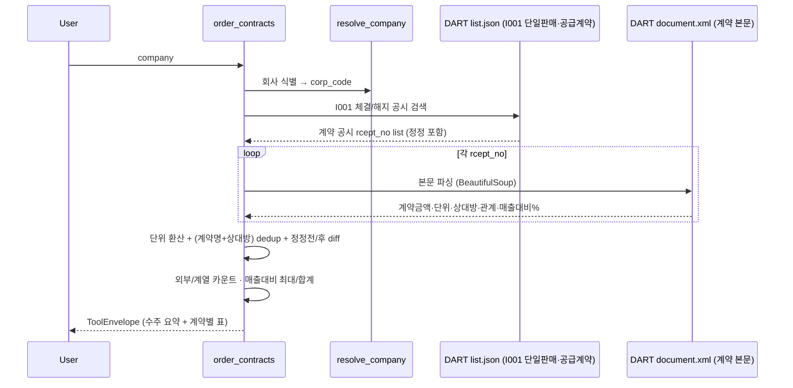

# order_contracts — 수주 추적

회사의 **수주·해지**(단일판매·공급계약체결/해지) 공시를 추적하는 data tool. 적자 디폴트인 코스닥 바이오/기술주에서 수주 = 미래 매출 가시성 시그널이라, 재무지표만으론 안 보이는 축을 채운다.

**단일판매·공급계약(체결/해지)의 단일 소스** (2026-06-14 일원화). 외부 수주 규모·**매출액 대비%**·최근 모멘텀, 그리고 **기재정정(변경계약) dedup + 증액/감액 diff**. 외부 수주와 계열 일감을 공시 '회사와의 관계' 필드로 구분(카운트). corporate_deals는 타법인주식(지분 인수/매각) 전담.

> **파싱만 — 추론 제외 (2026-06-14)**: 체결↔해지 매핑·순수주·계열일감 규모 같은 추론은 전 업종 662사 측정에서 부정확(매핑 26%, 관계 미기재 83%)해 **제거**했다. 공시에서 읽은 사실(체결·해지 파싱, 정정 dedup, 외부/계열 카운트)만 제공. 측정·결정 기록은 private storage.

## 무엇을 참고하고 무엇을 연산하나

| 참고 공시 항목 | 무엇을 연산·판단 |
|---|---|
| 단일판매·공급계약 본문의 **계약금액(원)** | 단위(원/천원/백만원) 환산 후 수주 규모. 외부(계열 제외) 합산 |
| **최근매출액 + 매출액 대비(%)** | 적자·소형 기업의 미래 매출 가시성 — 매출 대비 큰 단일 수주가 핵심 |
| **계약상대방 + 관계** | 외부 고객 수주 vs 계열·자회사 일감 구분 |
| **[기재정정]의 정정전/정정후** | 변경계약 증액/감액 diff — 수주가 커졌는지 줄었는지 |
| 계약명 + 상대방 (dedup 키) | 원본·정정본을 한 계약으로 묶음 (정정전 금액으로 원본 매칭) |

## dedup + diff (핵심 로직)

수주는 정정(변경계약)이 흔하다. 정정본 본문에 **정정전/정정후가 같이 있어** diff를 직접 추출한다.

- **계약 식별**: `(계약명 정규화 + 상대방)` 그룹
- **정정 체인**: 정정본의 *정정전 금액* = 이전 건 금액이면 같은 계약 체인으로 병합 → 최신본이 유효값
- **오묶음 방지**: 같은 키라도 금액 체인이 안 맞으면 별개 계약 (조선업처럼 상대방이 "유럽 소재 선사"로 익명·계약명이 "LNGC" 일반명인 경우)
- **해지 dedup**: 해지는 `correction_diff`(정정전 금액)가 없어 금액체인이 안 먹고, `(계약명+상대방)`
  키는 정정본이 상대방을 채우고 원본이 공란이면 키가 갈려 실패한다(쇼박스 실측: 원본 상대방='' vs
  정정본 '씬앤스튜디오' → 2건 오카운트). `_dedup_terminations`는 **`계약명+해지일자`** 안정키로 묶되,
  서로 다른 해지의 우연한 동명·동일자 over-merge를 막아 **체인에 기재정정본이 있을 때만** 병합한다.
  최신(정정)본이 유효값, 결측 필드는 이전본에서 상속. 검증: 쇼박스 2→1·삼성제약 단일해지 무영향 +
  합성 엣지(동명·다른일자 유지, 정정無 동명동일자 비병합). opm-tool-validation 스킬.

### 조건부 계약 · 금액이 처음 공개된 정정 (2026-11-15)

- **조건부 계약**: 거래소 서식 「2. 계약내역」의 `조건부 계약여부`가 「해당」이면 `is_conditional`·`confirmed_amount_won`(확정 계약금액 — 「-」는 빈칸, 「0」은 0)·`conditional_amount_won`(조건부 계약금액)을 싣는다. `contract_amount_won` 은 원문 총액 그대로다(조건부 금액을 빼지 않는다). 표의 계약금액 칸에 「(전액 조건부)」 또는 「(조건부 N억원)」을 붙이고, 요약의 `conditional_count`·`conditional_amount_won` 이 외부 수주 총액 중 조건부 몫을 따로 밝힌다. 조건부가 아니거나 그 칸이 없는 서식(유가증권 서식 등)은 세 칸이 없다.
- **금액이 처음 공개된 정정**: 정정 전 금액 칸이 「-」(공시유보로 비공개)였다가 정정 후에 금액이 적힌 정정은 증감이 아니다 — `correction_diff` 가 `{"amount_first_disclosed": true}` 만 주고 전후 금액·증감률을 싣지 않는다. 표의 정정 칸은 「금액 공개」.
- **정정 전후 금액 읽기**(2026-11-15 2차, 2026-08-10~11-13 정정 764건 실측): ① 정정 후 본문은 서식 1번 항목이 **마지막으로** 나오는 자리에서 시작한다 — 1번 항목 자체가 정정 대상이면 정정 표 안에 먼저 나오고(포스코퓨처엠 20261006800617: 21.2조로 줄인 정정이 40.0조로 나갔다), 제목에 「(자율공시)」가 붙은 코스닥 서식도 받는다(11건의 계약금액이 정정 전 값이었다). ② 정정 표의 두 수가 같은데 본문 금액이 다르면 두 수는 정정 전 칸의 확정 금액·총액이다 — 정정 후 값은 본문에서 얻고 `amount_after_from: "body"` 를 남긴다(55건이 「증감 없음」으로 나갔다). ③ 「계약금액 총액」 쌍이 있으면 확정 금액 쌍보다 먼저 쓴다(조건부 계약). ④ 첫 큰 수 앞에 계약금액 라벨이 없으면 금액 정정으로 읽지 않는다(대금지급 조건의 연도별 지급액을 전/후로 읽던 것). 고친 뒤: 증감 390 · 증감 없음 25 · 금액 처음 공개 6 · 금액 정정 아님 343.
- screener·원장이 수주 카드 값을 가져갈 때는 **그 접수번호의 행만** 쓴다. 같은 날 같은 계약의 정정이 하나로 묶여 그 공시가 목록에 없으면 값을 싣지 않는다 — 종전엔 첫 행으로 물러나 다른 계약의 금액이 붙었다(261115).
- **자릿수 구분이 깨진 금액**(「85,419,259,16」 같은 회사 오기)은 정정 전후 금액으로 읽지 않는다. 매출액 대비 전후는 그대로 싣는다.
- **「회사와의 관계」**: 같은 항목의 다음 줄(「- 회사와 최근 3년간 동종계약 이행여부」) 앞에서 끊는다.

## 단위 처리

본문 라벨의 단위 표기(`(원)`/`(천원)`/`(백만원)`)를 읽어 원으로 환산한다. 값 자릿수를 가정하지 않음(시장 실측: 대부분 `(원)`).

## Flow

## 어떻게 쓰나

자연어 예시:
- "에스티팜 수주 따낸 거 있어? 매출 대비 얼마나 커?"
- "계약 해지된 거 있어?" (체결·해지 모두 파싱, 해지는 `계약명+해지일자`로 dedup)
- "외부 고객 수주야 계열 일감이야?" (공시 '회사와의 관계' 필드로 외부/계열 카운트)

수주 시그널 요약(건수·외부/내부·외부 총액·매출 대비 최대/합계·정정 건수) + 계약별 표(금액·매출대비·외부여부·정정 diff).

## 함께 보면 좋은 기능

- [[corporate_deals]] — 타법인주식(지분 인수/매각) 거래. 공급계약은 이 tool로 일원화됨
- [[financial_metrics]] — 매출·수익성 (수주가 매출로 이어지는지)
- [[evidence]] — 공시 원문 확인

## 기술 상세

- 서비스: `open_proxy_mcp/services/order_contracts.py`
- 검색: I001 단일판매ㆍ공급계약 (일반+자율공시 모두 I001, 자회사 변형 포함 — 시장 실측 확인)
- 검증 표본·측정 기록: private storage

## 변경 이력
- 2026-11-15(3장): **계약기간·계약일자·공시유보를 읽는다.** `period_start`·`period_end`(「5. 계약기간 시작일 … 종료일 …」, 값이 「-」면 없음) · `contract_date`(「계약(수주)일자」) · `hold_reason`·`hold_until`(공시유보 사유·기한 — 칸이 비어 있으면 안 싣는다). 종전 정규식은 라벨을 「계약시작일」로 가정해 저장된 원문 1,347건 중 종료일 4건만 읽었다 — 고친 뒤 시작일 1,253 · 종료일 1,206 · 계약일자 1,313 · 유보 사유/기한 194(자율공시·유보 해제 정정 포함). 표에 「계약기간」 칸, 표 아래에 공시유보 안내 줄. **해지 사유**: 라벨 「해지 주요사유」와 60자를 넘는 문장을 못 읽어 해지 19건 중 6건만 읽혔다 → 19건 모두(표에 「해지 사유」 칸).

- 2026-11-15: **조건부 계약 표시**(`is_conditional`·`confirmed_amount_won`·`conditional_amount_won`, 요약 `conditional_count`·`conditional_amount_won`), **금액이 처음 공개된 정정은 증감으로 읽지 않는다**(`correction_diff.amount_first_disclosed`), 자릿수 구분이 깨진 금액은 정정 전후로 읽지 않는다, 「회사와의 관계」 칸에 다음 줄 문구가 딸려 나오던 것 수정. 원장의 2026-08-10 이후 수주 공시 원문 1,347건으로 전후 대조: 조건부 계약 16건(확정 0원·빈칸 10건) · 정정 764건 중 바뀐 것 7건(금액 처음 공개 6건 — 종전 「166억 → 1,660만 원, −99.9%」 1건·「±0%」 3건·증감 없음 2건, 깨진 금액 1건 — 종전 +948.1%) · 관계 칸 702건에서 뒤 문구가 빠졌고 외부/계열 판정은 1건이 계열로 바뀌었다(값이 길어 관계 칸을 못 읽던 「모회사(최대주주)의 최대주주」).

- 2026-10-18: 수주 공시 검색이 실패(013 이 아닌 DART 오류)했는데 0건이면 `status=no_filing` 대신 `error` — 0건이 「수주 없음」이 아니라 「모른다」다. 수주 공시는 찾았는데 본문을 하나도 받지 못했으면(DART 오류) `no_filing` 대신 `partial` — 경고에 「수주 공시 N건을 찾았으나 본문 N건을 DART 에서 받지 못해 …」.
