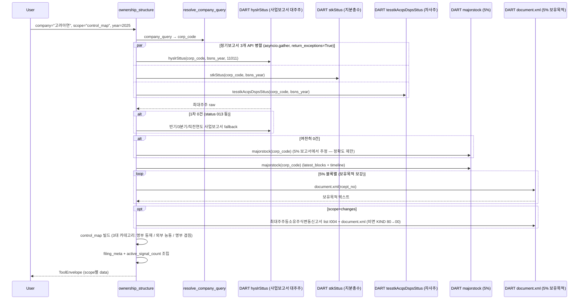

# ownership_structure

## 한 줄 요약
최대주주·특수관계인·5% 대량보유·자사주를 한 탭에서 보는 지분 구조 tool. 판의 구조(who holds what)를 그린다.

## 사용법
```
ownership_structure(
    company="고려아연",
    scope="control_map",
    year=2025,
)
```

자연어 예시:
- "고려아연 control map" → `scope="control_map"` (3대 카테고리: 명부 등재 / 외부 능동 / 수동)
- "삼성전자 5% 대량보유 타임라인" → `scope="blocks"` (최신 + 이력; 구 `timeline` scope 통합)
- "최대주주등소유주식변동신고서 (개인별 변동)" → `scope="changes"`
- "최대주주 바뀌었어? 양수도 계약·주식담보 걸려 있어?" → `scope="changes"` 의 `control_events`(최대주주변경 · 변경 수반 양수도·담보 계약 체결·해제)
- "최대주주 누구고 특수관계인 합쳐서 몇 %야?" → `scope="summary"` (특관 개별 내역은 `major_holders`)
- "국민연금이 5% 넘게 들고 있어?" → `scope="blocks"` (5% 대량보유 보고자·보유목적)
- "자사주 비율 얼마야?" → `scope="summary"` 의 자사주 snapshot (취득·소각 이벤트는 [[treasury_share]])

## 입력 인자
| 인자 | 타입 | 필수 | 설명 | 기본값 |
|---|---|---|---|---|
| company | str | yes | 회사명 / ticker / corp_code | - |
| scope | str | no | 5종 (아래 참조) | "summary" |
| year | int | no | 사업연도, 0이면 최신 | 0 |
| as_of_date | str | no | YYYYMMDD 기준일 — 5% 보고는 그 날까지 접수된 것만, 정기보고서 사업연도(`year` 를 안 주면)는 그 날까지 제출돼 있는 최신 사업보고서(결산월 기준) | "" |
| start_date / end_date | str | no | YYYYMMDD | "" |
| format | str | no | "md" / "json" | "md" |

scope:
- `summary`: 최대주주 + 특수관계인 + 자사주 + 5% signal count (기본)
- `major_holders`: 최대주주 + 특수관계인 상세
- `blocks`: 5% 대량보유 최신 N건 + 보고 이력 시계열 (보유목적 보강 포함; 옛 `timeline` 을 흡수)
- `control_map`: 3대 카테고리 (명부 등재 / 외부 능동 5% / 명부 겹침 5%)
- `changes`: 최대주주등소유주식변동신고서 (원문을 칸 머리 이름으로 — 개요·개인별 변동·총괄현황, 인적사항 제외, 아래 「변동신고서」) + 5% 대량보유 변동 + **최대주주변경 계열**(거래소 공시 다섯 서식, 아래 「최대주주변경 계열」)
- 폐지: `treasury`(자사주는 `treasury_share` tool) · `timeline`(`blocks` 에 통합). 넘기면 지원하지 않는 scope 로 돌아온다.

## 출력 schema (data dict)
```json
{
  "company_id": "...",
  "summary": {"top_holder": {...}, "related_total_pct": 28.5,
              "treasury_shares": 0, "treasury_pct": 0.0,
              "active_signal_count": 3},
  "major_holders": [{"name": "...", "relation": "...",
                     "ownership_pct": 19.5, "shares": 11_111}],
  "blocks": [{"reporter": "...", "ownership_pct": 5.1, "shares": N,
              "purpose": "경영참여", "report_date": "...",
              "rcept_no": "..."}],
  "treasury": {"issued_shares": N, "treasury_shares": N,
               "treasury_pct": 0.0,
               "basis": {"rcept_no": "...", "stlm_dt": "...", "bsns_year": "...",
                         "stock_class": "보통주", "common_only": true}},
  "share_basis": {"issued_shares": N, "rcept_no": "...", "stlm_dt": "...",
                  "comparison": "same|differs|unit_changed|past_year|mixed_class|listed_unavailable",
                  "listed": {"shares": N, "price_dd": "YYYYMMDD"},
                  "diff_shares": N, "diff_pct": 0.0},
  "control_map": {"core_holder_block": {...}, "treasury_block": {...},
                  "active_non_overlap_blocks": [...],
                  "overlap_blocks": [...], "flags": {...},
                  "observations": [...]},
  "timeline": [...],
  "change_filings": [...],
  "no_filing": false,
  "filing_count": N,
  "usage": {"dart_api_calls": N, "mcp_tool_calls": 1}
}
```

핵심 필드:
- `warnings`(유의사항): 본인 행보다 지분이 큰 묶음 안 보유자가 있으면 「최대주주(본인) X a% — 묶음 안 최대 보유자 Y(관계) b%, 묶음 합계 c%」 한 줄 — `top_holder` 하나만 읽고 최대주주 지분으로 단정하지 않게
- `summary.top_holder`: 최대주주 한 줄 — 공시 `relate` 칸이 「본인」·「최대주주 본인」·「최대주주」인 행(여럿이면 그중 지분 최대), 그런 행이 없을 때만 지분 최대 행(5% 보고 추정 경로 등). 명부(`major_holders`)의 표시 순서는 지분율 내림차순 그대로
- `flags`: `registry_majority` (50%+), `registry_over_30pct`, `treasury_over_5pct`
- `block_camps`: 5% 보고 합산 — `camps[]`(겹치는 보고자 편별 `net_pct`) · `overlap_found` · `net_total_pct` · `report_bases[]`(기준 주식총수 = 보유주식수÷지분율 묶음 — `implied_total_shares`·`reporters`·`report_dates`·`rcept_nos`) · `over_100_note`(100% 초과 때 찾은 까닭만; 겹침이 없으면 겹침이라 하지 않는다)
- `share_basis`(summary): 100% 분해 표의 **분모**(정기보고서 보통주 발행주식총수)가 어느 보고서·어느 결산기준일 값인지(`rcept_no`·`stlm_dt`·`bsns_year`·`stock_class`)와 최신 상장주식수(KRX 일별 시세 `price_latest` 보통주 코드 한 줄, DART·KRX 0콜)와의 대조. `comparison` — `same`(같음: 표는 그대로, 분모 출처 줄만) · `differs`(조금 다름, |`diff_pct`| ≤ 20%: 두 값·`diff_shares`(= 보고서 − 상장)·`diff_pct`(상장주식수 대비)를 적고 「지분율(최신 상장주식수 기준)」 칸을 덧붙임. 보유주식수·자사주는 보고서 기준일 수치 그대로라 그 뒤 소각·증자는 반영되지 않는다. 명부+자사주가 상장주식수를 넘으면 칸을 붙이지 않고 그 사실을 적는다) · `unit_changed`(크게 다름, |`diff_pct`| > 20%: 액면분할·병합(DATA-PX3) 등으로 주식 수 단위가 달라졌을 수 있다 — 보유주식수는 그 전 단위, 상장주식수는 그 뒤 단위라 나누면 터무니없는 값이 나오므로 두 값과 차이만 적고 상장주식수 기준 지분율은 계산하지 않음) · `past_year`(`year`·`as_of_date` 로 과거 사업연도를 물음: 오늘의 상장주식수와 시점이 달라 비교하지 않고 분모 출처 줄만) · `mixed_class`(합계 행에서 우선주만 뺐는데 다른 종류 행이 있어 보통주만이라 장담 못 함 → 보통주 상장주식수와 섞어 비교하지 않음) · `listed_unavailable`(상장주식수를 못 읽음 → 비교 생략)
- `active_signal_count`: 5% 대량보유 + 경영참여 목적 신호 수 (분쟁 조기 경보)
- `change_filings[]`: `status`(parsed·partial·unrecognized) · `reports[]`(보고 묶음 — `group` 「변경전/변경후 최대주주등」, `overview.before/after/delta` 의 `shares`·`pct`·`filed_on`, `individual_changes[]` 의 `name`·`relation`·`holder_kind`·`changes`, `total_holders[]` 의 `name`·`relation`·`holder_kind`·`common_*`·`total_*`, `total`) · `unread`(못 읽은 표 번호·절 제목) · `notes` · `profile_omitted` · `source`(dart_api·kind_scraping)
- `control_events[]`: `kind`(change·transfer_contract·pledge_contract·pledge_release·transfer_release) · `fields`(서식별 칸, **원문 글자 그대로**) · `notes` · `related` · `rows`(찾은 줄 원문) · `holders`(변경 전후 보유 현황 표) · `pledges`·`pledge_conditions` · `comparison`(해소 전후) · `amendment`(정정이면 정정 비교표) · `profile_omitted`

## Data sources
- **DART API**: 사업보고서 (대주주 `hyslrSttus`, 지분 `stkSttus`, 자사주 `tesstkAcqsDspsSttus`), `majorstock` (5% 대량보유 목록), `document.xml` (5% 보유목적 보강)
- **운영 DB `price_latest`**(KRX 일별 시세 최신 한 줄): summary 100% 분해 표의 분모와 대조하는 최신 상장주식수만(DART·KRX 호출 0, DB 한 줄 읽기). 못 읽어도 표는 그대로.
- **KIND**: 미사용 (false match 위험) — 단, `changes` 의 변동신고서 원문이 DART 에서 빌 때만 폴백(같은 서식, 2026-10-18 실측)
- 외부 호출: scope별 3-9회, 대주주 reprt 폴백·5% 블록 문서 보강 시 최대 12회 (asyncio.gather 병렬). `as_of_date` 만 주고 `year` 를 안 주면 company.json(회사 개황, 결산월 확인) +1콜(프로세스 캐시 1시간)

## Flow



호출 횟수: scope별 3-9회 (summary 9), 대주주 reprt 폴백 + 5% 블록 문서 보강 시 최대 12회.
`changes` 는 최대주주변경 계열에 목록 I001(구간 페이지 수) + 원문(최근 8건까지, 캐시면 0)을 더한다 — 변동신고서 조회와 동시에 돈다.

## 최대주주변경 계열 (`changes` 의 `control_events`, 261018)

`최대주주등소유주식변동신고서`(I004)는 최대주주가 **그대로인 채** 지분이 움직인 것이다. 최대주주가 **바뀐** 사실과 바뀌게 될 계약은
거래소 공시(I001) 다섯 서식에만 있다 — 이름이 닮아 겹치는 줄 알기 쉽다. 스크리너가 최대주주변경 카드를 이 도구로 안내하는데,
그동안 받는 쪽이 이 공시를 읽지 않아 안내를 따라가면 빈손이었다.

| kind | 공시 | 핵심 칸(`fields`) |
|---|---|---|
| `change` | 최대주주변경 | 변경 전·후 최대주주·주식수·비율 · 사유 · 지분인수 목적 · 인수자금 · 임원 선·해임 계획 · 변경일·확인일 |
| `transfer_contract` | 최대주주 변경을 수반하는 주식양수도 계약 체결 | 양도인·양수인(회사와의 관계) · 주식수 · 1주당 가액 · 대금 · 지급조건 · 의무보유 · 변경예정 최대주주·예정일·예정 비율 · 계약일 |
| `pledge_contract` | … 주식 담보제공 계약 체결 | 담보제공자 · 공시일 현재·**담보권 전부 실행시** 주식수·지분율 · 차입·담보설정 총액 · 누적 계약·주식 · 계약일 (+ `pledges` 채권자별 표 · `pledge_conditions` 실행 조건) |
| `pledge_release` | … 주식 담보제공 계약 해제ㆍ취소 등 | 채권자 · 담보제공자 · 채무자 · 해소 사유 · 해소 주식수·금액·건수 · 해소일 (+ `comparison` 해소 전후) |
| `transfer_release` | … 주식 양수도 계약 해제ㆍ취소 등 | 해소 종류·사유 · 당사자 · 주식수·가액·대금 · 체결일·해소일 |

- 합친 칸을 펼친 격자로 읽어 이름 경로(`1. 변경내용 › 변경전 › 소유비율(%)`)로 칸을 고른다(`services/control_change.py`). 모델 0.
- **인적사항 표는 싣지 않는다** — 담보 서식의 채무자 인적사항, 최대주주변경의 새 최대주주 기본정보처럼 머리에 주소·생년월일 칸이 있는 표. 당사자가 개인일 수 있다. `profile_omitted` 만 남긴다.
- 정정 공시면 정정 비교표(`amendment`)를 붙인다.

## 변동신고서 (`changes` 의 `change_filings`, 261018 다시 씀)

원문 서식(2019~2026 동일, DART document.xml 과 KIND 가 같다)은 보고 묶음 하나가 표 셋이다 —
**보고의 개요**(`보고일자 | 소유주식 › 구분·주식수·비율`, 줄은 직전보고서제출일·이번보고서제출일·증감 × 주식 종류),
**개인별 세부변동사항**(변동 있는 사람마다 표 하나: 인적사항 세 줄 + `변경일 | 변경원인 | 주식의 종류 | 변경전·증감·변경후주식수 | 비고`),
**총괄현황**(머리 두 줄 — `성명 | 생년월일 또는 사업자등록번호 | 성별 | 국내외 구분 | 국적 | 관계 | 겸직 | 보통주식·종류주식·증권예탁증권·합계 › 주식수·비율`).
「(최대주주변경시)」 서식은 `[변경전 최대주주등]`·`[변경후 최대주주등]` 두 묶음이 한 원문에 있다(변경후 묶음은 직전 칸이 `-`).

- 합친 칸을 펼친 격자(`doc_tables.table_grids`)에서 **머리 이름**으로 칸을 고른다. 개요 값은 합계 줄(없으면 보통주식 줄).
- 🔴 **인적사항은 허용 목록 칸만** — 성명·관계·국내외 구분. 생년월일·사업자등록번호·성별·국적·주소는 어느 표에서도 싣지 않고 `profile_omitted` 만.
- 못 알아본 표 → `unread`(원문 몇 번째 표 · 그 위 절 제목) + 경고, 개요부터 못 찾으면 `status="unrecognized"`. 숫자 꼴이 아닌 칸은 None(화면 `-`) — 0 으로 메우지 않는다.
- 검산: 개요 이번 합계 ≠ 총괄현황 합계면 `notes` 「확인 필요」.
- 260419~261018 의 위치 파서는 이 서식을 한 번도 맞게 읽지 못했다 — 보고일자를 주식수로(`직전: 20,260,921주`), 「이번」을 「금번」으로만 찾아 0주,
  총괄현황 머리 둘째 줄을 주주로, **개인 주주의 생년월일 칸 값을 보유주식 자리로** 냈다. 실측(2026-10-18, 원문 17건: STX 3 · 최근 9개사 · GS 2019/2021/2023/2024 · KIND 폴백 1):
  고치기 전 맞게 읽힘 0/17 · 생년월일 노출 14건 347줄 → 고친 뒤 17/17 · 원문 민감 칸 값 405개 중 출력 0 · 개요=총괄=주주별 합 17/17.

## 파싱 전략
- 사업보고서 기반 DART 공식 API 우선.
- 5% 대량보유 목적은 최신 원문(document.xml)으로 보강.
- KIND 비사용 (false match 위험). partial match 자동 확정 안 함.
- `stock_knd` 변형 positive matching + 3-tier fallback (보통주/우선주 자사주 변형).
  - 판정선: 공백·개행을 지운 뒤 **「없는」이 있으면 제외**, **「보통」 또는 「있는」이 있으면 채택**,
    **빈 값은 보통주로 간주**(빈 값으로 보고하는 회사가 있다). 표기가 「보통주」·「보통주식」·
    「의결권 있는 주식」·「의결권\n있는 주식」처럼 갈려 문자열 하나로는 거를 수 없다.
    우선주를 빼는 negative matching 은 변형을 놓친다.
- **260714 현재 지분 스냅샷 창 교정**: `latest_blocks`(보고자별 최신 1건 = 현재 지분)에 `timeline`과 동일한 360일 기간창을 씌워, 지분 변동이 없어 최근 공시가 없는 **안정적 지배주주가 조용히 누락**됐다(실측 16사 중 6사: SK·현대차 국민연금 7~8%, CJ 국민연금 13%로 블록 통째 빔, 네이버 BlackRock 6% 등 ≥5% 7건). → `latest_blocks`는 하한(360일) 제거 + 상한(end)만 유지(as-of look-ahead 방지) + **현재보유 ≥5% 필터**로 5% 이탈/청산 보고만 제외. 이탈 '이벤트'는 `timeline`에 유지. 검증: ≥5% 복구 7·이탈 정상제거 유지·과대제거 0(무회귀).
- 알려진 한계:
  - 대주주명 정규화 불완전 시 control_map이 찢어질 수 있음 (관찰 포인트로 표시).
  - 사업보고서 미제출(KOSDAQ 자율공시 일부) 시 `no_filing`.
- regression 0 검증: 200기업 audit `ownership_structure.summary` 90.8% exact (178/196), partial 7.7% (15건). stockknd fix 후 partial 17건 → 0.

## 관련 공시 (rules/disclosures/)
- [[대량보유상황보고서]] — 5% 변동, 보유목적/보유량 (blocks scope)
- [[임원·주요주주특정증권등소유상황보고서]] — 임원/10%+ 주주 보유 변동
- [[사업보고서]] — 정기, 대주주/지분/자사주 종합
- [[최대주주등소유주식변동신고서]] — 원문(DART·KIND 같은 서식), 보고 묶음별 개요·개인별 변동·총괄현황 (changes scope)

## 관련 개념 (rules/concepts/)
- [[최대주주]] — 본인+특관인 합산 최다 보유자
- [[특수관계인]] — 최대주주와 혈연/계열 연결된 자
- [[대주주]] — 1%+ 또는 시총 10억+ 보유자
- [[동일인]] — 재벌 그룹 정점 (공정위 지정)
- [[5%-대량보유]] — 5% 이상 보유 시 보유목적 공시 의무
- [[자사주]] — 의결권 없는 자기주식
- [[소액주주]] — 유통주식 대부분 보유
- [[지분구조]] — 최대주주/기관/자사주/소액주주 분포

## 관련 결정 (decisions/)
- stkrt vs ctr_stkrt(비교 분석문, 260831 삭제) — DART 대량보유 API: stkrt(합산) vs ctr_stkrt(주요계약) 차이
- cross-domain 체이닝(v1 설계문, 260831 삭제) — OWN → AGM/PRX 체이닝

## 관련 audit/fix (private storage `wiki-private/architecture/audits/`)
- 260429_0912_audit_parsing-200기업-v2-no_filing — ownership_structure 90.8% exact
- 260427 stockKnd 변형 positive matching(17건 partial → 0) · 260429 asyncio.gather 병렬화(3x) — 분석문은 storage `wiki-private/archive/opm-decisions/` 이관

## 알려진 issue + TODO
- 5% 보유목적이 `불명`으로 남는 경우 (원문 텍스트 추출 실패) — `requires_review`로 표시.
- 보고자명 정규화 불완전 케이스 control_map 분리. 동일인 매트릭스 도입 검토 (TODO).
- 변동신고서 칸 이름을 못 알아본 표는 0 으로 채우지 않고 `unread`(표 번호·절 제목) + 경고. 정정 공시의 정정 비교표는 아직 붙이지 않는다(정정본 값만).

## 변경 이력
- 2026-04-18: ownership_structure tool 검증 + release_v2 go
- 2026-04-19: 3개 기업 (삼성전자 / 고려아연 / KT&G) summary 통과
- 2026-04-27: stockknd fix (17건 partial → 0)
- 2026-04-29: speed optimization 3x (asyncio.gather), 200기업 audit 90.8% exact
- 2026-05-01: tool wiki 페이지 작성
- 2026-10-18: `changes` 에 **최대주주변경 계열**(`control_events`) — 최대주주변경 · 변경 수반 주식양수도·담보 계약 체결·해제 다섯 서식을 원문 칸 그대로(인적사항 표 제외). 스크리너 최대주주변경 카드의 안내가 빈손이던 것.
- 2026-10-18: 변동신고서(`change_filings`)를 칸 머리 이름으로 다시 씀 — 보고 묶음(`reports`)별 개요·개인별 변동·총괄현황, 인적사항(생년월일 등) 제외, 못 읽은 표는 `unread`. 위치 파서가 보고일자를 주식수로, 개인 생년월일을 보유주식 자리로 내던 것(도입 때부터).
- 2026-10-18: `control_events` md 의 정정 줄에서 항목 이름의 원문 줄바꿈을 ` / ` 로(줄이 깨지던 것). json 은 그대로.
- 2026-10-18: 5% 블록 「100% 초과」 유의사항이 찾은 까닭만 말함(`block_camps.over_100_note`) — 겹침은 겹치는 보고자를 찾았을 때만, 아니면 보고별 기준 주식총수 묶음(`report_bases`). 같은 날 두 번 낸 5% 보고는 접수번호가 늦은 것을 최신으로(두 경로). STX 「199.86% … 한 번만 세면 199.86%」 — 신한은행 옛 5.81% 가 남고, 겹침이 없는데 겹침이라 했던 것.
- 2026-10-22: summary 100% 분해 표에 **분모 출처**(어느 정기보고서·접수번호·결산기준일)를 적고, 최신 상장주식수(KRX `price_latest`)와 다르면 두 값과 차이·「지분율(최신 상장주식수 기준)」 칸을 덧붙임(`share_basis`). 삼성전자 발행주식총수 5,919,637,922 대 상장주식수 5,846,278,608(차이 73,359,314)이 표에 아무 말 없이 갈려 있던 것. 분모가 보통주만이라 장담 못 하면 섞어 비교하지 않음. 차이가 20%를 넘으면(분할·병합 등 주식 수 단위 변화 가능, `comparison=unit_changed`) 상장주식수 기준 지분율 칸은 붙이지 않고 두 값과 차이만 적으며, 과거 사업연도 조회(`comparison=past_year`)는 오늘의 상장주식수와 비교하지 않는다. 새 키만 더하고 기존 키는 그대로.
- 2026-10-23: 최대주주(본인)보다 지분이 큰 묶음 안 보유자가 있으면 `warnings` 에 「최대주주(본인) X a% — 묶음 안 최대 보유자 Y(관계) b%, 묶음 합계 c%」 한 줄(`_top_holder_gap_note`; 기존 키는 그대로). 명부가 비어 5% 보고에서 최대주주를 추정하는 경로(`_fetch_largest_shareholder_from_blocks`)에도 같은 기준일 거름(DATA-PIT9).
- 2026-10-23: 과거 시점(`as_of_date`)이 그 날의 정보만 쓰게 — ① 5% 보고는 보고자별 「최신」을 기준일까지 접수된 것 가운데서 고름(종전엔 전체에서 먼저 골라 기준일 뒤에 다시 보고한 보유자가 목록에서 사라졌다: 고려아연 2026-01-31 시점 영풍·국민연금공단 등이 빠지고 보유 목적도 기준일 뒤 원문에서 읽을 수 있었음) ② `year` 를 안 주면 사업연도를 `as_of_date.year - 1` 로 못박지 않고 결산월을 아는 공시 시점(`report_calendar.pit_annual` — 12월 결산은 1~3월 시점이 전전년, 3월 결산은 7월 이후 그해)으로, 과거 시점에는 오늘의 상장주식수와 맞대지 않음(`share_basis.comparison=past_year`) ③ `summary.top_holder` 를 지분율 첫 행이 아니라 공시가 「본인」으로 적은 행으로(한미사이언스 2025: 본인 송영숙 3.38% 인데 임원 신동국 16.43% 가 나가던 것; `proxy_contest` 의 `top_holder` 도 같은 함수를 쓴다). `as_of_date`·`end_date` 둘 다 없는 호출의 5% 블록·사업연도·상장주식수 대조는 그대로(`end_date` 만 줘도 그 날까지 접수된 보고에서 보고자별 최신을 고름), `top_holder` 는 본인이 지분 최대가 아닌 회사에서만 바뀐다. (DATA-PIT8·PIT9)
