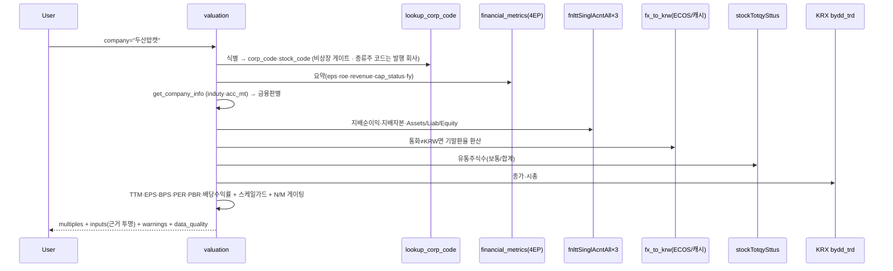

# price_multiple_data

## 이름 (260824 개명)
`valuation` → **`price_multiple_data`**. 「밸류에이션」이 배수(PER·PBR)와 규모(주가·시총)를 한 이름
아래 묶고 있었는데, 실제로는 서로 다른 질문이고 파라미터가 서로 다투었다. 규모·거래 쪽은
[[trading_data]] 로 갈랐다. 옛 이름의 사용통계는 `usage_tracker.TOOL_ALIASES` 가 접어 한 계열로 잇는다.

전제 개념: [[PER-PBR]](산식 요약) · [[시가총액]](분자, 단일 소스 `_market_for`) · [[연결-별도]](분모 = 지배주주 귀속) · [[단위-표기-규약]].

## 한 줄 요약
DART(공시) + KRX(공식시세) 기반 **상대가치 배수** — PER(FY0·TTM) · PBR(MRQ) · 배당수익률. 지배주주
귀속 기준, 비KRW 기능통화 자동 환산(ECOS), 실시간 스케일가드 + N/M 게이팅 + 식별 status 4단.
설계·검증 근거 = 방법론 스펙(private wiki).

## 사용법
```
price_multiple_data(company="두산밥캣")                    # firm: 기업 심층 (실시간)
price_multiple_data(scope="market")                        # 시장 전체(KOSPI·KOSDAQ) + 주간 히스토리
price_multiple_data(scope="sector", company="두산밥캣")    # 산업별 표 + 기업 vs 소속 섹터 비교 + 소속 섹터 시계열(연말 요약+전체 월별)
price_multiple_data(scope="firm_history", company="삼성전자")  # 종목 PER/PBR 시계열 — FY0·TTM·MRQ (주간 곡선 + 월말 요약)
price_multiple_data(scope="sector", scheme="중분류") # 업종 중분류 28 — 트레일링 옆에 선행 PER·PBR
```
자연어 예시:
- "삼성전자 밸류에이션" → firm: PER 46.9(FY0)/21.6(TTM) · PBR 4.33 · 배당수익률 0.54%
- "두산밥캣 PBR" → USD 재무 자동 KRW 환산(ECOS 1,434.9) → PBR 0.86
- "코스피 지금 싸?" → market: KOSPI PER 20.4(TTM)·PBR 2.23 + 주간 추이
- "반도체 업종 밸류" → sector: KSIC 섹터별 PER/PBR 표
- "두산밥캣 섹터 평균 대비 싸? 비싸?" → sector + company: 기업 vs 소속 섹터 비교 + 섹터 시계열
- "배당수익률 얼마?" → firm: 현재가 기준(시장·섹터 집계 배당수익률은 market/sector)
- "업종별 선행 PER" → sector(`대분류`·`중분류`): 선행 PER·PBR 칸 + 종목수 옆 괄호(추정 종목 수)

### 과거 시점 `as_of` (260907)
`as_of="20251231"`(또는 `2025-12-31`). `scope=firm` 이면 실시간 계산 대신 `firm_history` 의 **최근 3년 주간 곡선**(krx_weekly × DART 재무 PIT)에서
기준일 이하 가장 최근 점의 PER(FY0·TTM)·PBR(FY0·MRQ)·시총을 준다 — 배당수익률은 과거 시점 미제공.
그 주에 곡선 점이 없으면(그 시점 재무 칸이 비었다 — 사업보고서·분기보고서 미제출 등) 앞선 칸(1년 안)으로 센 대체 점(`firm_history` 의
`data.series_gap_fill`)으로 답하고 `data.basis` 와 「기준 분기 늦음」 경고로 밝힌다(261019 — 업종 비교 기업 행·「주간」 항목과 같은 규칙).
답한 점이 기준일(그 종목 마지막 시세 날을 넘으면 그 날)보다 2주 넘게 이르면 그렇다고 적는다.
기준일이 곡선 하한(`data.weekly_from`, 저장된 최신 주의 달력 3년 전)보다 이르면 가까운 옛 점으로 답하지 않고
「주간 시세는 최근 3년까지 제공(연말 값은 전체 기간)」 안내를 준다(`no_data`) — 연말 값은 `firm_history` 의 `history`(연말 PIT 밴드). `market`·`sector` 는
기준일 이하 스냅샷으로 표를 그린다. 형제 도구 `trading_data` 의 `as_of` 와 같은 뜻. 비우면 종전과 같이 최신.
달력에 없는 날짜(`20260231` 등)는 거부한다(260918 — 자릿수만 보던 때는 선행 조회가 DB 에서 실패했다).

### 3년 이전 곡선 — 콜드 서빙 (261019)
주간 시세 저장분은 3년 + 연말 행만 갖는다. 그 이전 주간 곡선은 보관본(DB 밖 서빙본)에서 이어 계산한다(형제 도구 [[trading_data]] 「3년 이전은 보관본에서」와 같은 이음매).
`firm_history` 의 `series` 가 재무가 공시된 주부터(FY2018 연간 재무가 있는 종목은 2019-04~, 없는 종목은 2019년 1분기 재무가 공시된 2019-05~ —
FY2018 연간 재무 공백은 아래 「옛 계정 분류체계」 참고) 이어지고 `data.weekly_from` = 보관본 시작(20151230)·`data.cold_until` = 이음매다.
과거 시점(`as_of`)도 그 곡선으로 답한다(예: `as_of=20210630` → 20210625 점). 그보다 이르면 「곡선의 첫 점은 …」과 까닭(그 시점 공시 재무가 있어야 점이 생긴다)을,
주간 시세 시작(2015-12-30)보다 이르면 범위 밖 안내를 준다(`no_data`). 꺼져 있으면 위 「과거 시점 `as_of`」의 종전 3년 안내 그대로다.
켜져 있는데 이번에 보관본을 못 읽었으면(일시 실패) 곡선 응답에는 일시 안내 한 줄이 더 붙고, DB 주간 구간 이전 기준일의 과거 시점은 「범위 밖」이 아니라
같은 일시 안내로 답한다(`no_data` — 잠시 뒤 다시 부르면 답한다). 연말 밴드(`history` 연말 항목)·「주간」 최근 16주 항목·월말 요약은 그대로다.
업종 비교(`scope=sector` + `company`)의 기업 행도 같다 — 기준일(그 날 이하 스냅샷 날짜)이 3년 하한 이전이면 보관본의 같은 주 행 시총으로 센다
(그 날 이하 가장 늦은 행, 없으면 그 날 뒤 가장 이른 행 — DB 와 같은 순서. 예: `as_of=20210630` → 20210625 스냅샷의 기업 PER(TTM)·PBR(MRQ)).
DB 에 그 주 행(연말 행 등)이 있으면 보관본을 보지 않는다. 못 찾으면 까닭을 가른다 — 보관본까지 봤는데 없으면 종전 「그 주에 시세가 없다(상장 전·…)」,
하한 이전인데 꺼져 있으면 「주간 시세 보존 구간 밖」, 켜져 있는데 못 읽었으면 일시 안내.

## 입력 인자
| 인자 | 타입 | 필수 | 설명 | 기본값 |
|---|---|---|---|---|
| company | str | firm·firm_history는 필수 | 회사명 / ticker(6자리) / corp_code. sector에선 선택(소속 섹터 비교) | "" |
| scope | str | no | `firm`(심층·실시간) / `market` / `sector` / `firm_history`(주간 곡선 + 월말 요약, DB 계산) / `explain`(수치 근거 — company 지정 시 실제 값 대입 계산 과정, 미지정 시 방법론·기준·출처 전문) | "firm" |
| scheme | str | no | sector 집계 축 — `중분류`(업종 중분류 28) / `대분류`(업종 대분류 10) / `ksic`(2026-08-21 집계에서 멈춤 — 아래 「KSIC 축」). 확정 배당수익률은 `대분류` 에만, 선행 PER·PBR·배당수익률은 `대분류`·`중분류` 에 붙는다(KSIC 없음). 옛 값(`wics_industry`·`wics_sector`)도 받는다 | "중분류" |
| format | str | no | "md" / "json" | "md" |

## scope 라우팅 — 기능 → 데이터 소스 (DB-first)

| scope | 소스 | 갱신 | 내용 |
|---|---|---|---|
| `firm` | 실시간 DART 재무 × 일별 시세 저장분(`price_latest`) 최신 시세 | 매 호출(재무) + 일별(시세) | EPS·BPS·배당·경고·FX·스케일가드 — 정밀 심층 |
| `market` | `mkt_val_history` (`sector='_ALL'` 행만) **+ `div_yield_hist`(확정 배당) + `opm_val_fwd`(선행 PER·PBR·배당)** | 주간 스냅샷(cron) + 과거 76개월 백필 · 배당 확정은 **연 1회**(4월) · 선행은 주 1회 추정 | KOSPI·KOSDAQ 시총가중 PER/PBR + **선행 PER·PBR** + **배당수익률(확정·선행 × all·payers)** + 히스토리 + 선행 추이 |
| `sector` | `mkt_val_history` (`sector != '_ALL'` 행) (+ company 지정 시 기업 배수: 그 날 주간 시세(없으면 일별 · 3년 하한 이전 주는 보관본 — 아래 「3년 이전 곡선」) 시총 × 시점별 재무를 **읽을 때 계산** — 261018 종목별 스냅샷 표 폐기) · `scheme='wics_sector'` 일 때 **확정 배당 추가** · WICS 두 층에 **선행(`opm_val_fwd`) 추가** | 주간 스냅샷(cron) + 과거 76개월 백필 | KSIC 하이브리드 섹터별 + 기업 vs 섹터 + **소속 섹터 시계열**(company 지정 시). 확정 배당수익률은 **WICS 대분류에만**(집계 버킷이 그 축). 선행 PER·PBR·배당은 WICS 대분류·하위업종, KSIC 에는 없다 |
| `firm_history` | `krx_weekly`(주간 시총) × `mkt_finstat_y`(연간 FY0) × `mkt_finstat_q`(분기 TTM/MRQ) (+krx_stock_flags 경고) | compute-on-query(저장 X) | 종목 PER/PBR 시계열 — **FY0·TTM·MRQ 세 기준**. 차트=주간 곡선(`data.series`, 하한 `data.weekly_from` = DB 에 실제로 남은 주간 구간(최근 3년)의 시작 — 그 이전은 연말 밴드. 콜드 서빙이 켜져 있으면 하한은 보관본 시작(20151230)이고 이음매는 `data.cold_until` — 위 「3년 이전 곡선」. 끝점은 일별 최신 거래일 — 이번 주면 `data.series_daily_end`), 텍스트=최근 12개월 월말(`data.summary`, ▲분기공시 마커) + 연말 밴드(장기). TTM=최근4분기 지배순이익(2020~), MRQ=최근분기 지배자본. 시총 기반이라 수정주가 조정 불변. 곡선은 그 시점 칸만 쓴다 — 칸이 다 비어 점을 못 만든 시세 주는 앞선 칸(1년 안)으로 센 대체 점을 곡선 밖 `data.series_gap_fill`(점마다 `basis`)에 싣고 경고 한 줄, 곡선 끝 뒤에도 시세 행이 있으면 `data.price_rows_end`(261019) |
| `explain` | firm 재계산(company 시) / 정적 텍스트 | — | **수치 근거** — "이 PER 어떻게 나온 거야?"에 계산 과정(실제 값 대입)·기준·출처·주기로 답변. 주가 인풋 줄의 출처는 `price_source` 대로(저장분 서빙 / 저장분에서 받지 못해 KRX 직접 조회), 주가를 못 받았으면 「미확보」. DPS 칸은 `dps_fetch_failed` 로 무배당(「없음(무배당 또는 미공시)」)과 조회 실패(「미확인」)를 가른다 |

### 배당수익률 (260831 추가)

시장·산업 표의 배당수익률은 **PER·PBR 과 출처 표도 기준일도 모집단도 다르다.** 한 표에
놓이지만 같은 기준으로 잰 값이 아니다 — 그래서 표 아래에 셋(주간 스냅샷·확정 사업연도·추정 as_of)을
따로 적는다.

| | 확정 | 선행 |
|---|---|---|
| 표 | `div_yield_hist` | `opm_val_fwd`(260918~, 선행 배수와 같은 표 · 종전 `fwd_agg`) |
| DPS | 12월결산 확정 | 애널리스트 추정 |
| 분모 시총 | 그 사업연도 **12월 마지막 주** | 추정 스냅샷의 `price_dd` |
| 모집단 | 그 시점 상장 보통주 전체 | 추정이 있는 종목만(`covered`) |
| 갱신 | 연 1회 (`run_div_hist_annual.sh`, 4월) | 추정 주 1회(토) → 다음 날 아침 집계(`fwd_val_weekly.py`) |

- **분모를 두 벌 낸다** — `all`(무배당·DPS미확정 포함, 본값) · `payers`(배당주만). 표기는 `1.60 (1.89)`.
  🔴 **코스닥을 `all` 한 값으로만 내면 왜곡이다.** `all`→`payers` 에서 값이 두 배가 된다(FY2023 −59.7%,
  코스피는 −15.5~−20.8%). 낮은 것은 사실이나 **눌림의 절반은 배당력이 아니라 구성 차이**다.
- **PER 과 게이팅이 다르다** — 적자면 PER 은 안 나오지만 배당수익률은 배당이 있으면 값이 난다.
- **fail-open** — 배당 조회가 실패해도 PER·PBR 표는 그대로 낸다. 칸만 비고 각주에 이유를 남긴다.
- 소규모 섹터를 합치지 않는다. `n_total` 을 남겨 읽는 쪽이 판단한다.

### KSIC 축 (`scheme="ksic"`) — 2026-08-21 집계에서 멈춤
2026-08-23 결정(커밋 7731cc20 — 섹터 집계 기준 축을 업종분류로, KSIC 는 기업 분류 용도로만)으로 업종 배수·시총 집계의 기준 축을 업종분류로 옮기고
KSIC 섹터 집계 저장을 멈췄다(과거 행은 보존). 축 자체는 열려 있어 `scheme="ksic"` 은 **20260821 표**를 낸다. 261019 부터 이 축의 최신 스냅샷이
시장 전체 스냅샷보다 이르면 응답이 그렇다고 밝힌다 — 마크다운 맨 위 「⚠ 이 축의 마지막 집계는 …」, 경고 한 줄, `data.stale`
(`axis_as_of`·`market_as_of`·`reason` = `ksic_aggregation_frozen` / 다른 축이면 `axis_not_updated`). 과거 기준일(`as_of`)에서는 KSIC 축만 본다
(업종분류 축은 2026-08-21 전까지 월말 한 점씩이라 — 시장 전체는 2026-07 부터 주간 — 그 사이 기준일에서 시장보다 이른 것이 설계대로다). 집계를 다시 돌릴지는 위 결정을 바꾸는 일이라 사용자 결정 사항이다
(배치 `market_val_weekly.py` 는 KSIC 섹터 버킷을 메모리에서 이미 계산한다 — 저장만 멈춘 상태, 주 약 97행).

### 선행 PER·PBR (260918 추가)

시장·산업 표에 **애널리스트 추정 기반 선행 PER·PBR** 을 트레일링 옆에 싣는다. 산업은 `대분류`(10)와
`중분류`(28) 둘 다. KSIC 에는 선행 집계가 없어 안 붙인다.

| | 트레일링 | 선행 |
|---|---|---|
| 표 | `opm_val_market` | `opm_val_fwd` |
| 분모 | 확정 지배순이익·지배자본(FY0·TTM·MRQ) | 추정 지배순이익·자기자본 — 종목마다 가장 가까운 추정 사업연도(지금은 거의 전부 2026년) |
| 합산 | Σ시총 ÷ Σ분모, **적자 포함** | 같다(적자 추정 포함) |
| 모집단 | 상장 보통주 전부 | **추정이 있는 보통주만**(시장 약 650사) — 산업 표는 종목수 옆 괄호 |
| 기준일 | 주간 시세 스냅샷 | 주 1회 추정 스냅샷(토요일 수집분) |

- **합산 방식을 트레일링에 맞춘다.** 옛 수집 배치 집계 `fwd_agg`(2610 은퇴)는 흑자 추정만 더했다(벤더 관행). 그 값을 트레일링 옆에
  두면 방식 차이가 기대이익 차이로 읽힌다 — 260913 코스피 전자와 전기제품 선행 PER 이 적자 포함 88.9, 흑자만 24.9 였다.
  흑자만 더한 값은 JSON `fwd_per_pos`, 선행 PSR 은 `fwd_psr` 에 둔다. 합이 0 이하면 트레일링처럼 「적자 −N조」.
- **영문 보통주도 포함하고 종류 미확인은 제외한다.** 이력 표에는 주식 종류 칸이 없어 끝자리 0을 기준으로
  고르지만, 종류가 미확인인 0161M0는 확인될 때까지 시장·업종 집계에서 제외한다.
- **업종·시장 구분은 추정 날짜 시점으로.** 업종 = 추정 날짜 이하 가장 최근 WICS 스냅샷(`class_dd`), 그보다 이른 것이
  없을 때만 가장 이른 것(소급 — 산업 표가 기업의 WICS 소속을 고르는 규칙과 같다). 시장 구분 = 추정 날짜 이하 가장 최근
  주간 시세(`mk_dd`), 그 주 뒤 상장 종목만 그 뒤 첫 시세. 이번 백필(2026-08-28~09-13)은 9개 날짜 모두 분류 0828 을 써
  소급이 없다. 같은 날짜는 다시 계산해도 같은 값이라 과거 날짜는 건너뛰고 가장 최근 날짜만 매번 다시 계산한다
  (수집 배치가 같은 날짜를 다시 올릴 수 있다).
- **선행 배당수익률도 이 표에서 온다** — 선행 배수와 모집단·기준일을 맞췄다. 하위업종 표에는 선행 배당만 있다
  (확정 배당은 시장·대분류 집계뿐).
- `as_of` 를 주면 그 이하 가장 최근 추정 스냅샷을 쓴다. 선행 집계가 시작된 2026-08-28 이전이면 선행 칸 없이 그 사실을 적는다.
- 시장 표 아래에 **선행 배수 추이**(ISO 주마다 마지막 스냅샷, 최근 8주)를 붙인다. 전 스냅샷은 JSON `fwd_history`.
- fail-open — 선행 조회가 실패해도 트레일링 표는 그대로 내고 각주에 이유를 남긴다.

**집계 배치**: `scripts/fwd_val_weekly.py` — `market-val-weekly` 워크플로 안에서 매일(DART·KRX 0콜, 수 초). 원천은 수집 배치가
올리는 추정치 이력 `fwd_hist`(13주 롤링 — 2610 부터 같은 이름·같은 칸의 뷰) + `wise_sector` + `krx_weekly`(시장 구분). 새 날짜와
가장 최근 날짜만 계산하고, 마지막 확인 단계가 「선행 최신 날짜 == 추정치 이력 최신 날짜」를 검사한다. 수집 배치 집계 `fwd_agg` 는
2610 에 은퇴했다 — 시장·업종 선행 배수를 저장하는 곳은 `opm_val_fwd` 하나다.
**보관은 전체다**(2610~). 원본이 13주만 남으므로 이 표가 선행 배수의 유일한 이력이다. 배치가 지우는 것은 **원본 창 안에서
원본에 없는 날짜**뿐이다 — 창은 원본의 가장 이른 날짜가 속한 ISO 주의 월요일부터이고, 같은 ISO 주 재송출로 대체된 날짜
(월요일 보강분을 그 주 토요일분이 덮은 것 등)가 여기에 걸린다. 창보다 이른 날짜는 원본에서 롤링으로 빠졌을 뿐이라 남긴다
(그 전에는 원본에 없는 날짜를 전부 지워 이 표도 사실상 13주 롤링이었다). 원본이 비어 있으면 오류로 멈추며 파생 표를 지우지
않는다. 분류 교정 코드 배포만으로 이미 저장한 과거 집계가 다시 계산되지는 않으므로 과거 교정은 영향을 받은 날짜의 별도
재계산·되읽기 검증이 필요하다.

**검증(260918)**: 같은 배치를 수집 배치 방식(숫자 코드만·흑자만)으로 돌려 `fwd_agg` 와 대조했다. 대분류가 있는 4개 날짜는
32칸, 나머지 5개 날짜는 시장 3칸씩 — 회사 수·PER·PSR·배당수익률이 **완전 일치**, PBR 은 최대 0.11% 차이(수집 배치는
반올림된 종목 PBR 로 자본을 되돌린다). 이 대조는 `fwd_agg` 은퇴(2610)로 끝났다. 지금 `--dry --check` 는 저장분을
**저장할 때의 분류·시세 날짜로 다시 내서** 회사 수·이름은 정확히, 합·배수는 부동소수 합산 오차(상대 1e-9) 안에서 대조한다 —
추정치 이력의 물리 구조를 바꾼 뒤 같은 집계가 나오는지 보는 검사다.
별도 검토자가 원천에서 표 전체(936행 × 22칸)를 따로 다시 계산해 불일치 0 을 확인했다. 그 검토가 짚은 세 가지 —
달력에 없는 기준일(20260231)이 선행 조회를 DB 에서 죽이던 것, 업종 분류와 시장 구분이 추정 날짜 뒤의 스냅샷을
쓸 수 있던 것 — 를 고친 뒤 다시 계산했고 값은 그대로였다.

- **FY 라벨은 하드코딩하지 않는다**: `mkt_fundamentals.ni_fy/eq_fy`는 `derive_fundamentals`가
  `_latest_annual_fy()`로 덮어쓰는 **가변열**이다. 이 값을 담는 `fin[]` 키를 연도 리터럴로 박으면
  FY가 넘어간 뒤 최신 fundamentals 가 옛 FY 라벨을 달고 진짜 그 FY 행(`mkt_finstat_y`)을 덮는다 —
  오늘은 멀쩡해 보이고 다음 결산 공시 때 터지는 look-ahead 오염이다. 라벨은 `_latest_annual_fy()`로
  파생한다.
- **시장·섹터 히스토리는 한 테이블(`mkt_val_history`)**이다 — `sector` 컬럼의 센티넬 `'_ALL'`(시장
  전체) vs 실제 섹터코드로 구분한다(PK: snap_dd·mkt·sector). 섹터 전용 테이블을 따로 두면 같은 산식이
  두 곳에 살아 갈라진다. 스키마 상세는 private 레포(data-storage-registry) 참조.
- 스냅샷은 `scripts/market_val_weekly.py`가 갱신(cron `.github/workflows/market-val-weekly.yml`,
  매일 KST 10:17 — 매일 수집(KRX 금요일 지연 게시 커버)→같은 주 수렴→주 마지막 거래일 영구 보존, KRX 4콜/일. 한 주 = ISO 주를
  달력 연도로 자른 것 — 연말 거래일이 다음 해 첫 주에 지워지지 않게, 261018).
  261018(재설계 5-1 쓰는 쪽): 스냅샷 시총은 일별 시세 저장분(`krx_daily_v`)의 그 날 단면에서 읽는다 — 주간 시세 저장분은 닫힌 주만 담는다.
  그 날 종목이 1,500 미만이면 기존 스냅샷을 지우지 않고 실패로 끝낸다(종전엔 0행 저장 후 「완료」).
  261018: 시세 갱신의 주 담당은 서버 백그라운드 작업(`krx_refresher`)이다 — 이 배치는 서버가 못 했을 때의 예비이고,
  서버가 이미 갱신했으면 DB 가 최신이라 시세 콜을 하지 않는다. 같은 응답을 일별 시세(최근 약 1년)에도 함께 쓴다([[trading_data]]).
- **market/sector 히스토리는 2020-01~현재, FY0+TTM+MRQ 전부**: cron이 쌓는 최신분 + `market_val_history_backfill.py`
  (1회성, DART 0콜)가 채운 과거 78개 월말 — 시장 156행 + 섹터 11,014행, FY0·TTM·MRQ 세 기준 모두 백필
  완료(260706, 최초엔 FY0만이었으나 분기 백필 완주 후 확장). "2020년부터 코스피 PER/PBR 추이" 응답 가능.
  261019: 두 과거 백필은 주간 시세 보존 하한 이전 달을 콜드 서빙본(`--cold-sqlite`)으로만 다시 낸다 — 없으면 그 달은 건너뛰고(연말만 DB 로)
  저장된 행을 지킨다. 배수를 낸 회사 시총이 버킷 시총의 절반 미만이면 비운다(「자료없음」). 아래 변경 이력 10-19 참조.
  주간 cron도 **sector 행에 per_fy0/pbr_fy0·ni_ttm·eq 를 채운다**(firm 단위 nf/ef 가 이미 로드돼 있어
  `_ALL` 과 같은 산식으로 합산, 신규 수집 0) — `_ALL` 행과 대칭이라야 `scope="sector"` 현재주 FY0 가
  비지 않는다. Σ순이익≤0 인 섹터는 N/M. ※ firm_valuation_snapshot이 최신 2주만
  보존해 그 이전 주간 sector 행(~3천)은 재백필 불가 — 연말 밴드가 장기 트렌드 커버.
- **섹터 소속 시계열**(sector scope + company 지정 시): `company_ctx.sector_history` —
  그 기업 소속 섹터의 78개월 전체 시계열(per_fy0·per_ttm·pbr_fy0·pbr_mrq·cap). md 렌더는 연말만
  발췌 표시, 전체는 json의 `data.company.sector_history`. 소규모(`_fold`) 섹터는 fold 버킷 시계열로 폴백.
- **방법론 통일(260823)**: firm 도 스냅샷과 같이 **보통주 시총÷지배순이익**. 종전엔 firm=주가÷EPS 라 삼성 PER(TTM)
  20.0(firm) vs 21.9(스냅샷)처럼 같은 이름으로 다른 정의가 나갔다. 남는 차이는 스냅샷 `cap_pref`(우선주 시총) 합산 여부.
- **수정주가**: PER/PBR/시총 시계열은 시총 기반이라 분할·무상증자 **조정 불변**(주가×주식수 상쇄) —
  조정 불필요. 주당 가격·EPS 시계열을 노출하게 되면 krx_adj_factor_v3(기준가 리셋 실측) 적용 필수.
  - **단, firm scope 의 PER 은 EPS 기반이라 계수가 필요하다.** 위 「조정 불필요」는 **스냅샷**
    (market·sector·firm_history, 시총 기반)에만 해당한다. 260823 이전에는 이 구분이 없어
    「조정 불필요」가 넓게 읽혔고, 계수 파이프라인에 cron 이 안 걸린 채 7주 방치됐다.
  - **계수 누락 탐지(260823)**: 조정성 이벤트는 주가·EPS 와 주식수가 상쇄하므로 **계수 f ×
    상장주식수 배율 r ≈ 1** 이 성립한다. 벗어나면 공시 EPS 조각이 옛 분모와 새 분모로 섞였다는
    뜻이라 **PER 을 N/M 으로 무효화**하고 이유를 경고에 적는다(EPS 값은 인풋으로 남겨 진단 가능).
    r = 최근 상장주식수(일별 시세 저장분 `price_latest`, 그 종목 행이 없으면 주간 시세 저장분의 가장 최근 행) ÷
    결산기준일 뒤 첫 주의 상장주식수(주간 시세 저장분).
    밴드는 ±50% — 유상증자·감자는 계수 대상이 아니라 r 만 움직이므로 통과시키고 액면분할·병합만
    잡는다. 실측 계기: 메이슨캐피탈(021880) 10:1 병합에 계수가 없어 TTM 지배순이익 **-70억**인데
    EPS(TTM) **+39원**, **PER 32.31** 이 live 로 나갔다(부호까지 뒤집힘).
  - **갱신**: `market-val-weekly` 가 매일 `krx_base_resets.py --update` → `adj_factor_v3.py` 를
    돌린다(260823 신설, KRX ~4콜/일). 종전엔 cron 이 없어 수동이었다.
- **비KRW 22사(USD/CNY/JPY) — 환산은 저장 시점에 한다**: `market_val_series.py`/
  `market_fund_quarterly.py` 가 fetch 시점에 그 해/분기 응답에서 `statement_currency()` 로 통화를
  감지해 KRW 로 환산한 뒤 저장한다 — **DB 의 ni/eq 는 항상 KRW**. 라벨도 `currency='KRW'` +
  `orig_currency=원통화` 로 남겨 하위 read-time FX 가 no-op 이 된다. 원통화로 저장하고 조회 시점에
  최신 통화 라벨 하나를 전 연도에 곱하면, **연도별로 기능통화가 바뀌는 회사**(두산밥캣)의 옛 연도가
  자릿수째 부풀어 오른다. 상세: private wiki.
- **옛 계정 분류체계(2018 사업보고서) — 연간 재무 수집이 두 접두어를 다 본다**(261019): 2018 사업보고서(그 이전도)는 계정 코드가
  `ifrs_…`(새 분류체계는 `ifrs-full_…`)로 온다. `market_val_series.py` 가 새 이름만 정확일치로 찾아 FY2018 이 거의 전부 nodata 였다
  (2,599종목 중 2,559) — 주간 곡선의 FY0 배수가 2020-04(FY2019 공시)부터만 났다. 이제 새 이름이 없으면 같은 계정의 옛 이름을
  정확일치로 본다(분기 수집 `market_fund_quarterly.py` 는 이미 그렇다). 굳은 nodata 는 `SERIES_REFETCH_NODATA_FY=2018` 로 한 번 다시 받는다.

## 데이터 계보 (소스 → 아이템 → 연산) — 핵심

| 단계 | 소스 (호출) | 뽑는 아이템 | 쓰임 |
|---|---|---|---|
| 식별 | **`resolve_company_query`(공용 리졸버 — company 툴과 동일 진입, 260705 채택)** → DART corp master | corp_code · stock_code · 상장여부 · ambiguous 후보 | 진입 게이트(동명 다수=후보표 / 비상장·빈입력 차단 / 우선주 등 종류주 코드는 발행 회사로 — 아래 가드 1) |
| 재무요약 | `build_financial_metrics_payload(stock_code)` → DART **fnlttSinglAcnt·AcntAll·Indx·감사의견** | eps_krw · revenue_krw · roe_pct · capital_impairment_status · fiscal year | EPS(FY0)·ROE·매출·자본잠식 상태 |
| 업종/결산월 | `get_company_info` → DART **company.json** | induty_code(KSIC) · acc_mt(결산월) | 금융 판별(64/65/66 — 업종코드가 비었을 때만 저장 업종코드 → 업종분류 대분류 「금융」, 261019) · FX 기준일 |
| 재무원장 | `get_fnltt_singl_acnt_all` ×3 (연간 11011 + 1Q당해 11013 + 1Q전년 11013) · 반기·분기 결산이면 다음 사업연도 사업보고서(11011) +1 | `_ctrl_ni`(지배순이익 — 수집과 같은 규칙 `services/controlling_ni`, 261020) · `_ctrl_equity`(지배자본) · `_gid`(Assets/Liab/Equity, **exact-match**) · 반기·분기 결산은 당기·전기·전전기 칸의 기수(「제 N 기」)별 지배순이익·EPS(`_report_periods`) | TTM 순이익 · BPS · 스케일 항등식 · 반기·분기 결산 12개월 결산기 순이익 합(`trailing_period_ni`, 261019) |
| 통화 | `statement_currency`(currency 필드) + `fx_to_krw` → **ECOS 731Y001**(→야후 대체값 — 저장 안 함, 30분만 기억) + 환율 표 저장분(ECOS 값만) | 기능통화 · 기간 말 환율(사업연도 말 · 고른 분기 말 · 전년 동기 분기 말) | 비KRW → 재무 KRW 환산(값마다 그 기간 말 — 261019) |
| 주식수 | `get_stock_total` → DART **stockTotqySttus** | distb_stock_co(합계/보통주, 자기주식 제외) | EPS 분모(보통주)·BPS 분모(합계) |
| 시세 | **일별 시세 저장분(최근 약 1년)** 우선 — 기준일 = `krx_daily` 최신 거래일, 종목 한 줄 = `price_latest` → 미스(그날 행 없는 신규상장·거래정지 등)만 라이브 KRX stk/ksq_bydd_trd | close(종가) · mktcap(종가×상장주식수) · list_shrs | 배수 분자(주가)·시총 노출·주식수 검증 |
| 배당 | `_annual_summary` → DART **alotMatter** | cash_dps(주당현금배당, 이미 주당값) · 반기·분기 결산이면 결산기별 보통주 DPS(`period_dps` — 다음·앞 사업연도 사업보고서도) · 결산기별 배당총액·사업보고서 접수일(`period_cash_meta`) | 배당수익률(반기·분기 결산 = 최근 12개월 결산기 합, 261019) |
| 주식 기준 | `krx_adj_events`(수정주가 이벤트 — 첫 결산기준일 뒤) + 확정 라벨이 아닌 이벤트만 `krx_weekly`·`price_latest` 상장주식수(이벤트 앞 마지막 주 ↔ 이벤트 뒤 63일) | 확정 라벨 분할·병합·무상증자·주식배당 계수 · 상장주식수가 계수의 역수만큼 바뀐 그 밖의 조정 · 그 밖의 큰 기준가 조정 | DPS 를 지금 주가의 주식 기준으로(`align_dps_to_price`) · 큰 기준가 조정 안내(261019) |

## 연산 파이프라인
```
TTM 순이익   = ni_fy(연간) + ni_qc(1Q당해) − ni_qp(1Q전년)      # 지배순이익 기준
               # 반기·분기 결산(사업보고서가 결산기마다)은 FY0 = 사업보고서 fy 결산기에서 거꾸로 12개월 결산기 합 · TTM = 가장 새 사업보고서에서
               #   거꾸로 12개월 결산기 합(분기 보고서 조립 없음). 분기 결산 FY0 는 보고서 하나에 결산기 셋뿐이라 마지막 결산기 그대로(261019)
EPS(FY0)     = 공시 기본주당이익 (연간 재무제표 직접, 3단 매칭)   # 결측 시 지배순이익÷보통주 폴백
EPS(TTM)     = 공시 EPS 조립: FY0 + 분기누적(thstrm_add) − 전년동기누적  # FY0과 같은 공시 기준(대칭)
BPS          = 지배자본(MRQ 우선, 없으면 FY0) ÷ shares_total(합계 유통주식, 보통+우선, 자기주식 제외)
보통주 시총   = KRX 상장주식수(list_shrs) × 최신 거래일 종가(price_latest)     # common_mktcap
PER(FY0)     = 보통주 시총 ÷ 지배순이익(FY0)                                # 260823: 주가÷EPS 에서 전환
PER(TTM)     = 보통주 시총 ÷ TTM 지배순이익
PBR(MRQ)     = 보통주 시총 ÷ 지배자본(MRQ 우선, 없으면 FY0 — pbr_basis 로 표기)
배당수익률    = FY0 DPS(alotMatter 보통주 현금배당) ÷ 현재가 × 100   # 반기·분기 결산은 최근 12개월 결산기 DPS 합(261019)
               # 결산기준일 뒤 분할·병합·무상증자(확정 라벨, 또는 상장주식수 × 계수 = 1 ± 2%)면 DPS × 계수 = 지금 주식 기준(261019)
환율(비KRW)   = 연간 값 × 사업연도 말 · 분기 누적·자본 × 그 분기 말 · 전년 동기 누적 × 그 분기 말   # 261019 — 곡선·업종 비교와 같은 규칙
```
- **배수는 시총 기반**(`multiples_basis: common_mktcap_over_controlling_income`, 260823 전환). 종전 「주가÷EPS·
  주가÷BPS」는 분모에 주식수가 들어가 액면분할·병합 때 옛 주식수 EPS 와 새 주가가 섞였다(메이슨캐피탈 적자인데
  PER 32.31). 시총÷이익은 주식수가 상쇄돼 조정성 이벤트에 불변이고, market/sector/firm_history 스냅샷과 정의가 같다.
  대가 ①시총은 오늘 주식수만 봐 가중평균이 아니다(연중 증자 회사는 공시 EPS 기반과 벌어짐) ②분자는 보통주
  시총인데 분모 지배순이익·지배자본에는 우선주 몫이 포함돼 배수가 소폭 낮다. EPS·BPS 는 인풋(`inputs`)으로 계속
  노출한다 — 회사 공식값이라 대조용.
- **지배주주 귀속 일관**: 지배순이익·지배자본(`_ctrl_*`)이 PER·PBR 분모, EPS·BPS 도 지배지분. 지주사(NCI 큰) 과대 방지.
  지배순이익 줄 고르기는 수집(DB 경로)·재무 지표와 **한 규칙**(`services/controlling_ni.controlling_ni` — 값 구조 검사, 261020)이라 firm·곡선·업종 비교가 같은 값을 쓴다.
  단 **스케일 항등식은 총자본**(지배+비지배, `_gid` Equity) — 지배자본만 쓰면 NCI만큼 상시 오탐.
- **EPS 대칭화**: FY0·TTM 모두 공시 기본주당이익 기준(TTM=공시 EPS 조립) — 두 PER 직접
  비교 가능. 커버리지 99%(100사 스윕), 결측 시 지배NI÷보통주 폴백+경고. 기중 주식수 급변 시
  조립 한계는 sanity 경고. 상세 private wiki.

## 가드 4종
1. **식별 status**(진입부): `invalid`(빈입력) · `not_found`(미존재) ·
   `unlisted`(비상장, 주가 없어 배수 불가 + 상장 후보 안내) · `no_financials`(재무 미확정). 크래시·오매핑 0.
   우선주 등 **종류주 코드**(`005935`)는 공용 리졸버가 발행 회사로 식별해 **회사 배수**를 준다 — 배수 정의(분자 = 보통주 시총, 우선주 시총 제외)
   그대로라 `005930` 과 같은 값이고, 응답 맨 앞 경고가 「「005935」는 **삼성전자**(보통주 005930)의 종류주…」로 밝힌다(우선주 주가 기준 배수는 만들지 않는다 —
   분모 이익·자본이 종류별로 공시되지 않는다). 그 종류주 자체의 주가·시총은 `trading_data(company="005935")`. 종전엔 마스터에 보통주 코드만 있어 `not_found`였다.
2. **N/M 게이팅**: 분모(EPS·BPS)≤0 또는 **완전자본잠식**(cap_status=full)이면 해당 배수 = None(N/M).
   적자를 숫자 배수로 내보내지 않음.
3. **스케일가드**(`services/scale_guard.py`, 설계 근거 private wiki): hard=②항등식(자산=부채+자본)이 10배 이상 깨짐(단위 오류 꼴)·
   ③시장최댓값배수 / soft=①배수점프·④시총비율·②'항등식 소폭 어긋남(원문 총계 칸 불일치 — 별도 경고 문장). **개별조회는 마스킹 안 함 — 값 유지 + 강한 경고**.
   (시장 aggregate는 반대로 무효화 — 소비 맥락이 다르므로.)
4. **통화**: 비KRW면 기간 말 환율로 순이익·자본·자산·부채 환산 후 배수 산출 + 환산 경고(값마다 쓴 날짜·환율). 연간(FY0)은 사업연도 말,
   분기 누적·자본(MRQ)은 그 분기 말, 전년 동기 누적은 그 분기 말(261019 — 종전엔 모두 사업연도 말 하나: 두산밥캣 PBR 0.67 → 0.62).

## 출력 schema (data dict)
```json
{
  "company_id": "cmp_241560",
  "identifiers": {"ticker": "241560", "corp_code": "01032486"},
  "sector_class": "general",           // general | financial
  "fiscal_year": 2025,
  "price_krw": 64400, "price_date": "20260703",
  "price_source": "db",                // db(일별 시세 저장분) | krx_live(저장분에서 못 받음 — 종목 행 없음·저장분 읽기 실패·DB 없는 서버 → KRX 직접 조회) | null(주가 못 받음)
  "multiples": {
    "per_fy0": 15.19, "per_ttm": 14.58,
    "pbr_mrq": 0.86, "pbr_basis": "MRQ",
    "dividend_yield_pct": 2.64
  },
  "inputs": {
    "eps_fy0_krw": 4241, "eps_ttm_krw": 4416, "bps_krw": 74931, "roe_pct": 5.83,
    "net_income_fy0_krw": 405931775100, "net_income_ttm_krw": 422682797700,
    "controlling_equity_krw": 7171963096800,
    "shares_common": 95713802, "shares_total": 95713802,
    "dps_krw": 1700, "revenue_fy0_krw": 8870273429400,
    "dps_fetch_failed": false,         // true = DART 배당 사항 조회 실패(DPS·배당수익률 미확인, 경고 동반) | false = 조회됨(dps_krw null 이면 무배당 또는 미공시)
    "dps_basis": {"rule": "trailing_12m_periods", "period_months": 6, "periods": [{"stlm_dt": "2025-12-31", "dps_krw": 123}, …]},  // 반기·분기 결산만(261019) — 그 밖엔 칸 없음
    "ni_basis": {"rule": "trailing_12m_periods", "period_months": 6,
                 "fy0": {"periods": [{"stlm_dt": "2025-06-30", "net_income_krw": 16546765792}, …], "net_income_krw": 36174226674},
                 "ttm": {"periods": [{"stlm_dt": "2025-12-31", "net_income_krw": 19627460882}, …], "net_income_krw": 43397643422}},
                                       // 반기·분기 결산만(261019 p1d) — net_income_fy0/ttm·eps·PER 이 이 합. 분기 결산 FY0 를 못 맞추면
                                       //   "fy0": {"periods": [{"stlm_dt": "2025-12-31"}], "single_period": true}(값은 그 결산기 하나). ttm_quarter = "최근 12개월 결산기",
                                       //   eps_ttm_basis = "disclosed_period_sum"(결산기 공시 EPS 합)
                                       //   결산기 DPS 편차가 크면 "uneven": {"max": {…}, "min": {…}, "ratio": 6.6, "latest_zero": false} 가 붙는다(261019 p1b)
    "dps_share_adjustment": {"periods": [{"stlm_dt": "2025-12-31", "dps_reported_krw": 5400, "factor": 0.2, "dps_krw": 1080,
                             "basis": "filed_before_event", "events": [{"event_dd": "2026-04-09", "event_type": "split", "adj_factor": 0.2}]}],
                             "undetermined": []},   // 결산기준일 뒤 분할·병합 등으로 DPS 를 바꾼(또는 확인 못 한) 회사만(261019 p1b)
    "price_basis_events": [{"event_dd": "2026-08-28", "event_type": null, "adj_factor": 0.2095, "prev_close": 10930, "base_price": 2290, "shares_ratio": 1.0}],
                                       // DPS 를 바꾸지 않은 큰 기준가 조정(계수 0.8 이하·1.25 이상, 주식 수가 상쇄하지 않음 — 대규모 배당락·자본 환급 등)이 첫 결산기 뒤에 있을 때만(261019 p1b)
                                       //   shares_ratio = 이벤트 뒤 63일 안 상장주식수 배율(읽었을 때만). dps_share_adjustment 의 이벤트도 상장주식수로 확인했으면 "basis": "listed_shares_ratio"·shares_ratio
    "common_market_cap_krw": 6173130586000,
    "capital_impairment_status": "normal",
    "functional_currency": "USD", "fx_rate_to_krw": 1434.9,   // 사업연도(FY0) 말 환율
    "fx_rates_to_krw": {"fy0": {"date": "20251231", "rate": 1434.9, "source": "ecos"}, "quarter": {"date": "20260630", "rate": 1541.5, "source": "ecos"},
                        "prior_quarter": {"date": "20250630", "rate": 1356.4, "source": "ecos"}}   // 외화 보고사만(261019) · source = "ecos"(한국은행 매매기준율) | "yahoo"(야후 대체값 — 경고 동반)
  },
  "warnings": ["기능통화 USD — 재무를 …환율 1,434.9원/USD로 KRW 환산…", "주가 기준일 …"],
  "data_quality": {"scale_tier": "clean", "scale_flags": [], "values_masked": false},
  "note": "lean v1 — RIM·EV/EBITDA·PSR·FCF·5년밴드·PIT는 v1.1. EPS(FY0)=공시 기본주당이익…"
}
```
- **단위**: 모든 `_krw` 필드 = 원 raw int. `_pct` = float(2.64 = 2.64%). 비KRW사는 환산 후 KRW.
- status 필드: `ok` / `invalid` / `not_found` / **`ambiguous`(동명 후보표)** / `unlisted` / `no_financials` / `no_data`(배치 미실행) / `db_error`(DB 일시 장애).

## DART/KRX 콜 budget (per-firm)
| 소스 | 콜 | 비고 |
|---|---|---|
| DART financial_metrics(summary) | ~7 (~14) | 4 endpoint + TTM/폴백. 12월 결산이 아니고 최신 사업보고서가 기본 연도(4월 이후 전년)와 다르면 그 연도로 한 번 더(261018) |
| DART company.json | 1 | 업종·결산월 |
| DART fnlttSinglAcntAll ×3 | 3 (~6) | 연간+1Q당해+1Q전년, CFS→OFS 폴백 시 최대 2배. 반기·분기 결산이고 다음 사업연도 결산기가 있으면 그 사업보고서 +1(261019) |
| DART stockTotqySttus | 1 | 유통주식수 |
| DART alotMatter(배당) | ~2 | 연간 요약. 반기·분기 결산(결산기 둘 이상)이면 다음·앞 사업연도 사업보고서 최대 +2(261019) |
| **DART 합계** | **11 (최대 ~15, 실측 260705)** | per-firm. scope=market/sector/firm_history는 **DART·KRX 0콜(DB만)** |
| KRX (시세) | **serve-time 0** | 일별 시세 저장분에서 읽음. 요청 경로는 KRX 를 부르지 않는다(DB 상태만 읽음). 최신 거래일 스냅샷은 서버 백그라운드 작업이 월~토 아침 확보(전종목 2콜) → **유저 수 무관 하루 수 콜 bounded**. KRX 개인키 일 10,000 한도 보호 |
| ECOS 환율 | 0~1 | 비KRW사만, 분기말 캐시 히트 시 0 |

**KRX 시세 = 일별 시세 저장분 서빙**(2026-10-18 — 종전 주간 시세 저장분의 이번 주 행): KRX Open API는 개인키 1개·일 10,000콜 한도(배치와
공유)라 라이브 유저를 직접 서빙하면 키 소진 시 배수 N/M 위험. FX 캐시와 동형 — 매일 최신 거래일
전종목 스냅샷을 서버 백그라운드 작업이 확보해 **'그 주(ISO week)' 슬롯에 덮어쓰며 갱신**(전날 종가까지 표시), 주중
일별은 다음 거래일에 덮여 사라지고 **주 마지막 거래일만 영구 보존**(주당 1스냅샷 ~52/년 = 무료티어
보호). valuation은 DB 우선 읽기, 서빙 KRX 콜 = 하루 ~2. 축적 주간가격은 v1.1 5년밴드·PIT 재사용.
price_date로 기준일 투명.
최신값(종가·시총·상장주식수)은 일별 시세 저장분(`krx_daily`, 최근 7거래일)에서 읽는다 — 기준일 = 그 표의 최신 거래일(60초 캐시),
종목 한 줄 = `price_latest`(그 종목의 가장 늦은 거래일이 기준일보다 이르지 않을 때만 — 보관 창 안에서 상장폐지된 종목의 옛 날짜는 내지 않고,
기준일 캐시가 하루 낡았을 때는 새 거래일 행을 그 날짜와 함께 낸다), 비상장 질의의 상장 후보 시총 정렬 = 그 기준일의 `krx_daily_v`.
기준일과 행은 같은 원천에서 읽고, 일별 저장분을 못 읽으면 주간 저장분으로 돌아가지 않고 라이브 KRX 로 확인한다.
어느 쪽에서 받았는지는 `price_source`(`db` / `krx_live`)로 응답에 남는다 — `trading_data(scope="quote")` 의 `data.source` 와 같은 값.
서빙 기준일의 정의(`krx_daily` 최신 거래일)는 `open_proxy_mcp/krx_daily.py` 의 `latest_day` 한 곳이고, `screener` 유니버스 단면의 기준일도 같은 것을 쓴다.
주간 시세 저장분은 지난 값(주간 곡선·연말 밴드·주식수 배율의 첫 주)에만 쓴다.

**fetch 병렬화**: 최상위 await 를 의존성 3단계 gather 로 묶는다 — P1(financial_metrics·company·KRX,
fy 무관) → P2(연간원장·주식수·배당, fy 의존) → P3(1Q당해·전년, fs_used 의존). 실측 개별 조회 ~2.2s
(순차 ~6.3s), 8종목 배치 20s(순차 50s).

**DB 읽기 겹치기 (261018)**: 결과가 서로의 입력이 되지 않는 DB 읽기는 한꺼번에 보낸다 — `firm_history` 의 읽기 9번(같은 날 종목별 스냅샷 표 읽기를 빼 8번)을 3단계로(왕복 9 → 3),
`firm` 의 수정계수 2·주식수 배율 2·수정주가 flag 1 읽기 5번을 2왕복으로. 읽기 하나가 Fly 도쿄 ↔ Supabase 서울 왕복(≈30ms 이상)이라 대기의 대부분이 왕복이었다.
한 호출이 동시에 보내는 읽기는 **3개까지**(DB 풀 5커넥션·기본 스레드 5칸을 한 호출이 다 쓰지 않게; `OPM_PG_FANOUT`, 1 이면 종전처럼 차례로).
비KRW 통화는 환율 조회 순서를 지키려 재무 로더를 겹치지 않는다. 응답·오류 모양은 그대로다.


## Flow


## 검증
7-에이전트 다각 검증(대형제조·금융·통화환산·지주NCI·부실스케일·엣지식별·독립산식감사) + 웹검증.
**견고성 blocker 0** — 18개 배수 독립 재계산 전부 일치, 두 자본 구분 SK(NCI 71%) 정확, 통화 ECOS
정합, 완전자본잠식(이오플로우) N/M 정확, 크래시·오매핑 0. 상세 = private wiki §"등록 전
7-에이전트 검증".

## 알려진 issue + v1.1
- **EPS FY0/TTM 방법론 비대칭**(문서화 완료, 통일은 v1.1).
- **shares_bad**(유통주식수 파싱오류) 시 PBR·EPS_ttm은 무효화되나 eps_fy0(공시값)는 유지 — 흑자
  종목이면 EPS 과소·PER 과대 누수 가능(v1.1: eps_fy0도 차단).
- **unlisted 상장후보 안내**가 리졸버 exact-match 단락으로 비는 경우(예 "삼성") — 부분매치 별도조회(v1.1).
- 리츠 전용 섹터 처리 없음. (데이터 부재 종목의 금융 오분류는 261019 에 고침 — 업종코드로 판정.)
- 반기·분기 결산 리츠의 배당은 최근 12개월 결산기 합이지만, 결산기가 둘뿐인 갓 상장한 리츠는 주기를 확인할 앞 결산기가 없어 마지막 결산기 하나다.
  순이익(FY0·TTM)의 12개월 합도 같은 주기 확인을 쓴다 — 주기를 모르면 종전 값(한 결산기). 배당은 12개월 합인데 순이익 합을 못 맞추면(접수번호로 못 잇거나
  보조 읽기 예외·결산기 부족) 그렇다고 경고한다 — 분기 결산은 사업연도가 넘어간 뒤 다음 사업보고서가 나오기 전(4~6월 무렵)엔 결산기가 셋뿐이라 TTM 도 빈다.
- 반기·분기 결산 리츠의 순이익 12개월 합(261019)은 **사업보고서만** 쓴다 — 6개월 결산기의 3개월 시점 보고서(DART 「반기보고서」)는 아직 TTM 에 넣지 않아
  TTM 이 최대 3개월 늦다. 분기 결산의 FY0(사업연도 넷)는 DART 재무 API 로는 맞출 수 없어(사업보고서 하나에 결산기 셋 · 한 해에 보고서 하나) **저장된 결산기 칸**
  (261020 — 빠진 결산기는 그 보고서 XBRL 원본)을 쓰고, 칸이 없으면 마지막 결산기 그대로 + 경고. 곡선·과거 시점·업종 비교·집계도 같은 결산기 칸(아래 10-20).
  결산기 칸은 매일·매주 배치(`--period-cells`)가 새 보고서를 본 뒤에 생기므로 새 리츠 보고서가 나온 날부터 하루~이레 동안은 곡선 끝점이 firm 보다 한 결산기 늦을 수 있다.
  12월 결산의 사업보고서 칸을 「사업연도 = 달력 해의 마지막 결산기에서 12개월」로 읽어 4월 1일에 넘어간다(firm 의 FY0 와 같다) — 9·11월에 끝나는 사업연도는 그 사업보고서가
  나온 뒤 몇 달 늦게 FY0 가 된다(TTM 은 그 보고서 접수일부터 쓴다). 결산기 3개월 시점 보고서의 자본은 API 가 그해 가장 늦은 것만 줘 지난 해의 앞 시점 자본은 없다
  (그 칸 자본은 그 앞 결산기 말 — 미래 정보는 아니고 덜 새롭다). 이미 쓴 칸의 시점 자본은 수집이 그 해를 다시 받을 때 되살린다(그해 다음 시점 보고서가 나와도 칸이 그대로).
- 대신밸류리츠(0030R0)는 재무 요약 표에 고유번호가 없어(영문 섞인 종목코드) 연간·분기 표 행이 없다 — 곡선·업종 비교가 비고 결산기 칸도 만들지 않는다(첫 결산기도 길이를 몰라 FY0 합이 없다).
- 리츠 배당은 **사업보고서**에서 읽는다 — 결산기 배당을 이사회가 결의(「부동산투자회사금전배당결정」)하고 사업보고서가 나오기까지 몇 주는 창이 한 결산기 낡다(10-19: KB스타리츠 2026-07 결산기 90원 결의(10-15) · 신한글로벌액티브리츠 2026-08 결산기 34원 결의(10-13)가 아직 창 밖 — 각각 22.21%·28.91% 가 그 앞 결산기 기준).
  그 결정 서식은 배당 결정 원장(`div_payment`)도 모으지 않는다(「현금ㆍ현물배당결정」만). 결정 원장에 리츠 서식을 더하는 것이 다음 일이다.
- 인프라 투융자회사·부동산 펀드(맥쿼리인프라·KB발해인프라·맵스리얼티)는 정기보고서를 펀드 공시로 내 DART 재무·배당 구조화 자료가 없다 — 배수가 모두 비고 그 까닭을 경고로 적는다.
- v1.1 백로그: RIM·EV/EBITDA·PSR·FCF·peer 랭킹·자기 5년 밴드·PIT 시계열 · FX 평균환율(flow) · 우선주 총시총 합산.
  (「한국은행 ECOS 를 야후 대체값 대신 정본 유지」는 261019 에 했다 — 환율 표에는 ECOS 값만, 대체값은 출처 칸 `source: "yahoo"` + 경고.)

## 변경 이력

- 2026-10-20: **지배 순이익 줄 고르기를 한 규칙으로 — 실시간 firm·재무 지표·결산기 칸·연간 수집이 분기 수집과 같은 값 구조 검사**(응답 모양은 그대로).
  - 분기 수집이 고친 규칙(아래 같은 날 항목 — 지배 몫 + 비지배 몫 = 당기순이익)이 실시간 firm 경로(`_ctrl_ni`·`_ctrl_ni_cum`)엔 없었다. 종전 firm 은 ① 지배 귀속
    순이익 계정 줄 값 그대로 → ② 없으면 총순이익 − 비지배 계정 줄이라, 그 줄에 총포괄이익의 지배 몫을 적은 회사는 그 값을, 표준 계정코드 없이 이름으로
    지배·비지배를 나눈 회사는 비지배를 포함한 총계를, 옛 분류체계(`ifrs_…`) 보고서는 빈 값을 썼다. 한 응답 안에서 값과 경고가 어긋났다 — 075180 은
    `net_income_fy0` 27.68억(총포괄 지배 몫)으로 `per_fy0` 19.84 를 내면서 경고는 「적자(FY0 EPS≤0) — PER N/M」(당기순이익 −5.15억), TTM 도 곡선·DB 경로와 달랐다.
  - 이제 규칙은 `services/controlling_ni.py` 한 곳에 있고 분기 수집·연간 수집·firm·재무 지표(`financial_metrics` 의 ROE·순이익률·전년비 분자)·결산기 칸이 모두 부른다.
    원문 캐시 6,572건으로 대조: 종전 firm 경로와 분기 누적 2,591·사업보고서 당기 53건이 달랐다(모두 고침 방향), 표준 꼴은 같다.
  - 한 규칙으로 합치며 결산기 칸 규칙의 장점을 옮겼다 — 지배 순이익 계정 줄이 같은 보고서의 순이익 쪽 비지배 계정 줄과 짝이 안 맞으면(지배 + 비지배 ≠ 당기순이익)
    그 줄은 혼자 쓰지 않고 다음 후보·총계 − 비지배로 간다(케이스 끝 `_IDX` — 부호가 뒤집힌 줄·자릿수가 빠진 줄·3개월 값을 적은 줄). 총계 줄이 총포괄 − 기타포괄과
    맞을 때만(총계 줄에 법인세차감전 값을 적은 보고서가 있다) · 계속·중단영업 두 몫의 합에는 그 줄도 넣는다.
  - 적자 경고는 PER 을 낸 값과 같은 근거로 — 공시 EPS 가 적자인데 지배순이익이 흑자라 PER 을 냈으면 「PER N/M」 대신 둘이 갈린다고 적는다. 공시 EPS 를 못 읽었는데
    지배순이익이 적자면 「적자(FY0 지배순이익≤0) — PER N/M」.
  - 연간 재무(곡선·과거 시점·업종 비교의 연간 칸): 지배 계정 줄이 없으면 총계(비지배 포함)를 쓰던 연간 수집 규칙도 같은 규칙으로 — 표준 계정코드 없이 이름으로
    나눈 회사는 비지배를 뺀 지배 몫(089860 FY2021 꼴 — 총계 1,135.8억 · 지배 1,187.5억). 비지배가 없는 회사(056360 꼴)는 값이 같다.
  - 연간 수집이 정정 사업보고서([기재정정])를 다시 받는다 — 종전엔 받은 행을 다시 받지 않아 정정 뒤 값이 그대로였다(246710 FY2025 −349.4억 → 지금 DART −319.5억).
    행마다 그 값이 나온 보고서의 접수번호를 남기고(`dart_finstat_y.rcept_no`) 최근 10일 정기공시 목록에 더 늦은 보고서가 있을 때만 다시 받는다(`--amended`).
    정규 수집과 한 실행(같은 이벤트 루프)에서 돈다 — 두 번 나눠 돌리면 정규 수집이 DART 를 부른 날 정정 목록을 못 읽었다(검토에서 고침).
    정정본에 그 행이 받았던 재무제표(연결/별도)가 없으면 다른 쪽으로 바꿔 쓰지 않고 있던 행을 둔다.

- 2026-10-20: **재무 원천의 지배 순이익 줄 고르기 — 총포괄이익의 지배 몫·순이익이 아닌 줄을 고르던 것**(곡선·`as_of`·업종 비교의 응답 모양은 그대로).
  - 분기 수집(`scripts/market_fund_quarterly.py`)은 ① 지배 귀속 순이익 계정 줄 → ② 이름에 「지배」가 든 줄 가운데 순서가 가장 앞선 줄을 지배 순이익으로 골랐다.
    이 규칙이 고른 잘못된 줄: 순이익 귀속 줄에 총포괄 계정을 붙인 회사의 「총포괄손익의 귀속 → 지배기업지분」(056360 FY2021 — 순이익 지배 몫 70.1억인데 68.6억),
    계정을 코드 알파벳 순으로 내준 보고서에서 순서가 앞선 총포괄 쪽 지배 줄, 지배 순이익 계정 줄에 총포괄 값을 적은 회사(336570 2022 반기 등),
    주당이익(원/주)·「종속기업, 공동지배기업과 관계기업으로부터의 기타이익」·계속영업 몫만·값이 0 인 지배 줄, 순서가 앞선 빈 줄(그 표를 건너뛰어 비지배를 빼지 않은 총계로).
  - 이제 후보 줄마다 **값 구조**를 본다 — 지배 몫 + 비지배 몫 = 당기순이익 총계(비지배가 없으면 지배 몫 = 총계)면 순이익 줄, 그 식이 총포괄손익 총계(없으면
    당기순이익 + 기타포괄손익)에만 맞으면 총포괄 줄이라 버린다. 계속·중단영업 몫은 더해 한 후보로, 총포괄 계정을 붙인 줄은 구조가 순이익일 때만 쓴다.
    어느 쪽에도 맞지 않는 줄(비지배 줄이 응답에 빠진 회사 등)은 가를 수 없어 종전처럼 쓴다. 케이스 이름에 `_PARTS`·`_CIID`·`_CIREJ` 가 붙는다.
    연간 수집(`scripts/market_val_series.py` 수집·정정치)도 지배 순이익 계정 줄 값이 총포괄 지배 몫이면 같은 규칙으로 간다.
  - 원문 캐시 약 3,270건(대부분 2026 반기)에 다시 돌리면 값이 바뀐 보고서 46건(이름 규칙 29 · 계정 규칙 13 · 총계 규칙 4)이 모두 원문 대조로 새 값이 맞다.
  - 운영 칸: 다중회사 주요계정(당기순이익·총포괄손익·자본총계)으로 후보를 좁히고 그 보고서만 다시 읽어 분기 표의 이름 규칙 칸 796 · 계정 규칙 칸 259 ·
    전기 칸 보충 13 · 연간 표 FY2023~25 35행을 새 규칙 값으로 바꿨다(예 086280 2023 3분기 지배 순이익이 주당이익 2만 1,704원이던 것 → 8,139억).
  - 같은 날 검토: 지배·비지배 몫을 **총포괄 쪽에만** 낸 보고서는 지배 몫을 버린 뒤 비지배를 빼지 않아 지배 순이익이 비지배 순이익만큼 컸다.
    이제 순이익 쪽 비지배 줄이 없으면 버린 지배 몫과 짝인 총포괄 쪽 비지배로 뺀다(케이스 끝 `_CINCI` — 비지배 몫의 기타포괄만큼은 어긋나는 근사.
    네 줄이 다 있는 원문 1,636건에서 이쪽이 더 가까운 경우 87%, 다음 해 보고서 전기 칸으로 맞춰 본 6칸 가운데 5칸 — 238090 2021 반기 17.7억 → 23.3억, 참값 23.3억).
    총포괄 계정을 붙인 지배 줄이 어느 구조에도 맞지 않으면 쓰지 않는다는 것·주당이익 이름 줄·연간 수집의 같은 검사도 시험으로 묶었다.
  - 2차 검토 — `_CINCI` 부호 가드: 기타포괄손익이 총포괄 쪽 비지배와 같은 부호로 그만큼 이상이면 그 비지배 몫이 통째로 기타포괄일 수 있어 빼지 않는다
    (044480 2020 1분기 — 빼면 −11.04억, 총계 −1.92억). 네 줄이 다 있는 원문 1,668건: 참값 5% 넘게 나빠지는 칸 80 → 9, 나아지는 칸 605 → 516.
    운영 칸: 비지배 흔적이 있는 회사의 연결 총계 규칙 칸을 다시 읽어 새 규칙이 바꾸는 칸(총포괄 계정 줄 · 계속+중단 몫 · 이름 줄 · 가드를 지난 근사)을 고쳤다.
- 2026-10-20: **반기·분기 결산 리츠 — 주간 곡선·과거 시점(`as_of`)·업종 비교·시장/업종 집계도 firm 과 같은 12개월 결산기 기준**(#149 의 남은 갈림).
  - **왜**: 결산기마다 사업보고서가 따로 나오는 회사는 DART 재무제표 API 가 (사업연도 표기, 보고서 코드)마다 **가장 늦은 보고서 하나만** 준다. 그래서 연간 표엔 해마다
    마지막 한 결산기(롯데리츠 FY2025 = 2025.07~12 196.3억), 분기 표 반기 칸엔 그해 마지막 3개월 시점 보고서(2025.07~09 — **11/13 접수인데 곡선은 8/14 부터 썼다**,
    미래 정보 석 달)가 들어 있었다. firm 은 #149 부터 12개월 합(361.7억 · PER 32.59/27.17)인데 곡선 끝점·과거 시점·업종 비교 기업 행·부동산 업종 집계는 한 결산기였다.
  - **설계 (다) — 결산기 사실값을 12월 결산 회사의 「사업연도 누적」 꼴로 기존 칸에** (`open_proxy_mcp/services/period_cells.py`): 사업연도 y = 달력 y 해에 끝나는 마지막
    결산기에서 거꾸로 12개월(firm 의 FY0 와 같은 정의), 분기 칸 (y, q) = 직전 사업연도 마지막 결산기 다음부터 그 달(3·6·9월) 말까지 끝난 결산기 순이익 합 ·
    그 달 말 이하 가장 늦은 재무상태표의 자본. 그러면 모든 읽는 쪽의 같은 식 TTM = 연간(y-1) + 누적(y,q) − 누적(y-1,q) 이 그 칸까지 끝난 마지막 결산기에서
    거꾸로 12개월이다 — 곡선·업종 비교·집계 배치 둘·재무 요약 파생이 갈래를 따로 두지 않는다. 값은 정정 칸(원본 칸은 DART 값 그대로), 근거 칸 머리
    「결산기 12개월(261020) 공시 YYYYMMDD」 — 그 칸에 쓴 보고서의 최초 접수일.
  - **저장보다 읽을 때 계산을 먼저 보았다**: 결산기 사실값은 DART 가 다시 주지 않으므로(가장 늦은 보고서 하나) 남겨야 하고, 누적 꼴이면 읽는 쪽 다섯 곳이 한 식을
    그대로 쓴다. 이미 있는 행·칸이라 저장 공간이 늘지 않고, 누적의 차가 곧 결산기 값이다. (가) 결산기 행을 새 표에 두고 읽는 쪽마다 12개월 합을 세는 길은 소비자
    다섯 곳에 갈래가 생기고 스키마 변경이라 병합 뒤에야 쓸 수 있었다. (나) 연간 칸에만 12개월 합을 저장하면 TTM(분기 칸)이 그대로 틀린다.
  - **미래 정보 금지**: 읽는 쪽(서버 곡선·`as_of`·업종 비교 기업 행, 두 집계 배치)은 결산기 칸을 그 공시일부터 쓴다(`report_calendar.Fiscal.cells`·`pit_cell`). 결산기
    사업보고서는 결산 뒤 90일 안이라 분기 공시 기한 45일 규칙으로 고르면 미래 값이다. FY0 의 사업연도는 달력 규칙 그대로(firm 과 같다). 결산기 칸이 있는 종목은
    표시 없는 1~3분기 칸(DART 가 준 3개월 시점 보고서)을 쓰지 않는다. 배포된 옛 읽기(45일 규칙)는 깨지지 않는다 — 값이 12개월 기준이 되고 미래 정보가 줄 뿐이다.
  - **firm 도 같은 기준으로**: ① 분기 결산 FY0 는 저장된 결산기 칸(그 사업연도 넷 — 첫 결산기는 XBRL 원본)이 있으면 그 값(SK리츠 FY0 323.6억(석 달) → 825.8억, `ni_basis.fy0.stored_period_sum`) ·
    ② PBR 자본은 가장 새 재무상태표(3개월 시점 보고서보다 늦게 접수된 사업보고서가 있으면 그 자본 — 롯데 2026.03 → 2026.06 · 분기 결산은 종전 FY0 자본 → 최신 사업보고서) ·
    ③ ROE 도 12개월 합 ÷ 평균 지배자본(사업연도 말·12개월 전) · ④ 결산기 순이익을 지배·비지배로 나누지 않고 지배 총포괄만 나눈 보고서(기타포괄 0)는 그 값
    (신한알파리츠 2023~2025 9월 사업보고서 — 종전 총순이익 113.1억, 지배 67.5억) · 표준 계정코드 없이 이름 줄(「지배기업 소유주지분」)로만 나눈 보고서는
    순이익·총포괄 두 곳의 그 줄 값이 하나로 모일 때만 그 값(디앤디플랫폼리츠 2021·2022 — 비지배 몫이 섞여 있었다. 기타포괄이 있어 갈리면 쓰지 않는다 —
    분기 수집 파서가 총포괄 지배 몫을 순이익으로 고르던 결함을 들이지 않는다). 그 결함은 리츠 원본 칸에는 없었다(3개월 시점 보고서 109건 원문 대조 —
    다른 2건(디앤디 2021·2022 반기)은 파서가 맞고 기타포괄 0. 리츠 칸은 결산기 칸 정정이 읽힌다).
    지배 귀속 순이익 줄은 **값 구조(지배 + 비지배 = 총순이익)가 맞을 때만** 쓴다 — 신한서부티엔디리츠 2021~2023 사업보고서는 그 줄을 0 으로 적어(비지배 0 ·
    총순이익 16.5억 등) 결산기 순이익이 0, 사업연도 2021·2022 합이 0 이 됐다. 신한알파리츠 2020.09 사업보고서 전기 칸은 지배 줄이 총순이익과 같고 비지배 −0.6억이
    따로였다. 어긋나면 총순이익 − 비지배(비지배 줄이 없으면 지배 줄 0 일 때만 어긋났다고 보고 지배 총포괄 → 총순이익)로 간다(리츠 원문 266칸 중 10칸).
  - **수집**: `scripts/market_fund_quarterly.py --period-cells` — 결산기 칸 종목 + 후보(최근 사업연도에 1·3분기 칸이 모두 자료 없음 — 분기보고서를 내지 않는 꼴, 공시 목록 1콜로
    3·6개월 간격 확인) + `--tickers`. 지난번에 본 공시 목록의 끝(근거 칸 끝 「목록 YYYYMMDD」)보다 늦게 접수된 보고서(정정 포함)가 있을 때만 그 해 −1 부터
    다시 받는다(종목당 목록 1콜 · 새 보고서 연도마다 1~2콜 · 분기 결산의 빠진 첫 결산기는 XBRL 1콜). 매일 시장 배수 배치(파생 앞)와 재무 배치(분기 수집 뒤)에서 돈다.
    다시 받을 때 그해 앞 3개월 시점 자본은 API 가 더 주지 않아(그해 가장 늦은 시점 하나만) 이미 쓴 칸에서 되살린다(`period_cells.stored_points` — 검토에서 찾음:
    되살리지 않으면 6·12월 결산 리츠의 9월 시점 보고서가 나오는 11월에 그해 1분기 칸이 앞 결산기 말 자본으로 덮여 곡선 PBR 이 소급해 바뀐다).
    분기 수집(`--fetch`)·전기 칸 보충·연간 재작성치 백필(`--backfill-restated` — 리츠의 전기는 앞 결산기라 앞 사업연도 행에 넣으면 틀린다)은 결산기 칸 종목을 건너뛴다.
  - 결산기 칸 리츠 21종(반기 결산 18·분기 결산 3, 결산 달력 9가지 — 6·12 · 3·9 · 2·8 · 5·11 · 1·7 · 4·10 · 분기 셋) DART 원문 대조: 2025 사업연도·10-20 칸 TTM 이
    firm(#149) 12개월 값과 반기 결산 18종 모두 원 단위로 같고, 분기 결산 3종은 TTM 같음 · FY0 는 이번에 firm 도 12개월.
- 2026-10-19: **재무 원천 칸의 잘못된 값 네 갈래를 수집 규칙으로 막는다**(그날 재무 결측 재수집에서 손으로 걸러낸 것을 코드로 · 곡선·`as_of`·업종 비교의 응답 모양은 그대로).
  - **전기 칸 보충(`scripts/market_fund_quarterly.py --prior-from-next`)의 거름 세 가지** — ① 다음 해 보고서의 「전기」 칸이 전년 동기가 아니라 전년 회계연도
    전체인 보고서(채울 자본이 같은 보고서 재무상태표 전기 칸 = 직전 사업연도 말과 같거나, 채울 순이익·자본이 그 회계연도 연간 값과 원 단위로 같음 → 순이익·자본 모두 뺌),
    ② 기간 말이 상장 전인 칸의 자본(공모 전 자본 — 상장 직후 최근 분기 PBR 이 74~129배로 부풀었다 → 자본만 뺌, 순이익은 1년 뒤 TTM 전년 동기로 둔다),
    ③ 스팩 합병(역취득) 전 기간(비교 칸은 영업회사 값인데 그때 상장된 것은 스팩 — 주간 시세로 스팩 꼴·합병 주를 보고, 출처 보고서가 합병 뒤 것이면 뺌. 첫 주 + 스팩 존속 기한(약 39개월) 뒤의 주식 수 변화는 합병으로 보지 않는다 —
    관측창 전 상장 옛 저가주의 몇 해 뒤 증자·병합을 합병으로 잡지 않게).
    뺀 값은 근거(`restate_why`)에 원 단위로 남고, **근거가 있는 칸은 다음 실행이 다시 채우지 않는다**(종전엔 값 칸만 봐서 손으로 비운 칸을 같은 잘못된 값으로
    다시 채웠다). 하한 이전 상장 종목의 스팩 판정은 콜드 보관본(`--cold-sqlite`)이 있어야 하고, 없으면 그 칸은 쓰지 않는다. 운영 칸 2,023개에 다시 적용하면
    2,021칸이 그날 손 작업과 같은 결정이고, 다른 2칸(336570 2021 반기·355150 2022 1분기)은 출처 보고서 자본변동표에 합병 줄이 있어 새 규칙이 맞다.
  - **자본변동표 전기 말 자본** — 옛 분류체계(`ifrs_Equity`, 2019년 무렵 보고서)도 읽고 두 재무제표 사이 1원 반올림 차이를 같게 본다. 지배 몫 합계 행이 없거나
    재무상태표와 어긋나면 총계 − 비지배가 재무상태표 지배자본과 맞을 때 전기도 총계 − 비지배로(종전엔 그 칸 자본이 비었다).
  - **「지배기업 소유주지분」 계정을 납입자본(자본금) 줄에 붙인 회사 태깅** — 이름이 자본금·납입자본이거나 값이 같은 재무상태표 자본금 계정과 같으면
    그 줄을 지배자본으로 읽지 않고 자본총계 − 비지배지분(또는 이름이 지배인 줄)으로(분기·연간 수집·연간 정정치·XBRL 원본 대체 모두). 056360·065680·069960 의
    2018~2025 PBR 이 25~40배 부풀어 있었다. 연간 수집에 그 행만 다시 받는 `--refetch 종목:사업연도` 를 더했다(그 행이 받았던 연결·별도부터 ·
    받지 못하면 있던 값을 지우지 않는다).
  - **연간 표의 옛 행 — 순이익 칸에 법인세차감전 순이익, 자본 칸에 자본과부채총계** — 2026-07 이전 수집기(계정 코드 부분 일치)로 받은 행이다. DART 다중회사
    주요계정으로 대조해 FY2020 551·FY2021 581·FY2022(정정치 없는 행) 4행의 순이익과, FY2020~23 13행의 자본(011930·025860·037560·082270·089860 — 9행은 주요계정 자산총계 대조, 4행은 순이익을 다시 받을 때 함께)을
    `--refetch` 로 다시 받았다(다른 해는 0~1행). 예 고려아연 FY2020 순이익 8,124억 → 5,748억(PER 10.3 → 14.6), LG헬로비전 FY2021 자본 1조 4,881억 → 6,524억(PBR 0.26 → 0.60).
    연간 수집은 지배자본·자본총계 계정이 둘 다 없으면 분기 수집과 같은 이름·총계 규칙으로 읽는다(표준 계정코드 없이 「지배기업지분」으로 낸 회사).
  - **「비지배지분부채」를 비지배 자본으로 읽던 것** — 100790 2023 3분기~2026 반기 지배자본이 −2,602억~−3,895억이었다(같은 보고서 지배자본 3,563억 등).
  - 재무 배치가 시작할 때 `ECOS_API_KEY` 가 없으면 한 줄 경고(외화 보고사 환산이 야후 대체값이 된다 — [[environment-secrets]]).
- 2026-10-19: **시장·업종 배수 과거 월말 — 보존 하한 이전 부분 행으로 덮지 않는다 · 최소 커버리지 · 전 구간 재계산.**
  - **하한 가드** — 두 과거 백필(`scripts/market_val_history_backfill.py`·`scripts/sector_val_backfill.py`)이 월말을 주간 시세 저장분의
    `DISTINCT ON (월) max(price_dd)` 로 골랐는데, 그 표는 보존 하한(최신 주 3년 전) 이전을 종목별 연말 행만 남긴다. 하한 이전 달마다 그 달에
    상장폐지한 종목 1~8개의 마지막 행 날짜가 「월말」로 뽑힌다(업종분류 월간 일정이 매월 1일 `--since 20200101` 로 돈다 — 2020-01~2023-09 의
    41개 달 중 37개). 10-19 에는 그 종목들이 분류·재무 표에 없어 그 날짜 집계가 0행이라 실제로 덮지는 않았지만, 분류·재무가 남은 종목이 걸리면
    몇 종목짜리 집계가 월말을 덮거나 엉뚱한 날짜(20200110 등)에 새 행을 만든다. 이제 월말은 `scripts/month_end_prices.py`
    가 고른다: DB 촘촘한 주간 구간(서버 곡선과 같은 시작) · 하한 아래 연말(그해 말 살아 있던 모든 종목의 행 — 온전) · 콜드 서빙본
    (`--cold-sqlite`, 서버 곡선과 같은 이음매, 틈에 걸친 달은 뺀다). 그 밖의 하한 이전 달은 건너뛰고 저장된 행을 그대로 둔다(실행 줄에 적는다).
    같은 꼴인 `market_val_series.py` 시계열 보고(쓰기 없음)도 하한 이전 1~3분기를 건너뛴다.
  - **최소 커버리지** — 배수를 낸 회사의 시총이 그 시장·업종에서 재무가 하나라도 있는 회사 시총의 절반 미만이면 배수와 분모 합을 비운다
    (화면 「자료없음」 — 분모 합이 남으면 「적자」로 읽힌다). 예: 2020-01~03 PER(TTM)은 직전 해 같은 분기(2018 1~3분기) 재무가 있는 회사만 셀 수
    있어 코스피 시총 8%·코스닥 0.3%(3종목, 68.31)로 낸 값이었다. 업종에서는 금융(1·2분기 재무가 API 에 없는 2019~2022)·코스피 부동산(리츠는
    결산마다 사업보고서만 — 분기 칸이 없어 TTM·MRQ 가 소수 개발사 값으로 0.3↔0.75 를 오갔다) 등 그 시점 대표값이 아닌 칸이 빈다.
    시장 표 각주·방법 설명과 업종 표 각주가 「자료없음」의 뜻을 함께 밝힌다.
  - **주간 스냅샷 행은 과거 백필이 덮지 않는다** — 2026-07 부터 시장 행은 매일 배치의 주간 스냅샷(그때의 재무 요약 × 보통주 시총, 외화 환산)이고
    `cap_pref` 칸이 있다. 과거 백필의 PIT 산식으로 월말 점만 바꾸면 주간 이웃과 산식이 달라 곡선이 튄다(코스닥 20260828 PER(FY0) 97.18 → 101.85,
    앞뒤 주 98.01·94.56). KSIC 업종 행은 2026-08-23 동결 뒤 월말을 새로 만들지 않는다. 업종분류 백필은 같은 값이면 다시 쓰지 않고,
    `--with-stored-weekly` 로 이미 저장된 업종 주간 점도 같은 산식으로 다시 낸다(재무를 다시 받은 뒤 월말만 바뀌어 주간 점이 튀지 않게 — 10-19 운영:
    코스닥 에너지 PER(FY0) 월말 0828·0923 은 136.2·134.8 인데 사이 주간 점 0904~0918 은 89.9~101.0 이던 톱니). 매일 배치(`market-val-weekly`)의
    업종 집계 단계가 이 플래그로 돈다 — 재무 고침·다음 해 재작성치가 들어와도 월말과 주간 점이 함께 바뀐다(값이 같으면 쓰지 않아 평소엔 0행).
  - **최소 커버리지로 비는 칸의 실측(10-19, 전체 배수 칸 71,576 중 613 = 0.86%)** — 시장 6(2020-01~03 PER(TTM)) · 업종분류 314 · KSIC 293.
    대부분 PER(TTM)·PBR(MRQ)(분기 칸이 없는 금융·리츠)이고, FY0 도 69칸 빈다 — 그 업종 시총의 절반 이상인 회사가 그 시점 직전 사업연도 보고서가
    없는 신규 상장·분할 신설사일 때(예: 2021-08~2022-03 코스피 의복·의료정밀 KSIC·건강관리장비, 2026-01~03 코스닥 합성고무 KSIC).
  - **운영 전 구간 재계산(10-19)** — 오늘 다시 받거나 고친 재무(FY2018·2019 연간, 분기 결측·금융 FY2021 정정치, FY2020·2021 순이익이 법인세차감전으로
    들어가 있던 행, 자본금이 지배자본으로 태깅된 행)를 반영해 하한 이전은 콜드 서빙본, 이후는 표준 스크립트로 2020-01~2026-10 을 다시 내고 값이 다른
    행만 썼다(주간 스냅샷 행은 그대로). 하한 이전 업종 배수는 업종분류 보강(10-18) 전 값이라 20231016 앞뒤로
    계단이 지던 것(시총은 #143 에서 고침)도 함께 맞춰졌다.
- 2026-10-19: **반기·분기 결산 리츠의 PER — 순이익도 12개월 결산기 합.** 실시간 `firm`(과 `explain`)의 FY0 순이익은 사업보고서 하나의 당기,
  곧 **한 결산기(3·6개월)** 순이익이라 PER(FY0) 이 2~4배로 부풀었다(10-19 운영: SK리츠 FY0 = 2025.10~12 석 달 → 49.39, 롯데리츠 = 2025.07~12 여섯 달 → 60.07).
  반기 결산의 「반기 누적」 TTM 은 6개월 결산기 + 3개월 시점 보고서 − 3개월 시점 보고서라 12개월이 아니었고(롯데리츠 = 2025.10~2026.03 → 57.54,
  신한알파리츠 = 2025.04~09 + 2026.04~06 − 2025.10~12 → 93.87), 분기 결산(보고서 없음)은 TTM 이 비었다. 배당(같은 날 고친 12개월 결산기 합)과 같은 원리로:
  - **FY0** = 사업보고서 fy 의 결산기에서 거꾸로 12개월(반기 결산은 그 보고서의 당기 + 전기). **TTM** = 가장 새 사업보고서(다음 사업연도 결산기가 있으면 그 보고서 —
    DART 1콜)에서 거꾸로 12개월. 겹치는 결산기는 새 보고서 칸(정정·지배/비지배 구분 반영 — 신한알파리츠 2025.09 사업보고서는 지배 구분이 없어 총순이익이
    지배순이익 자리에 들어갔다). 보고서와 결산기준일은 배당 사항의 접수번호로 잇고 기수(「제 N 기」)로 확인한다 — 못 이으면 종전 값.
  - EPS(FY0·TTM) = 결산기마다 공시한 기본 EPS 의 합(`eps_ttm_basis: "disclosed_period_sum"`). `inputs.ni_basis` 에 결산기별 순이익, 경고 한 줄, md 「TTM 기준」 줄·
    explain 지배순이익 줄에 결산기. 방법 고지(`note`)의 TTM 식과 explain EPS(FY0) 줄도 결산기 합으로 적는다(종전 식 「FY0+분기누적−전년동기누적」이
    바로 위 「TTM 기준」 줄과 어긋났다). 공시 EPS 가 빈 결산기가 있거나 수정계수 보정 대상이면 EPS 는 12개월 지배순이익 ÷ 보통주.
    배당은 12개월 합인데 순이익 합을 못 맞추면(접수번호로 못 잇거나 보조 읽기 예외·결산기 부족) 값은 종전 그대로이고 경고 한 줄로 밝힌다(종전엔 말없이 한 결산기).
  - 분기 결산의 FY0 는 맞출 수 없어 마지막 결산기 그대로이고 그렇다고 적는다(`ni_basis.fy0.single_period`) — PER(TTM) 은 새로 생긴다(SK리츠 14.79).
  - 운영 리츠 26종 로컬 대조(읽기 전용 DB): 반기 결산 18종·분기 결산 4종이 바뀐다(롯데리츠 60.07/57.54 → 32.59/27.17 · 신한알파리츠 58.8/93.87 → 40.22/36.32 ·
    SK리츠 TTM 없음 → 14.79). 12개월이 적자인 리츠는 N/M(마스턴프리미어리츠 2024.10~2025.03 −123.5억 · 제이알글로벌리츠 2026.01~06 −1,006.8억 — DART 원값).
    결산기가 하나인 회사(12월 결산·그 밖의 결산월)·펀드 공시 회사는 응답이 그대로다.
- 2026-10-19: **반기·분기 결산 리츠의 FY0 가 2026 으로 넘어가 배당수익률이 반토막 나던 회귀(financial_metrics 기본 연도 변경 뒤)를 고친다.**
  실시간 `firm`(과 `explain`)은 재무 요약(financial_metrics summary)을 기본 연도(year=0)로 불러 그 연도를 FY0 로 이어받는다. financial_metrics 의 기본 연도가
  회사 개황 결산월을 따르게 되자(같은 날 — JTC 등 12월 결산이 아닌 회사의 최신 사업보고서), 개황이 「마지막 결산기 달」(롯데리츠 06·신한알파리츠 03·SK리츠 03)인
  리츠는 FY0 가 2026 이 됐는데 재무 요약 표의 결산월 칸은 12(종전 읽기)라 결산월 보정이 돌지 않았다. 2026 사업보고서 배당 사항에는 결산기가 하나뿐이라
  최근 12개월 합이 빠졌고(운영 10-19 롯데리츠 6.42% → 3.41% · 신한알파리츠 6.56% → 3.31% · 반기 결산 12종), 분기 칸은 아직 없는 2027 을 찾아
  PER(TTM) 이 비고 PBR 기준이 MRQ → FY0 로 바뀌었으며(15종), 제이알글로벌리츠는 2026 결산기 적자로 배당·PER 이 모두 비었다. 이제 첫 재무 요약에
  **12월 결산 달력 규칙의 연도**(4월 이후 전년)를 직접 주고, 결산월(재무 요약 표의 칸)이 12월이 아니면 종전 결산월 보정이 최신 사업보고서 해로 옮긴다 —
  리츠·12월 결산은 그날 아침(06:33 운영) 응답과 같고, JTC 처럼 칸도 12월이 아닌 회사는 그대로 최신 사업보고서다(이 회사들은 재무 요약을 한 번 더 읽는다 — 그 변경 전과 같다).
  최신 사업보고서를 늦게 내는 12월 결산이 아닌 회사도 같은 길로 FY0 가 비던 것(재무 요약이 분기 보고서로 대체 → 보정은 연도가 같아 그대로)이 함께 돌아온다.
  financial_metrics 도구의 기본 연도는 그대로다.
- 2026-10-19: **배당수익률의 주식 기준 — 리츠·인프라 배당수익률 분포 점검에서 찾은 것.**
  - **분할·병합 뒤 DPS** — 사업연도가 끝난 뒤 액면분할·병합·무상증자·주식배당(수정주가 이벤트 확정 라벨)을 하면 사업보고서 DPS 는 옛 주식 기준인데 주가는 새 주식 기준이라
    배당수익률이 계수만큼 어긋났다(운영 10-19: INVENI 015360 1:5 분할 38.46% → 7.69%, 미원화학 134380 1:10 42.06% → 4.21%, LS ELECTRIC 1.89% → 0.38%,
    폰드그룹 무상증자 6.15% → 3.46%). 결산기준일 뒤 이벤트의 계수를 DPS 에 곱한다 — 사업보고서 접수일 뒤 이벤트는 그대로 곱하고, 결산기준일과 접수일 사이 이벤트는
    배당받은 주식 수(배당총액 ÷ DPS)가 사업연도 말 유통주식 수에 가까울 때만 곱한다(기준일이 이벤트 뒤라 이미 새 주식 기준인 DPS 를 두 번 바꾸지 않게).
    `inputs.dps_share_adjustment`·경고·explain DPS 줄에 사업보고서 값과 계수. 배당 공시 도구의 「현재가 기준 배당수익률」도 같은 규칙. PER·PBR 은 시총 기반이라 그대로다.
  - **큰 기준가 조정** — 라벨 없는 큰 조정(리츠 대규모 배당락 — 코람코더원리츠 2026-08-28 10,930원 → 2,290원, 8,974원 특별 배당)이 첫 결산기 뒤에 있으면
    DPS 는 그대로 두고 「조정 뒤 주가로 그 앞 배당을 나눴다」를 알린다(`inputs.price_basis_events`). 15.77% 는 이 때문이다.
  - **결산기 DPS 편차** — NH프라임리츠 39.57%(625 + 837원)는 이사회 결의·DART 원문 그대로다(배당총액 = 1,866만 주 × DPS, 단위·정정 이상 없음) — 자산(리츠 지분) 처분 이익을
    배당한 결산기라 그 앞 126원의 5~7배. 값은 두고, 가장 큰 결산기가 가장 작은 결산기의 3배 이상이거나 가장 늦은 결산기가 무배당(제이알글로벌리츠 2026-06)이면
    「12개월 합이 앞으로 이어질 수준이 아니다」를 알린다(`dps_basis.uneven`).
  - **재무·배당 자료가 모두 빈 회사** — 맥쿼리인프라·KB발해인프라·맵스리얼티가 이유 없이 빈 칸만 냈다. 펀드 공시로 내는 회사라는 까닭을 경고로 적는다.
  - **확정 라벨이 아닌 조정도 상장주식수로 확인** — 라벨 원천(v2 장부·DART 공시 장부)이 2026-06·07 에 멎어 그 뒤 이벤트는 모두 `unlabeled`(무상증자는 종류도 빈다)라
    확정 라벨만 보면 7월 뒤 분할·병합·무상증자를 못 본다. 상장주식수 배율 r(이벤트 앞 마지막 주 ↔ 이벤트 날부터 63일 안의 주별 값·일별 저장분 최신값 가운데
    계수의 역수에 가장 가까운 것)이 f × r = 1 ± 2% 이고 주식 수가 3% 넘게 바뀌었으면 주식 수 조정으로 보고 곱한다(`dividend.share_ratio_for`, `inputs.dps_share_adjustment`
    의 이벤트에 `"basis": "listed_shares_ratio"`). 무상증자 신주는 권리락 뒤 17~33일에 상장해(운영 실측) 이벤트 뒤 첫 주만 보면 늘 「주식 수 그대로」였다 —
    운영 10-19 엠앤씨솔루션 무상증자 1:2(라벨 `dart`) 14.49% → 4.83%, 남성 10:1 병합(확정) + 무상증자(unlabeled) 0.47% → 3.71%, 영화금속·대교 병합(unlabeled) 0.90% → 4.48%·3.93% → 7.86%.
    유상증자(주식 수만 늘고 계수는 1 근처)·대규모 배당락(주식 수 그대로)은 상쇄하지 않아 그대로다. 시장 이전·호가단위 맞춤(`excluded_…` 라벨)은 기업 행위가 아니라 뺀다.
  - **편차 안내의 창** — 가장 큰 결산기는 12개월 창 안에서만 본다. 큰 배당이 창을 벗어나 앞 결산기 자리로 가면 12개월 합은 이미 평소 수준인데 반년 동안
    「일회성이 섞였다」고 잘못 알렸다(이지스밸류플러스리츠 2024-08 612원 → 창 173·172원). 가장 작은 쪽은 그대로 앞 결산기까지 본다(NH프라임리츠처럼 창의 두 결산기가 모두 클 때).
  - 이벤트가 없는 회사(대부분)는 값·경고·칸이 그대로이고 DB 읽기 한 번만 는다. 확정 라벨이 아닌 이벤트가 있으면 이벤트마다 상장주식수 읽기가 한 번 는다.
- 2026-10-19: **DART 키 한도(020) 계열에서 재무 배치 수집이 멈추고, 그 응답을 행에 남기지 않는다.** 연간·분기 재무 수집
  (`scripts/market_val_series.py --fetch`·`--backfill-restated`, `scripts/market_fund_quarterly.py --fetch`·`--refetch`·`--prior-from-next`·`--acc-mt`)이
  키 한도·키 문제·접근 IP·점검 오류(020·010·011·901·012·800)를 받으면 그 자리에서 멈추고 그 항목과 남은 항목의 행을 그대로 둔다 — 다음 실행의
  재개 규칙(err·창 안 nodata 다시 받기)이 그 자리부터 받는다. 종전엔 항목마다 `err:DART API 에러 [020]…` 으로 적고 쉬지 않고 다음 항목을 불렀다
  (10-19: 연간 재무 다시 받기가 키 한도에 닿은 뒤 남은 2,074건을 몇 분 안에 불러 모두 err 로 적었다). 분기 수집의 XBRL 원본 대체는 한도로 못 받은
  원본을 「원본 없음」으로 보고 칸을 빈 채로 적던 것을, 전기 칸 보충은 020 예외로 죽으며 그때까지 받은 칸까지 버리던 것을 고쳤다(받은 칸은 쓰고 멈춘다 ·
  그 밖의 DART 오류는 그 칸만 건너뛴다). 분기 `--refetch` 가 ok 칸을 다시 받다 그 칸만의 오류·환율 실패가 나면 받아 둔 값을 빈 값·err 로 덮던 것도
  고쳤다(서버는 분기 표의 값을 상태와 무관하게 읽어 그 칸이 곧바로 비었다 — 이제 ok 칸은 그대로, nodata·err 칸 위에는 종전처럼 err). DART 클라이언트는 키의 사정(020·010·011·901)이면 보조 키를 모두 차례로 본 뒤에야 오류를 올린다(종전엔 한 번)
  — 멈춤이 「쓸 키가 없다」는 뜻이 되게. 사용자 키 하나로 온 요청은 종전처럼 다른 키로 넘어가지 않는다. GitHub Actions 에서는 멈춤 줄이 경고 주석으로 뜬다.
  서버 읽기는 그대로다(연간·분기 표는 `fetched='ok'` 이거나 정정 값이 있는 행만 읽어 err 와 nodata 를 같게 본다).
- 2026-10-19: **환율 출처** — 환율 표(`ecos_fx_rate`)에 야후 종가 6행이 굳어 있었다(JPY 20241231·20250228·20260228·20260331,
  GBP 20260131·20260331 — ECOS 와 −0.08~+0.62%). ECOS 키가 없는 GitHub Actions 배치가 캐시 미스 날짜를 야후로 받아 영구 저장했고, 서버는 그 값을 읽어
  출처를 「한국은행 ECOS」로 적었다(JTC FY0 9.1907 — ECOS 9.1338). 이제 야후 대체값은 표에 넣지 않고 30분만 기억하며(그 뒤 ECOS 부터 다시),
  `inputs.fx_rates_to_krw` 칸마다 `source`("ecos"/"yahoo"), 대체값이면 경고 한 줄, explain 의 출처 문구도 받은 그대로. 운영 6행은 ECOS 값으로 바로잡았다.
- 2026-10-19: **업종 비교(`company`)의 기업 행이 3년 하한 이전 기준일에 빠지던 것**(콜드 서빙을 켠 뒤 운영에서 발견). 그 날 시총을 DB(주간·일별)에서만
  찾아, 3년 하한 이전 주(DB 에 연말 행만 남음)는 기업 행을 빼고 「그 주에 시세가 없다(상장 전·거래정지·상장폐지)」라고 했다 — 운영 10-19 005930
  `as_of=20210630`: 같은 도구 `firm` + `as_of` 는 보관본을 이은 곡선의 20210625 점으로 답했다. 이제 DB 에 그 주 행이 없으면 보관본의 같은 주 행으로
  센다(위 「3년 이전 곡선」). 꺼짐·강등이면 까닭을 「보존 구간 밖」·일시 안내로 가른다(종전엔 상장·거래 중이던 회사를 두고 「상장 전·…」).
  DB 에 행이 있는 기준일(3년 안·연말)은 종전 그대로다.
- 2026-10-19: **분기·연간 재무 원천 결측 두 갈래.** ① 스케일 가드의 항등식(자산 = 부채 + 자본)은 **10배 이상** 깨질 때만 값을 무효화한다(단위 오류 꼴).
  그보다 작은 어긋남은 원문 총계 칸 불일치라 경고만 — 분기 재무 수집에서 이 검사 하나로만 비었던 22칸(예: 삼성생명 2025 반기·3분기 — 응답의 자산총계·부채총계가
  1분기 값 그대로)을 원문으로 보니 지배 순이익·자본은 회사 규모·전기 칸과 맞았다. 진짜 단위 오류는 보고서가 통째로 부풀어 항등식이 맞고 다른 검사가 잡는다.
  실시간 `firm` 은 소폭 어긋남을 「원문 재무상태표의 자산총계 ≠ 부채총계 + 자본총계 … 순이익·자본 값은 그대로 썼다」 한 줄로 알린다(`scale_tier` soft, 값 그대로).
  ② DART 재무제표 API 에 보고서가 아예 없는 칸(금융업의 2023 반기까지 분기 보고서, 일부 사업보고서)은 **다음 해 같은 보고서의 전기 칸**으로 정정 칸을 채운다
  (`scripts/market_fund_quarterly.py --prior-from-next` — 손익 전기 누적·자본변동표 전기 말 지배자본, `scripts/market_val_series.py --backfill-restated --tickers`).
  곡선·`as_of`·업종 비교는 이미 정정 칸을 먼저 읽으므로 응답 모양은 그대로이고, 비던 PER(TTM)·PBR(MRQ)·FY0 점이 채워진다.
- 2026-10-19: **10-19 기능 검증의 「원래 있던 결함」 다섯 갈래를 고친다**(그날 아침 코드도 같았다 — 회귀 아님).
  - **반기·분기 결산 배당수익률** — 사업보고서 요약의 DPS 는 결산기가 여럿이면 마지막 한 결산기라 리츠 수익률이 절반(반기)~4분의 1(분기)로 나갔다
    (운영 10-19: 롯데리츠 3.01%·SK리츠 1.24%·신한알파리츠 3.25%). 결산기가 둘 이상이면 다음(필요하면 앞) 사업연도 사업보고서도 읽어
    **최근 12개월 결산기 보통주 DPS 합**을 쓴다(6.42%·5.05%·6.56% — DART 직접 조회 합과 일치). 창 첫 결산기의 앞 결산기까지 같은 주기여야 하고
    (결산월 변경 이행기의 12개월+6개월을 더하지 않는다), 12월 결산은 읽기·값이 그대로다. `inputs.dps_basis`·경고 한 줄·explain DPS 줄에 결산기별 값.
  - **외화 보고사 환율** — TTM·MRQ 까지 사업연도 말 환율 하나로 환산했다. 값마다 그 기간 말 환율(곡선·업종 비교와 같은 규칙):
    두산밥캣 PER(TTM) 9.96 → 9.27 · PBR 0.67 → 0.62, 딥커머스 5.41 → 5.13 · 0.18 → 0.16(검증의 원천 표 재계산과 일치). `inputs.fx_rates_to_krw`, 경고·explain 에 날짜별 환율.
    분기 말 환율을 못 받으면 사업연도 말 환율로 대신하고 경고한다. 평균 환율 규칙은 아직 없다(`dart/fx.py` v1.1).
  - **금융·지주 판정** — 「매출이 비면 금융」 폴백을 뺐다. 재무 없는 신규상장(멜콘 업종코드 292·글로벌테크놀로지)이 「금융·지주 업종」으로 나갔다.
    업종코드가 있으면 그것만(64·65·66), 회사 개황을 못 받았을 때만 저장 업종코드 → 업종분류 대분류 「금융」.
  - **KSIC 축 낡음 표시** — `scheme="ksic"` 이 8주 전(20260821) 표를 기준일만 적어 냈다. 위 「KSIC 축」 절 — 집계 재개는 2026-08-23 결정을 바꾸는 일이라 하지 않았다.
  - **곡선 공백의 과거 시점** — 피씨엘(241820, 2025 사업보고서 미제출)은 곡선이 20260327 에서 끝나 `as_of=20260814` 가 20주 전 점으로 까닭 없이 답했다.
    곡선은 그대로 두고(그 시점 칸만 쓰는 규칙) 앞선 칸으로 센 대체 점을 `firm_history` 의 `series_gap_fill` 에 싣고, 과거 시점은 그 점으로 답하며 `basis`·「기준 분기 늦음」을 밝힌다.
  - **표기** — explain 「자본잠식 상태: None」(재무 없는 회사) → 「판정 불가(…)」, 상태 코드는 우리말(「없음」·「부분 자본잠식」…). 0 이 아닌 배수가 반올림으로 0 이 되면
    유효숫자 둘(한창 PER(FY0) 「0.0」 → 0.0038 — 정리매매가 11원). 같은 규칙을 연말 밴드(`history` 의 「연말」 항목)·업종 비교 기업 행에도 쓴다.
  - **같은 날 검토 보강** — 사업연도 말 환율을 못 받으면 분기 값도 환산하지 않는다(분기만 원화로 바꾸면 TTM 에 통화가 섞인다 — 종전처럼 전부 미환산 + 「환율 조회 실패」 경고).
    분기 말 환율을 사업연도 말 환율로 대신했으면 `fx_rates_to_krw`·경고에 대신 쓴 날짜를 적는다. 배당 보조 읽기(다음·앞 사업연도)의 전송 오류는
    「조회 실패」로 내려가 PER·PBR 응답을 막지 않고, 주기를 못 맞춰 마지막 결산기 값을 쓰면 그렇다고 적는다. explain 「판정 불가」는 재무가 아예 없을 때와
    자본금·자본 칸만 빌 때를 가른다. 업종 표 읽기와 시장 최신일 읽기는 한 묶음(왕복 늘지 않음).
- 2026-10-19: **결산월을 12월로 바꾼 회사의 실시간 `firm` 이 곡선·업종 비교와 같은 칸을 쓴다.** 실시간 `firm` 은 회사 개황(DART company)의 결산월이
  12월이면 재무 요약 표의 결산월 칸(`acc_mt` — 저장된 칸이 따르는 결산월)을 읽지 않았다. 개황은 「지금」 결산월이라, 결산월을 12월로 바꿨지만 새 결산월의
  사업보고서가 아직 없는 회사(저장된 칸은 옛 결산월)는 실시간 `firm` 만 12월로 읽어 FY0 가 한 해 낡았다 — 운영 10-19 001080(6월 칸): `firm` 은 FY2025
  PER N/M·TTM 45.82, 같은 날 `firm` + `as_of`·업종 비교는 FY2026 116.51. 021880(3월 칸)도 같다. 이제 재무 요약이 이미 받아 둔 출처 사업보고서 이름의 기준월
  (「사업보고서 (2026.06)」)이 12월이 아니면 결산월 칸을 읽고 그 칸을 따른다. 12월 결산(이름이 12월 기준)은 읽기가 늘지 않고 응답이 그대로다.
  외화 보고사의 환산 기준일(사업연도 말)도 고른 결산월로 센다(개황과 칸이 같은 지금 종목은 그대로).
- 2026-10-19: **3년 이전 주간 곡선을 보관본에서 이어 계산한다**(콜드 서빙, 설계 v03 D2 — 형제 도구 [[trading_data]] 「3년 이전은 보관본에서」와 같은 이음매).
  `firm_history` 의 `series` 가 재무가 공시된 주부터(대개 2019-04~, FY2018 연간 재무가 비어 있는 종목은 2019년 1분기 재무가 공시된 2019-05~) 이어지고,
  `data.weekly_from`=보관본 시작·새 칸 `data.cold_until`(이음매), 경고 둘째 줄이 이음매 문장으로 바뀐다. 과거 시점(`as_of`)은 그 곡선으로 답한다.
  연말 밴드(`history` 연말 항목)·「주간」 최근 16주 항목·월말 요약은 그대로다. 서버 설정 `OPM_COLD=1` 일 때만 켜지고 기본은 꺼짐(응답 불변),
  켜져 있는데 못 읽으면 종전 응답 + 일시 안내 한 줄(DB 주간 구간 이전 기준일의 과거 시점은 「범위 밖」 대신 그 일시 안내).
- 2026-10-19: **재설계로 줄었던 읽기 되살리기**(재설계 6단계 읽는 쪽, 설계 v03 감사 2·3 · 시험 서버 대조 · #110·#114 가 남긴 것).
  - 주간 곡선 **끝점 = 일별 최신 거래일**(감사 3): 주간 시세 저장분은 닫힌 주만 담아(재설계 5-1) 화~금에는 `firm_history` 의 「최신 X 기준」·`series` 마지막 점·월말 요약·
    「주간」 항목, 이번 주 날짜의 `firm` + `as_of` 가 지난 금요일 값이었다(같은 도구 `firm` 은 어제 값). 일별 시세 저장분의 그 종목 최신 한 줄을 곡선 끝에 잇는다 —
    같은 주면 갈아 끼우고 늦은 주면 붙인다(시세 도구 종목 시계열과 같은 규칙, 같은 왕복). 이었을 때만 `data.series_daily_end`·`method` 한 문장이 붙고, `as_of` 응답은
    「일별 최신 거래일 …(이번 주 — 주간 곡선의 끝점)」으로 말한다. 토·일(금요일이 닫힌 뒤)은 종전과 글자까지 같다.
  - 주간 곡선 **하한 = DB 에 실제로 남은 주간 구간의 시작**(감사 2): 종전 하한(최신 주의 달력 3년 전)은 최신 주가 닫힐 때마다 한 주씩 올라가, 롤링 정리를 켜지 않아
    DB 에 그대로 있는 주간 행을 숨겼다(10-24 부터 20231020 주 약 2.7천 행 — 1년이면 약 14만 행). 하한 아래에도 촘촘한 주(최신 주 행 수의 절반 이상)가 21일 안팎으로
    이어져 있으면 그 주까지 내린다 — 연말 행(약 1년 간격)·상장폐지 종목의 마지막 행(몇 개)은 이어지지 않아 곡선에 섞이지 않는다. 시세 도구 종목 시계열도 같은 하한.
    운영 실측(읽기 전용): 지금 20231016(종전과 같다), 하한을 20231023·20231030·20240105 로 옮겨도 20231016. 질의 8ms(왕복 약 20ms), 1시간 캐시.
  - 업종 비교(company)의 **소속 섹터 과거 시계열(`company.sector_history`)이 업종분류 축(대분류·중분류)에서 빠지던 것**: 260921 공개 이름 전환 때 이 질의만 표의
    scheme 값으로 바꾸지 않아 0행이었다(시험 서버 대조에서 발견 — 운영 005930 중분류 88행). KSIC 축은 그대로.
  - 업종 비교에서 **기업 행이 없을 때 실제 까닭**: 종전 「종목 스냅샷 없음(비상장·미수집)」(없앤 표를 가리켰다) 대신 재무 요약 없음(신규 상장 등)·DART 회사 매칭 없음·
    규모 이상치·그 주 시세 없음·업종분류에 없는 종목·DB 읽기 실패를 가른다. 행을 내고 안 내는 판단은 그대로.
  - `not_found` 안내의 종류주 문장을 지금 동작대로 — 종전 「우선주는 보통주 종목코드로 조회한다」는 #114 전 동작이었다(종류주 코드도 받는다 · 배수는 보통주 시총 기준).
  - 운영 대조(10-19 새벽, 읽기 전용, 141호출 × PR 머리 1bf2b4b7·이 판): 같음 91, 다름 50 — 전부 위 의도(업종분류 축 sector_history 36 · 그 md 의 섹터 히스토리 표 3 ·
    기업 행 없음 문장 6 · not_found 2(컨센서스 도구 포함) · 흐름 보기 업종 미상 → 업종 3). 일요일이라 곡선 끝점·하한은 종전과 같은 값이다(끝점 = 닫힌 금요일).
- 2026-10-18: **결산월을 아는 읽기** — 분기·연간 재무 칸의 사업연도 표기는 DART 그대로 「보고서 기준일이 속한 해」다(3월 결산: 1분기 = 그해 6월 말 ·
  사업보고서 = 그해 3월 말, 6월 결산: 3분기 = 그해 3월 말, 9월 결산: 반기 = 그해 3월 말 — DART 직접 대조). 종전엔 모든 회사의 칸을 달력 분기로 읽어
  12월 결산이 아닌 회사는 기한 전 칸을 골라 값이 비고(업종 비교 N/M), 과거 곡선은 아직 안 나온 보고서를 앞당겨 쓰고, TTM 의 직전 연간 값이 한 해 어긋났다.
  - 회사 결산월(재무 요약의 `acc_mt` — 가장 최근 사업보고서의 기준월. 결산월을 바꾼 회사·반기 결산 리츠는 12 = 종전 읽기, 그 칸이 비면 업종 비교는 앞선 칸으로 —
    아래 「기준 분기 늦음」)로 칸의 실제 기간 말을 계산해
    그 시점 칸(분기 = 기간 말 + 45일, 사업보고서 = 결산월 다음 넷째 달 1일)·FY0·TTM 직전 연간(3월 결산의 6·9·12월 말 칸 = 같은 해 3월 말 사업보고서)을 고른다.
    주간 곡선·연말 밴드·업종 비교 기업 행·`as_of`·실시간 `firm`(최신 사업보고서와 그 뒤 분기 칸 — 최신 공시가 사업보고서면 TTM = 그 연간 값,
    `ttm_quarter` 「사업보고서(연간)」)이 같은 규칙. 12월 결산이 아닌 외국 상장사는 제출 기한(분기 60일·사업보고서 120일)으로 본다.
  - 12월 결산 이 아니면 응답 경고에 「결산월 N월 — …」 한 줄(칸 표기 읽는 법)이 붙는다. **12월 결산은 응답이 글자까지 그대로**다(10-18 운영 대조:
    12월 결산 2,730종목의 업종 비교 기업 행·주간 곡선 429,645점·연말 밴드 26,198점 전부 같음, 대형주 10종목 × 8호출 실제 도구 경로 전부 같음).
  - 운영 대조(10-18, 읽기 전용, 최신 주 20261016): 12월 결산이 아닌 32종목 — 업종 비교 기업 행은 PBR(MRQ)가 32종목 모두 값(종전 N/M 25)이고 PER(TTM)은
    21종목이 값(종전 N/M 이던 17종목에 생김)이다. 남는 PER N/M 11 가운데 10은 새 칸으로 센 TTM 이 적자, 1(950250)은 1년 전 같은 칸이 수집 표에 없다.
    옛 스냅샷 표 대비로는 PER 이 값 → N/M 3(새 TTM 적자 — 008870·084440·092440), N/M → 값 7. 주간 곡선 4,669점은 고른 칸이 바뀌고,
    4종목(3월 결산 금융사)의 2023-10 네 주는 점이 빠진다 — 종전 점은 아직 안 나온 2023.09 보고서(11/14 마감)를 쓴 값이었고 그때 나와 있던 2023.03·06 보고서는
    수집 표에 없다. 연말 밴드는 3월·6월 결산 등의 연말이 그해 사업보고서를 쓰게 된다(109점이 한 해 새 사업보고서로).
  - 업종분류 집계 배치(`sector_val_backfill`)·과거 시장 밴드(`market_val_history_backfill`)도 같은 함수에 결산월을 넘긴다 — 다음 배치부터 그 업종 집계 값이
    조금 바뀐다(2026 월말·최신일 750행 중 233행, 대부분 1% 미만).
- 2026-10-18: **종목별 밸류에이션 스냅샷 표(`opm_val_firm`, 위 표의 옛 이름 `firm_valuation_snapshot`)를 읽지 않는다**(Supabase 재설계 6단계 — 표는 배포·배치 쓰기 중단 뒤 백업하고 지운다).
  - `sector` + company 의 기업 PER(TTM)·PBR(MRQ)·시장·KSIC 섹터를 그 날 행에서 읽던 것을 **읽을 때 계산**한다 — 주간 곡선과 같은 정의(그 날 시총 ÷ 그 시점까지 공시 마감이 지난 재무).
    그 날 주간 행이 없으면 일별 시세 저장분의 그 날 행(닫힌 주만 담는 주간 표에 없는 이번 주 스냅샷 날짜), 그 날 행이 정확히 없으면 같은 주(ISO 주를 달력 연도 안으로 자른 것) 안
    그 날 이하 가장 늦은 행, 그것도 없으면 같은 주 안 그 날 뒤 가장 이른 행(각각 주간 먼저, 없으면 일별 — 다른 주로는 넘어가지 않는다. 그 주 마지막 배치가 실패해
    스냅샷은 목요일·주간 행은 금요일인 주도 일별 보관 창이 지난 뒤 기업 행을 잃지 않는다). 시장·KSIC 섹터·기업 행을 내지 않는 경우(재무 요약 수집 실패·그 주에 시세 없음·완전자본잠식)는 종전과 같다(경고 문장은 10-19 부터 실제 까닭 — 아래).
    분모는 그 시점까지 공시 마감이 지난 분기(PIT)다(firm_history 곡선과 같다) — 스냅샷 표는 재무 요약의 「그날 수집돼 있던 가장 늦은 분기」를 썼다.
    **그 칸이 비면 앞선 칸으로 센다**(설계 v03 감사 4): 그 시점 칸보다 앞선 칸 가운데 값이 있는 가장 늦은 칸(기간 말 기준 1년 안)으로 PER(TTM)·PBR(MRQ)를
    세고, `company.firm_basis`(`pit_q` 그 시점 칸 · `per_ttm`/`pbr_mrq` 실제로 쓴 칸)와 경고 「기준 분기 늦음 — …」를 붙인다. 대상은 반기 결산 리츠(1·3분기 칸이
    없다)·반기보고서 미제출·결산월 변경사(종전 읽기 12월의 칸이 빈다)·1년 전 같은 분기가 없는 신규 상장 등이다. 칸 값이 있는데 TTM 이 적자면 N/M 그대로,
    앞선 칸만 보므로 아직 안 나온 보고서를 앞당겨 쓰지 않는다. 곡선은 바꾸지 않는다(종전에도 그 칸이 비면 N/M).
    완전자본잠식이면 종전처럼 기업 행을 내지 않되(260829 지시 — 대체한 칸의 자본이 0 이하여도 잠식), 경고가 「종목 스냅샷 없음(비상장·미수집)」 대신
    「그 시점 완전자본잠식 — 기업 배수·비교를 내지 않는다」로 까닭을 말한다. 외국 상장사 등 재무 요약에 연간 값이 빈 종목은 연간 재무 표로 채워 값이 생긴다.
    **운영 전수 대조**(10-18, 읽기 전용, 스냅샷 표 16주 41,311행 · 그 날 후보 2,571~2,599종목): 행 있음/없음·시장·KSIC 섹터는 완전자본잠식 시점(아래) 말고 전부
    같고, 최신 주 20261016 은 스냅샷 2,561종목 중 2,507 같음 · 54종목(69칸) 다름 — 12월 결산이 아닌 회사의 칸 교정 42칸 · 기준 분기 늦음 대체로 N/M → 값 13 ·
    재무 요약 연간 빈 칸 9 · 분기 재무 파서 공백 재수집 5. 값 → N/M 은 3칸(12월 결산이 아닌 회사의 새 TTM 적자)뿐이고 PBR(MRQ) 값 → N/M 은 16주 내내 0 이다.
    16주 전체에서 다른 5,315칸은 모두 원인이 확인된 갈래다: 반기 마감일 당일(20260814 — 스냅샷은 그날 아침 아직 수집 전이던 1분기 칸, 새 코드는 곡선과 같은
    반기 칸. 마감일 당일을 공시된 것으로 보는 규칙은 곡선의 종전 규칙) 3,501 · 결산월 교정 813 · 기준 분기 늦음 대체로 값이 생김 261(같은 대체로 스냅샷 값과
    같아진 칸 462) · 그 뒤 늦은 보고서를 다시 받아 그 시점 칸이 생긴 것 183 · 스냅샷 N/M 이던 칸을 그 시점 칸으로 셀 수 있게 된 것 144 · 재무 요약 연간 빈 칸 132 ·
    재수집·정정 98 · 그 시점 칸 TTM 적자(값 → N/M) 96 · 파서 공백 87. 행이 없어지는 것은 08-29 전 주의 완전자본잠식 종목뿐이다(주당 12~19종목, 16주 149행 —
    스냅샷 표는 260829 지시 전 주에 배수 없는 행으로 담았다).
  - 그 시점 확정 사업연도의 연간 재무 행이 없는 종목(상장 첫해 — 직전 사업보고서가 없다)은 분기 자본으로 **PBR(MRQ)만** 낸다(곡선과 업종 비교가 같은 함수).
    종전 곡선은 이 경우 점을 만들지 않아 상장 첫해 곡선이 비었고, 스냅샷 표는 재무 요약의 최근 분기 자본으로 PBR(MRQ)를 냈다. PER(TTM)·FY0 배수는 직전 사업연도 연간 값이
    있어야 해서 비운다(스냅샷 표도 비어 있었다). 운영 대조(10-18, 읽기 전용): 최신 주 업종 비교에서 이 경우인 4종목이 스냅샷 표와 같은 값으로 돌아온다(바뀌는 종목은 이 4종목뿐).
    주간 곡선은 82종목에 PBR(MRQ)만 있는 점 2,477개가 새로 생긴다(76종목은 2023~2026 상장 종목의 상장 첫해, 6종목은 그 사업연도 연간 행만 `nodata` 인 기존 상장사)
    — 기존 점 394,698개는 전부 그대로다. 곡선·연말 밴드가 모두 비던 5종목(종전 응답엔 스냅샷 표의 「주간」 항목만 있었다)은 곡선이 생기고, `firm` + `as_of` 도
    같은 곡선에서 값을 낸다(종전 「기준일 이하 주간 점 없음」). 연간 행도 분기 배수도 없으면 종전처럼 점을 만들지 않는다.
  - `firm_history` 의 `history` 「주간」 항목(시장의 최근 16주)은 스냅샷 표 대신 **그 주 업종 비교 기업 행과 같은 값**으로 만든다(감사 5 — 곡선 점, 그 시점 칸이
    비면 앞선 칸으로 세고 그 항목에 `basis`). 칸 모양·소수 둘째 자리·시총(원 단위 실수)·`pbr` = PBR(MRQ), 없으면 PBR(FY0) 은 종전 그대로다. 재무가 없는
    상장 인프라 펀드(088980 등)는 종전처럼 시총만 있는 항목이 남는다(한때 「시계열 없음」이던 것을 되돌림). 잠식 시점 주·수집 정상이 아닌 종목은 뺀다(배치 규칙).
    마크다운은 연말 항목만 그리므로 화면은 그대로다. 시장·섹터는 재무 요약에서 바로 만든다(16주 41,311행에서 시장·KSIC 버킷 전부 일치). DB 장애 판정은
    재무 요약 읽기로(통화를 모른 채 KRW 로 계산하지 않는다). 곡선이 없으면 연말 밴드가 있어도 「주간 곡선 미산출」 안내를 단다.
  - 최신 사업보고서를 안 낸 회사(10-18 운영 082660·241820)는 재무 요약의 연간 값이 그 전 해 값인데 최신 해(`_latest_annual_fy()`) 자리에 얹혀 FY0 배수와
    TTM 의 직전 연간이 낡은 값으로 나갔다. 같은 값이 앞선 해에 있으면 얹지 않는다 — 그 두 종목의 4월 이후 곡선 점은 FY0 이 N/M 이 되어 빠진다(업종 비교는 앞선 칸으로 값이 남는다).
  - 분기 재무 수집의 **파서 공백**(응답은 받았는데 지배 순이익·자본이 비던 1~3분기 행 — 표준 계정코드 없는 순이익 총계 행·빈 지배자본 행·재무상태표가 빠진 응답)을
    이름으로 찾기·같은 접수번호의 XBRL 원본 대체로 고쳐 41개사 74칸을 다시 받았다(`scripts/market_fund_quarterly.py --refetch`). 남은 1칸(488060 2025 3분기)은
    원문 재무상태표의 자본총계가 비어 있고 XBRL 에도 그 기간 말 값이 없다.
- 2026-10-18: 선행 집계(`opm_val_fwd`) 보관을 **전체**로 — 원본 창 안에서 원본에 없는 날짜(같은 ISO 주 재송출)만 지운다. 전에는
  원본(13주 롤링)에 없는 날짜를 전부 지워 선행 추이도 13주에 묶였다. 집계 배치 `--check` 는 은퇴한 `fwd_agg` 대신 저장분을
  저장할 때의 분류·시세 날짜로 다시 내서 대조한다. 응답 모양은 그대로.
- 2026-10-18: `firm` 의 `inputs` 에 **`dps_fetch_failed`** 를 더했다 — DART 배당 사항 조회가 실패해도(013 = 데이터 없음은 실패가 아님) DPS 가 null 이라
  무배당과 구분이 안 됐고, `explain` 의 DPS 칸이 장애 때도 「없음(무배당 또는 미공시)」이라 적었다. 이제 실패면 경고 한 줄(「DART 배당 사항 조회 실패 — DPS·배당수익률 미확인…」)과
  explain 「미확인 — DART 배당 사항 조회 실패」. `price_source=krx_live` 의 explain 문구도 「저장분에서 받지 못해 KRX 에서 직접 조회」로 —
  그 종목 행이 없을 때뿐 아니라 저장분을 읽지 못했을 때·DB 를 붙이지 않은 서버도 같은 값이다.
- 2026-10-18: 우선주 등 **종류주 코드**(`005935`)와 영문이 섞인 **신형 종목코드**(`0126Z0`)를 받는다 — 둘 다 종전엔 `not_found`. 종류주 코드는 발행 회사로 식별해
  회사 배수(보통주 시총 기준 — 위 정의 그대로, `005930` 과 같은 값)를 주고 경고 맨 앞에 그 사실을 밝힌다(위 「가드 4종」 1). 고친 곳은 공용 리졸버 하나다.
- 2026-10-18: `firm` 응답에 **`price_source`**(`db` = 일별 시세 저장분 / `krx_live` = 저장분에서 못 받아 KRX 직접 조회 / null)를 더했다.
  `explain` 의 주가 인풋 줄이 값을 어디서 받았든 「일별 시세 저장분 서빙」이라 적던 것을 실제 출처대로 적고,
  주가를 못 받았을 때(저장분·KRX 직접 조회 모두 실패) 숫자 서식 오류로 explain 응답 전체가 실패하던 것을 「미확보」로 적게 고쳤다.
  같은 explain 블록에서 없는 값이 「None」·「None원」으로 나가던 칸(유통주식수·DPS·EPS·BPS·일부 미확정 순이익)은 「미확정」·「없음(무배당 또는 미공시)」으로,
  배수를 내지 않는 경우(완전자본잠식)의 계산 줄은 「= **None**」 대신 N/M 으로 적는다.
  사용자 문장의 저장소 표 이름을 중립 표현으로 — `firm_history` 의 「시계열 없음」·「주간 곡선 미산출」 경고와 method(연간·분기 재무),
  시장·산업 빈 스냅샷 안내(「주간 밸류 스냅샷이 비어 있음 — 집계 배치 미실행」), 확정 배당수익률 조회 실패 안내, explain·방법론의 수정계수 출처. 값은 그대로다.
- 2026-10-18: `firm`(과 이를 재사용하는 `dividend_disclosure` 현재가 수익률·`asset_holdings` 시총)의 **최신 시세를 일별 시세 저장분에서 읽는다** —
  기준일 = `krx_daily` 최신 거래일, 종목 한 줄 = `price_latest`, 상장 후보 시총 정렬 = 그날의 `krx_daily_v`. 주식수 배율의 최근 주식수도
  `price_latest`(없으면 종전 주간 행). 지금은 주간 저장분의 이번 주 행과 값이 같아 응답이 바뀌지 않는다(20261016 2,762종목 차이 0) —
  주간 저장분이 닫힌 주만 갖게 되는 다음 단계에서도 최신값이 낡지 않게 하려는 것. 주간 곡선·연말 밴드·`as_of` 는 그대로 주간 저장분.
  종목 한 줄은 기준일 이후 행만 받는다 — 다른 머신이 새 거래일을 쓴 직후 기준일 캐시(60초)가 하루 낡아도 KRX 라이브로 새지 않는다.
- 2026-10-18: `firm_history`·`firm` 의 서로 독립한 DB 읽기를 동시에(호출당 최대 3) 보낸다. 응답·오류 모양·환율 조회 순서는 그대로. 읽기 하나가 실패(None)해도 종전과 같은 모양으로 무너지고,
  주간 스냅샷 읽기가 실패하면 같은 `db_error` 응답을 재무·곡선 계산 없이 곧바로 낸다.
- 2026-10-08: 선행 집계에서 주식 종류 미확인 0161M0를 제외하고, 수집 배치 대조의 예전 숫자 코드 제한을 제거했다.
- 2026-10-18: 주간 시세 저장분을 최근 3년 + 종목별 연말 행으로 줄이는 데 맞춰 `firm_history` 주간 곡선에 하한(`data.weekly_from`)을 두고
  경고 한 줄을 붙임. `as_of`(firm)가 하한보다 이르면 가까운 옛 연말 점으로 답하지 않고 안내. 연말 밴드(`history`)는 전체 기간 그대로.
- 2026-09-21: `scheme` 값을 중립 이름 「대분류」·「중분류」로(기본 「중분류」, 옛 값도 받는다). 출력의 분류 이름표도 「업종 대분류·중분류」.
- 2026-09-18: 시장·WICS 대분류·하위업종 표에 **선행 PER·PBR**(JSON 에 선행 PSR·흑자만 PER) — `opm_val_fwd`(`scripts/fwd_val_weekly.py`,
  market-val-weekly 안에서 매일). 트레일링과 같은 합산 방식(적자 추정 포함)·추정 종목 수 병기·선행 추이. 선행 배당수익률 출처를
  `fwd_agg` → `opm_val_fwd` 로 옮겨 하위업종 표에도 붙는다. 2026-08-28~09-13 9개 날짜 백필.
  `as_of` 는 달력에 없는 날짜를 거부한다.
- 2026-09-07: 출처 표·인풋 줄의 「Supabase krx_weekly」 → 「주간 시세 저장분」.
- 2026-09-07: `as_of` — firm(firm_history 주간 곡선에서 점 선택 · `opm_val_firm` 은 최근 10주만 있어 안 씀)·market·sector 의 과거 시점. 응답 `as_of_requested`.
- 2026-08-06: 수정 경위 서술을 현재형 설계 근거로 정리(경계 규칙 [[wiki_schema]] 0.0).
- 2026-07-14: FY 라벨 하드코딩 제거(`_latest_annual_fy()` 파생).
- 2026-07-09: 주간 cron 이 sector 행의 per_fy0/pbr_fy0·ni_ttm·eq 도 채우도록.
- 2026-07-06: 시장·섹터 히스토리 테이블 병합(`mkt_val_history` + `'_ALL'` 센티넬) ·
  테이블 개명(`mkt_finstat_y`/`mkt_finstat_q`/`firm_valuation_snapshot`) ·
  비KRW 환산을 저장 시점으로 이동 · FY0+TTM+MRQ 78개월 백필 완료.
- 2026-07-05: tool 등록(`tools/price_multiple_data.py`). 공용 리졸버 채택 · EPS 대칭화 · 섹터 소속 시계열 ·
  KRX 시세를 `krx_weekly` 서빙으로 · fetch 3단계 병렬화.

## 관련
- 설계·스케일가드·FX·검증 전체 근거 = private wiki
- [[financial_metrics]] — 재무 펀더멘탈(이 tool이 요약을 재사용). valuation=시장배수, financial_metrics=펀더멘탈
- [[배당수익률]] — DPS ÷ 주가
- [[environment-secrets]] — ECOS_API_KEY·KRX_OPEN_API_KEY 등 필요 키
