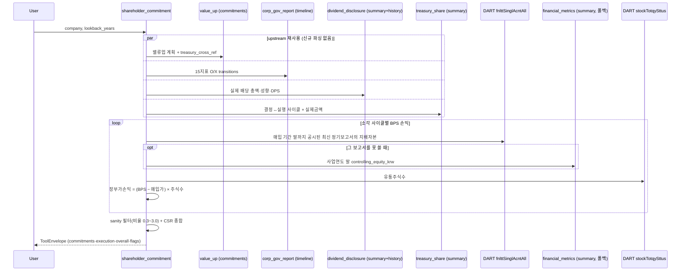

# shareholder_commitment

## 한 줄 요약
밸류업 계획·배당·자사주 소각의 **약속 vs 실제 이행**을 연중 추적하는 Action Tool. `proxy_advise_before_meeting`이
주총이라는 1회성 이벤트의 판단이라면, 이 tool은 주총과 무관하게 스튜어드십/기관투자자 관여(engagement)
관점에서 "작년에 공표한 계획을 실제로 지켰나"를 본다. 자사주 소각 사이클마다 **매입시점 BPS 대비 실제
매입가**를 비교해 장부가(BPS) 기준 손익을 원화로 계산한다(내재가치 판단은 하지 않음, 장부가 사실만).

## 사용법
```
shareholder_commitment(company="미래에셋증권", lookback_years=3)
```
자연어 예시:
- "이 회사 작년에 공표한 밸류업 계획 실제로 지켰나?"
- "최근 3년간 자사주 소각으로 장부가 기준 얼마나 벌었나?"
- "이 회사 배당·소각 합친 주주환원율 얼마야?"

## 입력 인자
| 인자 | 타입 | 필수 | 설명 | 기본값 |
|---|---|---|---|---|
| company | str | yes | 회사명 / ticker / corp_code | - |
| lookback_years | int | no | 조회 기간(년) | 3 |
| format | str | no | "md" / "json" | "md" |

## Flow



## 신규 계산 로직 — 자사주 소각 장부가(BPS) 손익
기존 4개 tool 어디에도 없던 유일한 신규 로직(나머지는 전부 기존 tool 재사용):
```
장부가손익(KRW) = (매입시점 BPS − 가중평균 매입가) × 매입주식수
가중평균 매입가 = actual_amount_krw ÷ cumulative_shares   (treasury_share, 260707 원문단위버그 수정 완료)
매입시점 BPS    = 지배자본(매입 기간 말까지 공시된 최신 재무상태표) ÷ shares_total(DART stockTotqySttus)
```
- **대상**: `for_cancelation=true`로 표시된 취득결정에 매칭된 실행결과(`acquisition_result`)만.
- **배당은 이 계산에서 제외**한다 — 방향이 반대다. 배당은 자본만 줄고 주식수는 그대로라 BPS가
  오히려 내려간다. 자사주 소각과 섞으면 부정확하다.
- **자본은 지배자본이다**(261021). 종전엔 자본총계(비지배지분 포함)로 나눴다 — 지주사는 연결 자본총계 대부분이
  자회사 비지배 몫이라 BPS 가 몇 배 부풀고 「매입가가 BPS 보다 싸다(장부가 기준 이득)」가 거꾸로 나왔다(한화 FY2025 말
  4.09배 · CJ 3.27배 · 삼성물산 1.15배). 주가·시총·주식수가 지배회사 주주의 것이라 분모도 그 몫이어야 한다 —
  [[연결-별도]] 「왜 지배주주 귀속인가」, [[price_multiple_data]] 「지배주주 귀속 일관」(BPS·PBR 분모 = 지배자본). 지배자본을 고르는 규칙은
  분기·연간 수집·배수 도구·재무 지표 도구와 같은 공용 규칙(`services/controlling_eq` — 지배자본 계정 줄 → 이름 줄 → 자본총계 − 비지배 →
  자본총계, 자본금·자본 구성요소 줄에 붙인 계정은 거른다)이다. 비지배가 없는 회사는 지배자본 = 자본총계라 값이 변하지 않는다.
- **기준 시점은 매입 기간 말이다**(261021). 종전엔 결과보고서 접수 해의 사업보고서(말일 기준)라 그해 안에 끝난 매입도 **매입 뒤에야 공시된**
  재무상태표로 나눴다(2025년 8~11월 매입이면 2026-03 에 나온 2025 말 값). 이제 사이클의 `period_end`(매입 기간 말, 없으면 결과보고서 접수일)
  까지 공시돼 있던 **가장 늦은 정기보고서**의 재무상태표다. 어느 보고서인가는 공시 달력(`services/report_calendar.pit_cell`)으로 정한다 —
  분기·반기 보고서는 기간 말 + 45일, 사업보고서는 결산 다음 넷째 달 1일(외국 상장사 60일·다섯째 달)까지 낸 것으로 본다. 법정 기한 전에 일찍 낸
  보고서는 쓰지 않으므로 미래 정보는 없고, 기한 직전 매입(예: 11-10)은 직전 반기보고서가 된다. 그 보고서가 정정공시를 거쳤으면 응답은 **최신 정정본**이라
  접수일이 기준일 뒤일 수 있다(한화 2025 3분기: 원본 11-13 → 기재정정 11-28) — `bps_basis.balance_sheet.filed_after_reference_date`.
- **유통주식수는 종전 그대로**(접수 해 사업보고서의 합계 유통주식). 분기보고서의 주식의 총수 칸은 비어 오는 회사가 있어(한화 2025 3분기 전부 `-`) 재무상태표와 날짜를 맞추지 못한다.
  그 해 사업보고서가 아직 안 나온 사이클은 종전엔 BPS 없음이었으나 이제 기준일에 공시돼 있던 최신 사업보고서의 주식수로 대신하고 `shares_basis` 에 밝힌다.
- **못 쓸 때는 종전 연말 길**로 물러난다(데이터를 비우지 않는다): 연결 재무제표가 없거나 조회 실패 · 지배자본을 못 고름 · 보고 통화가 원화가 아님 ·
  같은 응답의 전기말과 100배 이상 10ⁿ 점프(단위 오류 의심). 물러난 길은 재무 지표 도구 summary 의 `controlling_equity_krw`(사업연도 말 지배자본)이고, 그 칸이
  아예 없는 옛 응답이거나 지배자본을 못 구해 자본총계로 물러난 응답이면 자본총계 그대로 + `data_quality_flags` 경고(`bps_basis.equity = total_incl_minority`).
  사유는 `bps_basis.fallback_reason` 과 `data_quality_flags` 에 남는다.
- **`bps_basis`**(사이클마다, 새 키 — 종전 키는 그대로): `equity`(`controlling` | `total_incl_minority`) · `equity_case`(공용 규칙이 고른 길 `BS_ID`·`BS_NM`·
  `TOTAL_MINUS_MINORITY`·`TOTAL`) · `controlling_equity_krw` · `total_equity_krw` · `bps_if_total_equity_krw`(종전 방식 BPS — 비교용) · `shares_total`/`shares_basis` ·
  `balance_sheet`(`source` = `latest_filed_as_of_reference_date` | `annual_year_end`, `reference_date`·`reference_kind`(`period_end` | `rcept_dt`), `fiscal_year`,
  `report`·`reprt_code`, 재무상태표 말일 `period_end`, 출처 `rcept_no`·`rcept_dt`, `filed_after_reference_date`) · `fallback_reason`.
- **sanity 필터**: `actual_amount_krw / decision.amount_krw` 비율이 0.3~3.0 밖이면 그 사이클을 계산에서
  제외하고 `data_quality_flags`에 남긴다. `treasury_share`의 결정↔실행 사이클 매칭(`_link_cycles`)에
  오탐이 남아 있어(관측된 건은 전부 `disposal_result`) 조용히 틀린 값을 내지 않기 위한 방어다.
  이 tool은 `acquisition_result`만 쓰므로 **실전 발동 사례는 아직 없다** — 안전장치이지 상시 경로가
  아니다.

## 주주환원 종합(overall) — 배당 포함
CSR(현금성주주환원율/주주환원율) 공식은 [[주주환원]] 캐논 정의를 따른다 — 분자는 **자사주 매입**
(acquire), 소각(retire) 아님:
```
CSR% = (배당총액 + 자사주매입액[취득결정+신탁체결]) ÷ 순이익 × 100
```
260914 변경: 이전엔 `cancelation_amount_total_krw`(소각금액)를 분자로 썼으나, 이는 과거 보유분
처리까지 섞여 "이번 기간 실제 신규 지출"을 왜곡한다(실측: 삼성화재·SK텔레콤은 소각결정은 있었지만
최근 24개월 신규 취득 0건). 소각금액은 여전히 출력에 참고용으로 남기되(`buyback_cancelation_krw`)
CSR에는 반영하지 않는다 — 매입 vs 소각 괴리 자체가 신호이기 때문.

단 배당은 **최근 확정 사업연도 스냅샷**(dividend.summary), 매입·소각 금액은 **조회 lookback 기간
누적**(treasury_share.summary)이라 서로 다른 기간 기준 — `overall.period_note`에 명시. 엄밀한
다년 합산이 아닌 참고용 종합.

> `director_performance.py`/`proxy_advise_before_meeting.py`의 CSR(의결권 추천용)은 여전히
> 소각(`cancelation_decision`) 기준 별개 계산식이다 — 이 tool의 260914 변경 대상이 아니었다.
> 두 곳의 공식이 지금 서로 다르다는 점에 주의(추후 통일 여부는 별도 결정 사안).

## 배당수익률 — 연말종가 기준 보완
`dividend.history`의 `yield_pct`(DART 자체 결의시점 시가배당률)는 **옛 연도일수록 결측이 많음**을
실측 확인(미래에셋증권·현대차·SKC 전부 2021·2022년 None, 2023년부터만 값 있음 — DART alotMatter의
과거 공시 특성). `krx_weekly`(연말종가, `valuation.py`의 `_annual_pit_band`와 동일 쿼리 패턴)로
`DPS ÷ 연말종가`를 직접 계산해 `yield_pct_yearend` 필드로 별도 노출 — 원본 `yield_pct`는 그대로
두고 공백만 메운다. 두 값은 **기준일이 다르므로**(결의시점 시가 vs 연말종가) 값이 다를 수 있음을
출력에 명시.

## 출력 schema (data dict)
```json
{
  "canonical_name": "...", "corp_code": "...", "lookback_years": 3,
  "commitments": {
    "latest_plan": {...}, "latest_status": {...},
    "treasury_cross_ref": {"cancelation_decision_count_24m": 1, "acquisition_count_24m": 2, ...}
  },
  "capital_return_execution": {
    "buyback_cycles": [
      {"rcept_no": "...", "period": "2025-08-29 ~ 2025-11-24", "shares_acquired": 4052192,
       "avg_acquisition_price_krw": 19767, "bps_at_acquisition_krw": 23175,
       "premium_discount_pct": -14.71, "book_value_gain_loss_krw": 13809568880,
       "note": "매입가가 BPS보다 쌈(장부가 기준 이득)",
       "bps_basis": {"equity": "controlling", "equity_case": "BS_ID", "bps_if_total_equity_krw": 23175,
                     "balance_sheet": {"source": "latest_filed_as_of_reference_date", "reference_date": "2025-11-24",
                                       "report": "3분기보고서", "period_end": "2025-09-30", "rcept_no": "...",
                                       "filed_after_reference_date": false}, "fallback_reason": null}}
    ],
    "dividend_history": [{"year": 2025, "annual_dps": 300, "payout_ratio": 11.1,
                          "yield_pct": 0.4, "yield_pct_yearend": 1.31, ...}]
  },
  "governance_trend": {"transitions": [{"label": "...", "from_val": "X", "to_val": "O", "direction": "improved", ...}]},
  "overall": {"dividend_krw": ..., "buyback_cancelation_krw": ..., "cash_shareholder_return_pct": 41.0,
              "total_book_value_gain_loss_krw": ..., "period_note": "..."},
  "data_quality_flags": [],
  "usage": {"dart_api_calls": 35, "mcp_tool_calls": 1}
}
```

## Data sources (재사용 — 신규 파싱 없음)
| 소스 tool | scope | 쓰임 |
|---|---|---|
| `value_up` | `commitments` | 밸류업 계획 원문 + 기존 `treasury_cross_ref`(소각 약속 vs 24개월 실제) |
| `corp_gov_report` | `timeline` | 15개 지표 연도별 O/X 전환(`transitions`) |
| `dividend_disclosure` | `summary`, `history` | 실제 배당 총액·성향·연도별 DPS |
| `treasury_share` | `summary` | 결정↔실행 사이클 + 정확한 실제금액(260707 단위버그 수정) |
| DART `fnlttSinglAcntAll` | (client 직접, 연결) | 매입 기간 말까지 공시된 최신 정기보고서 재무상태표 → 지배자본(`services/controlling_eq`) — BPS 분자 |
| `financial_metrics` | `summary`(사업연도 말) | 위를 못 쓸 때의 폴백 — `controlling_equity_krw`(없는 옛 응답이면 `total_equity_krw` + 경고) |
| DART `stockTotqySttus` | (client 직접) | 유통주식수 — BPS 분모(`valuation.py`의 `_shares_outstanding` 재사용) |

## upstream 호출 계약

- **조회 구간을 그대로 넘긴다.** `lookback_years`를 `value_up` 호출에 명시적으로 전달한다 — 기본값
  (최근 12개월 rolling)으로 부르면 2년 전 최초공시된 밸류업 계획이 「없음」으로 나온다.
- **upstream 의 `warnings` 와 진단 필드를 버리지 않는다.** `_data()` 헬퍼가 예외뿐 아니라 정상 응답의
  `warnings` 도 그대로 전파하고, `value_up` 의 `availability_status`(`exists_outside_requested_window`
  + `diagnostic_window`)를 명시적으로 확인해 「lookback_years 를 늘려 재조회」 경고를 붙인다.
  조합형 tool 이 upstream 신호를 조용히 삼키면 상류가 이미 알려 준 부재 사유가 사라진다.

## 외부 호출
- 이 tool 전체는 upstream 합산(예시 응답 `usage.dart_api_calls` ≈ 35, 사이클 수에 비례해 늘어남). 아래는 **BPS 만의 사이클당 DART 콜**.
- 261021 이전: 약 **5콜**(재무 지표 summary 약 4 — 주요계정·전체 재무제표 × 당기·전기 — + 주식수 1).
- 261021 이후 일반 길: **2콜**(전체 재무제표 1 + 주식수 1) — 사이클당 **−3콜(늘지 않는다)**. 재무 지표 도구는 안 부른다.
- 연말 폴백 길: 위 전체 재무제표 1콜이 헛걸음이 되고 이어 재무 지표 summary 약 4 + 주식수 1 → **약 6콜(종전 +1)**. 사업보고서가 아직 없는 사이클은 주식수 +1.
  기준일 바꾸기로 사이클당 늘어나는 DART 콜은 어느 길에서도 **1콜 이하**다.

## 알려진 issue + TODO
- 유통주식수는 접수 해 사업보고서 값이라 분기 재무상태표와 날짜가 완전히 맞지는 않는다(분기보고서 주식의 총수 칸이 비어 오는 회사가 있음).
- 기준 보고서는 공시 기한 규칙으로 고른다 — 기한 전에 일찍 낸 다음 분기보고서는 쓰지 않는다(보수적). 정정공시가 있으면 최신 정정본 값이다.
- `_link_cycles` 매칭 오탐(→ [[treasury_share]]) — sanity 필터로 회피만, 근본수정 아님.
- overall의 배당·소각 기간 불일치(스냅샷 vs 누적) — 다년 정밀 합산은 TODO.
- 다중기업 배치·포트폴리오 스캔 미지원(단일기업 조회만).

## 변경 이력

- 2026-10-21: 자사주 소각 사이클 BPS 를 **지배자본**으로, 기준 시점을 **매입 기간 말까지 공시된 최신 재무상태표**로(종전: 자본총계 · 결과보고서 접수 해 말) — 사이클마다 `bps_basis`. 지주사 BPS 가 비지배만큼 부풀던 것을 바로잡는다(한화 ÷4.09 · CJ ÷3.27 · 삼성물산 ÷1.15, 2025 말 기준). 낡은 주석의 옛 모듈명 `valuation.py` → `price_multiple_data.py`.
- 2026-10-18: 상류(value_up·corp_gov_report·dividend_disclosure·treasury_share) 가운데 조회 실패(`status=error` 또는 예외)가 있으면 `status=partial`, 전부 실패면 `error` — 종전엔 상류가 모두 DART 오류로 실패해도 `exact` 였다(상류 경고만 옮겼다).
- 2026-09-07: 배당수익률 주석의 테이블 이름 `krx_weekly` → 「KRX 연말 종가」.

## 관련
- [[proxy_advise_before_meeting]] — 유일한 다른 Action Tool, 주총 1회성 판단 vs 이 tool의 연중 추적
- [[value_up]] / [[corp_gov_report]] / [[dividend_disclosure]] / [[treasury_share]] — upstream 재사용 tool 4종
- [[financial_metrics]] — 연말 폴백의 지배자본(`controlling_equity_krw`) 소스
- [[price_multiple_data]] — BPS·PBR 분모 = 지배자본, 같은 공용 규칙(`services/controlling_eq`)
- [[연결-별도]] — 왜 지배주주 귀속으로 나누는가
