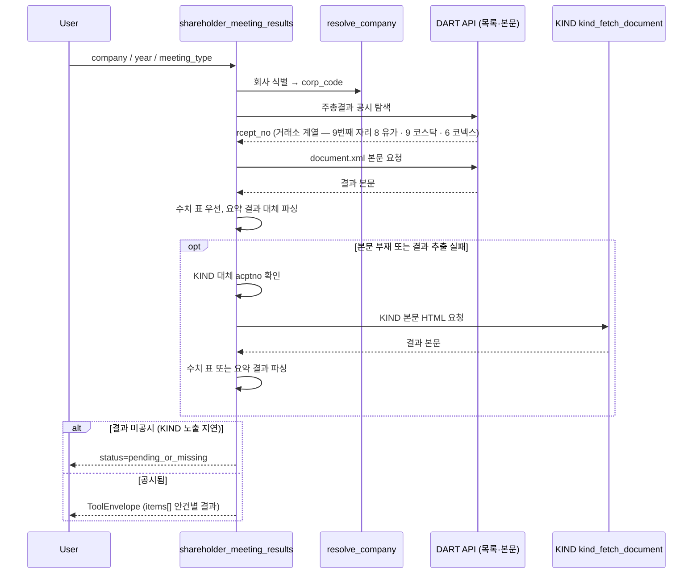

# shareholder_meeting_results

주총 **의결 결과** 공시 (사후). DART API 본문 우선, 추출 실패 시 KIND fallback. 안건별 결과와 추출 가능한 찬반율을 제공한다. 요약형에는 비율이 없을 수 있으며 빈 값은 0이 아니다.

## 분리 배경 (2026-05-04)

사전 소집공고와 사후 결과를 별도 도구로 제공한다. 현재 결과 조회는 DART 본문을 먼저 읽고, 본문 부재·파싱 실패 시 KIND 웹 스크래핑으로 대체한다.

## scope

`results` 단일 (param 자체 없음):

| 필드 | 의미 |
|---|---|
| `result_format` | "table" / "summary" |
| `numerical_vote_table_available` | 수치 표 추출 여부 (`table`이면 True). 개별 비율의 존재까지 보장하지 않음 |
| `items[]` | 안건별 결과 |
| - `agenda` | 안건명 |
| - `resolution_type` | 보통결의 / 특별결의 / 보고 |
| - `passed` | 정규화 결과 — 가결 / 부결 / 수정가결 / 미결 / 철회 / 보류 / 미상정 / 무산 (표 서식은 칸 원문 그대로) |
| - `passed_raw` | 결과 원문 문구(줄글 서식의 「의결정족수 미달로 인한 부결」 등). 표 서식은 가결여부 칸 그대로 |
| - `remark` | 표 서식 비고 칸 원문(없으면 빈 문자열) |
| - `remark_contradicts_pass` | 가결·수정가결 행의 비고가 무효·철회·취소·미취임을 말하면 True(글자 사이 공백 허용). 「부결」·「사임」 은 해당하지 않는다 |
| - `approval_rate_issued` | 발행주식수 기준 찬성률 |
| - `approval_rate_voted` | 출석주식수 기준 찬성률 |
| - `opposition_rate` | 반대율 |
| `void_notice` | 「기타 투자판단」 구역의 결의 무효처리 문장 원문(「무효처리」·「효력이 발생하지 아니」). 없으면 빈 문자열 |
| `result_reference.filing_channel` | 결과 공시 접수 창구(`krx_kospi`·`krx_kosdaq`·`krx_konex` …) |

## Flow



## source

- DART `get_document_cached(rcept_no)` 본문을 우선 파싱 (`source=dart_api`)
- 안건 결과를 추출하지 못하면 KIND acptno(유가 계열만 80→00 whitelist, 코스닥·코넥스 계열은 변환 미확인이라 대체 없음)를 사용해 `kind_fetch_document`로 대체 (`source=kind_scraping`)
- 수치 표가 없으면 요약 결과를 추출 (`result_format=summary`), 찬반율은 빈 값으로 유지
  - 줄글 서식: 머리말 「결의사항」·「의결사항」·「기타 결의내용」·「결의내용」·「부의안건」, 안건 머리 `제N호 (의안) :` 는 줄 맨 앞에서만, 결과는 표시 기호(`→ -> => ⇒ ▶ ☞ ➤`) 뒤 또는 화살표가 없을 때 끝의 괄호(`(부결)`)·붙임표(` - 원안대로 가결`)·결과 낱말, 결과만 적힌 다음 줄. 결과 없는 머리줄은 버린다(제목의 「승인」 을 결과로 읽지 않는다). `제N-M호` 는 바로 앞 `제N호` 아래일 때만 하위 안건. 「제N호 내지 제M호 일괄 가결」 줄은 해당 안건들에 결과를 준다
- 표 서식: 비고 칸을 `remark` 로 싣고, 가결인데 비고가 무효·미취임을 말하는 행과 「기타 투자판단」 의 무효처리 문장(`void_notice`)을 결과 화면에 따로 띄운다 — 판정하지 않고 원문만 옮긴다
- 결과 미공시 (가결 후 KIND 노출 지연) 시 status=pending_or_missing

## 사용 예

```
"삼성전자 2026 정기주총 결과"
"LG화학 안건별 찬반율"
"이번 주총에서 안건들 다 통과됐어? 부결된 안건 있어?"
"고려아연 임시주총 의결 결과"
```

## 변경 이력

- 2026-09-05: 출처를 DART 우선·KIND 대체로 정정하고 실제 `table`/`summary` 형식과 비율 누락 의미를 문서화.
- 2026-11-03: 줄글 서식 다시 씀 — 첫 안건 유실, 제목에 「의안 :」·결과문이 붙던 것, 결과 없는 머리줄을 「승인」 으로 가결 처리하던 것, 미결·철회·보류·미상정·무산 미인식, 다른 머리말·표시 기호 미인식을 고침(`passed_raw` 추가). 표 서식에 `remark`·`remark_contradicts_pass`, 결과에 `void_notice` 추가. 결과 참조에 접수 창구(`filing_channel`) 추가, 거래소 번호 변환은 유가 계열만.

## ref

- 사전 안건/후보: [[shareholder_meeting_notice]]
- 후속 공시(배당/자사주/구조 등)는 dividend_disclosure·treasury_share 등 각 tool 직접 호출 (proxy_result_after_meeting은 2026-06-13 archive)
- 원문: [[evidence]]
